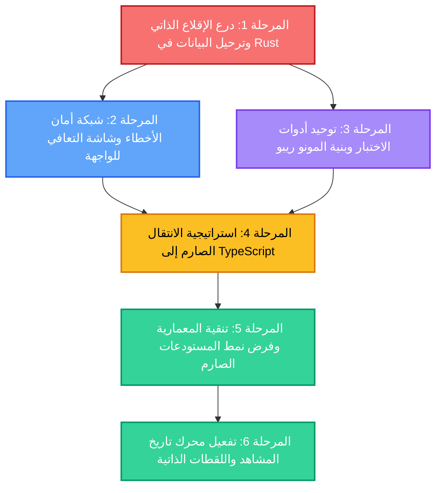

# 🛡️ خطة المعالجة المتقدمة والتحصين البنيوي الشامل
## Advanced Remediation & Architectural Hardening Roadmap
### تطبيق ScriptFlow Enterprise — النسخة المكتبيّة الاحترافية

---

## 📌 بطاقة الوثيقة

| البند | البيان |
| :--- | :--- |
| **اسم المشروع** | **ScriptFlow Enterprise** (`com.scriptflow.enterprise`) |
| **رقم الإصدار** | **2.0.0 — Post-Stabilization Hardening Phase** |
| **تاريخ الإنشاء** | **16 أكتوبر 2026** |
| **طبيعة الوثيقة** | خارطة طريق علاجية وتنفيذية شاملة (Execution Roadmap) |
| **المرجعية الفنية** | معالجة الدروس المستفادة والنتائج الميدانية بعد اكتمال المراحل الست لـ [`CORRECTIVE_ACTION_ROADMAP.md`](file:///d:/SCRIPTFLOW%20Pro/SCRIPTFLOW%20ENREPRISE/CORRECTIVE_ACTION_ROADMAP.md) |
| **فلسفة العمل** | تحصين ذاتي صلب (Self-Healing Architecture) + أمان بيانات مطلق دون إضافة أي خصائص دخيلة |

---

## 🧭 الفلسفة الهندسية والأهداف الحاكمة

تستند هذه الخطة إلى الدروس العميقة المستخلصة من عملية النقل الفعلي واختبارات قاعدة البيانات الحية، وتهدف إلى تحويل **ScriptFlow** من تطبيق يعمل بنجاح إلى **نظام مؤسسي صامد ضد الأعطال (Fault-Tolerant Enterprise System)** عبر 4 أركان محورية:

1. **سلامة وقدسية بيانات الكاتب (Absolute Data Inviolability):** لا تراجع، لا فقدان لأي سيناريو أو مشهد، مع حماية آلية واستباقية ضد تغيرات المسارات أو أعطال الهجرات.
2. **التعافي الذاتي عند الإقلاع (Self-Healing Boot Architecture):** النظام يعالج ترحيل البيانات القديمة تلقائياً دون تدخل يدوي، ويكتشف أعطال قاعدة البيانات ليقدم حلول استعادة فورية.
3. **التجربة الاحترافية للأخطاء (Graceful Error Recovery):** القضاء التام على ظاهرة الشاشات السوداء أو البيضاء المعلقة، وإحلال واجهات تشخيص عربية تفاعلية بأزرار استعادة واضحة.
4. **التوحيد البرمجي الصارم (Unified Tooling & Strict Typing):** إنهاء ازدواجية اللغات والأدوات (JSX مقابل TSX، ونسخ Vitest المتفاوتة) لتأسيس بنية نقية قابلة للتوسع لسنوات قادمة.

---

## 🗺️ المخطط العام للمراحل والتبعيات (Milestone Dependencies)



---

## 📊 جدول تتبع المراحل (Milestone Progress Matrix)

| المرحلة | النطاق الفني | درجة الحرج | الملفات المعنية | الحالة |
| :--- | :--- | :--- | :--- | :--- |
| **المرحلة 1** | درع الإقلاع التلقائي وترحيل البيانات القديمة في Rust | 🔴 حرج للغاية | 3 ملفات | `READY_FOR_EXECUTION` ⏳ |
| **المرحلة 2** | شاشة التعافي من الأخطاء ودرع استثناءات React | 🔴 حرج للغاية | 4 ملفات | `PENDING` ⏳ |
| **المرحلة 3** | توحيد بيئة الاختبارات وسكربتات المونو ريبو | 🟠 مرتفع | 5 ملفات | `PENDING` ⏳ |
| **المرحلة 4** | الانتقال الصارم لـ TypeScript والقضاء على `any` | 🟠 مرتفع | 12 ملفاً | `PENDING` ⏳ |
| **المرحلة 5** | تطهير الاستعلامات المباشرة وفرض نمط Repository | 🟡 متوسط | 8 ملفات | `PENDING` ⏳ |
| **المرحلة 6** | تفعيل محرك تاريخ المشاهد واللقطات التاريخية | 🟢 منخفض | 4 ملفات | `PENDING` ⏳ |

---

## 🛠️ التفصيل المنهجي لمراحل الخطة (Actionable Blueprint)

---

### المرحلة 1: درع الإقلاع الذاتي وترحيل البيانات في Rust (Self-Healing Boot & Auto-Migration)
> **الهدف:** تمكين محرك Tauri بلغة Rust من اكتشاف قواعد البيانات القديمة تلقائياً ونقلها دون أي تدخل يدوي، وحماية ملفات الهجرة من أي تضارب مستقبلي.

#### 📌 المهمة 1.1: كاشف المسارات السابقة والترحيل التلقائي في `src-tauri/src/lib.rs`
- [ ] إضافة دالة فحص استباقية بلغة Rust تنفذ عند بدء التطبيق (`setup` hook):
  - فحص المسار الحالي: `%APPDATA%\com.scriptflow.enterprise\scriptflow.db`.
  - إذا لم يكن الملف موجوداً أو كان حجمه أقل من 500 كيلوبايت (قاعدة فارغة حديثة)، يتم مسح المسارات التاريخية تلقائياً:
    1. `%APPDATA%\com.tawfikmostefaoui.desktop\scriptflow.db`
    2. `%APPDATA%\com.workstation.scriptflow_pro\scriptflow.db`
  - في حال العثور على قاعدة بيانات قديمة بحجم صالح:
    - إنشاء نسخة احتياطية فورية باسم `scriptflow_migrated_backup.db`.
    - نسخها تلقائياً إلى المسار الحالي مع نقل مجلد `backups/`.
    - تسجيل العملية في سجل الأحداث (Log) بوضوح.

#### 📌 المهمة 1.2: صمام أمان الهجرات (Migration Safe Guard & Pre-backup)
- [ ] إنشاء نسخة احتياطية تلقائية لقاعدة البيانات قبل تنفيذ أي هجرة من هجرات `tauri_plugin_sql`.
- [ ] إقرار سياسة الهجرات الإلحاقية الصارمة (**Forward-Only Migrations Rule**):
  - حظر التعديل التراجعي لأي ملف هجرة مطبق (`001` إلى `011`).
  - أي تعديل هيكلي إضافي يُنشأ في هجرة جديدة برقم تسلسلي تالٍ (`012_...sql`).

#### 📌 المهمة 1.3: إرجاع كود الخطأ التفصيلي بدلاً من الانهيار الصامت
- [ ] تحسين دالة `check_db_health` في Rust لتعيد تفاصيل الحالة وحجم الملف وأي أخطاء تتعلق بالـ Checksum بشكل صريح تستطيع واجهة المستخدم التفاعل معه.

#### 🎯 معيار القبول للمرحلة 1:
```bash
# عند مسح قاعدة البيانات في مسار enterprise وتشغيل التطبيق:
# يجب أن يقوم التطبيق تلقائياً بنسخ بيانات المستخدم التاريخية ويفتح مباشرة وبها كافة السيناريوهات
```

---

### المرحلة 2: شبكة أمان الأخطاء وشاشة التعافي للواجهة (Graceful Error Recovery UI)
> **الهدف:** القضاء النهائي على تعليق التطبيق عند شاشة التحميل السوداء (`...INITIALIZING ENVIRONMENT`) وتقديم شاشة تفاعلية باللغة العربية عند حدوث أي طارئ.

#### 📌 المهمة 2.1: إعادة بناء شاشة التهيئة في [`apps/desktop/src/components/LockScreen.jsx`](file:///d:/SCRIPTFLOW%20Pro/SCRIPTFLOW%20ENREPRISE/apps/desktop/src/components/LockScreen.jsx)
- [ ] إحاطة استدعاء `initDb()` بمؤقت مهلة ذكي (Timeout Watchdog) مدته 8 ثوانٍ.
- [ ] في حال فشل `initDb()` أو انتهاء المهلة دون استجابة:
  - عدم إبقاء الشاشة معلقة على حلقة التحميل الدائرية.
  - إظهار واجهة عربية أنيقة: **«مركز التعافي واستعادة النظام»**.
  - عرض تفاصيل الخطأ بأسلوب مبسط للكاتب مع قسم فني للمطور.

#### 📌 المهمة 2.2: توفير أدوات النجاة الفورية للكاتب داخل الشاشة
- [ ] زر: **«إعادة محاولة الاتصال»** (Retry Initialization).
- [ ] زر: **«فتح مجلد البيانات في المتصفح»** (عبر أمر Tauri لفتح `%APPDATA%`).
- [ ] زر: **«استعادة من أحدث نسخة احتياطية»** (قراءة قائمة المجلد `backups/` واستعادة أحدث نسخة بنقرة واحدة).

#### 📌 المهمة 2.3: بناء درع React العام للأخطاء (`GlobalErrorBoundary.tsx`)
- [ ] إنشاء مكون `GlobalErrorBoundary` يلتف حول كامل شجرة المكونات في `App.jsx`.
- [ ] منع ظهور الشاشات البيضاء الناتجة عن أخطاء معالجة النصوص، وتوفير خيار حفظ مسودة العمل محلياً قبل إعادة تحميل الصفحة.

#### 🎯 معيار القبول للمرحلة 2:
```bash
# محاكاة خطأ في اتصال قاعدة البيانات أو تلف مصطنع:
# يجب أن تظهر شاشة استعادة راقية تتيح استعادة النسخة الاحتياطية أو إعادة المحاولة دون تعليق.
```

---

### المرحلة 3: توحيد بيئة الاختبارات وأدوات المونو ريبو (Unified Tooling & Workspace Harmony)
> **الهدف:** توحيد أدوات الاختبار والبناء عبر كافة الحزم وإلغاء تباين الإصدارات لتسريع دورة التطوير ومنع الأخطاء الخفية.

#### 📌 المهمة 3.1: توحيد إصدار Vitest عبر كافة الحزم
- [ ] تدقيق إصدارات `vitest` في:
  - حزمة `apps/desktop`
  - حزمة `packages/nasab` (التي تستخدم حالياً Vitest 4)
  - باقي الحزم التي تستخدم Vitest 1.6
- [ ] ترقية ومطابقة كافة الحزم على إصدار حديث ومستقر وموحد لإنهاء أي تباين في التفسير البرمجي.

#### 📌 المهمة 3.2: إنشاء تكوين مساحة العمل الموحد [`vitest.workspace.ts`](file:///d:/SCRIPTFLOW%20Pro/SCRIPTFLOW%20ENREPRISE/vitest.workspace.ts)
- [ ] ضبط التكوين العام لمساحة العمل ليدير تشغيل اختبارات الحزم الست بنقرة واحدة فائقة السرعة مع مشاركة الكاش.

#### 📌 المهمة 3.3: سكريبت التحقق الشامل من تكامل الحزم (`npm run verify:all`)
- [ ] إنشاء سكريبت فحص موحد ينفذ تسلسلياً:
  1. تدقيق الروابط الرمزية (Junctions Check)
  2. فحص الأنواع الصارم (`tsc --noEmit`)
  3. تشغيل كافة الاختبارات
  4. البناء الطوبولوجي الكامل

#### 🎯 معيار القبول للمرحلة 3:
```bash
npm run verify:all # => يمر بالكامل في أمر واحد بسرعة واستقرار
```

---

### المرحلة 4: استراتيجية الانتقال الصارم لـ TypeScript (JSX to TSX Modernization)
> **الهدف:** إنهاء الانقسام اللغوي بين JSX و TSX في التطبيق المكتبي، والتخلص من النوع المتساهل `any` في المحركات الحساسة.

#### 📌 المهمة 4.1: خريطة طريق التحويل التدريجي للصفحات الأساسية من `.jsx` إلى `.tsx`
- [ ] تحويل [`apps/desktop/src/pages/CharactersPage.jsx`](file:///d:/SCRIPTFLOW%20Pro/SCRIPTFLOW%20ENREPRISE/apps/desktop/src/pages/CharactersPage.jsx) إلى `CharactersPage.tsx` وإضافة الواجهات الصارمة.
- [ ] تحويل [`apps/desktop/src/pages/CharacterProfilePage.jsx`](file:///d:/SCRIPTFLOW%20Pro/SCRIPTFLOW%20ENREPRISE/apps/desktop/src/pages/CharacterProfilePage.jsx) إلى `CharacterProfilePage.tsx`.
- [ ] تحويل [`apps/desktop/src/pages/RelationshipsPage.jsx`](file:///d:/SCRIPTFLOW%20Pro/SCRIPTFLOW%20ENREPRISE/apps/desktop/src/pages/RelationshipsPage.jsx) إلى `RelationshipsPage.tsx`.
- [ ] تحويل [`apps/desktop/src/pages/TimelinePage.jsx`](file:///d:/SCRIPTFLOW%20Pro/SCRIPTFLOW%20ENREPRISE/apps/desktop/src/pages/TimelinePage.jsx) إلى `TimelinePage.tsx`.
- [ ] تحويل محرر المشاهد الرئيسي [`SceneEditor.jsx`](file:///d:/SCRIPTFLOW%20Pro/SCRIPTFLOW%20ENREPRISE/apps/desktop/src/pages/SceneEditor.jsx) إلى `SceneEditor.tsx` بعد التأكد من اكتمال كافة الواجهات.

#### 📌 المهمة 4.2: تطهير استخدامات `any` في محركات قياس النصوص ومحرر الورق
- [ ] مراجعة [`TextMeasurementEngine.ts`](file:///d:/SCRIPTFLOW%20Pro/SCRIPTFLOW%20ENREPRISE/apps/desktop/src/components/editor/TextMeasurementEngine.ts) وتعريف أنواع صارمة للخطوط، أوزان النصوص، وارتفاعات الأسطر.
- [ ] تدقيق مكونات `PaperEditor.tsx` و `GutterSmartAdder.tsx` لضمان خلوها من أنواع `any` غير المبررة.

#### 🎯 معيار القبول للمرحلة 4:
```bash
npm run build --workspace=@scriptflow/desktop # => تجميع مكتبي نظيف بنسبة 100% بلغة TypeScript نقية
```

---

### المرحلة 5: تنقية المعمارية وفرض نمط المستودعات الصارم (Repository Pattern Enforcement)
> **الهدف:** منع أي استدعاء عشوائي أو مباشر لـ SQL من داخل مكونات الواجهة وتوحيد كافة العمليات عبر حزمة `@scriptflow/database`.

#### 📌 المهمة 5.1: تدقيق شامل لكافة الصفحات ومنع استدعاء `dbExecute` المباشر
- [ ] فحص صفحات ومكونات `apps/desktop/src` والتحقق من عدم وجود أي استدعاء مباشر لـ `Database.load` خارج مكتبة العميل المركزية.
- [ ] تحويل أي استعلامات مخصصة إلى دوال واضحة داخل أصناف المستودعات المخصصة:
  - `ScenarioRepository`
  - `SceneRepository`
  - `CharacterRepository`
  - `ShootDayRepository`

#### 📌 المهمة 5.2: فصل منطق الأعمال الحسابي عن واجهات العرض
- [ ] نقل دوال احتساب النسب، الإحصائيات، وتوزيع الأيام من مكونات React إلى خدمات نقية داخل `@scriptflow/application`.

#### 🎯 معيار القبول للمرحلة 5:
```bash
# خلو مجلد apps/desktop/src بالكامل من أي استعلامات SQL نصية خام
```

---

### المرحلة 6: تفعيل محرك تاريخ المشاهد واللقطات التاريخية (Scene Snapshot History Engine)
> **الهدف:** استغلال جدول `scene_snapshots` المحصن لبناء تجربة تراجع تاريخية ذكية تحمي إبداع الكاتب من الضياع العرضي.

#### 📌 المهمة 6.1: تحسين استعلامات جدول لقطات المشاهد
- [ ] التأكد من وجود فهارس فعالة على `(scene_id, created_at DESC)`.
- [ ] ضبط دالة التقليم التلقائي (`pruneOldSnapshots`) لتعمل في خلفية النظام دون التأثير على سلاسة الكتابة في المحرر.

#### 📌 المهمة 6.2: ربط خطافات `useSnapshots` في محرر المشاهد
- [ ] فحص خطافات [`apps/desktop/src/hooks/queries/useSnapshots.ts`](file:///d:/SCRIPTFLOW%20Pro/SCRIPTFLOW%20ENREPRISE/apps/desktop/src/hooks/queries/useSnapshots.ts).
- [ ] تجهيز واجهة عرض مصغرة في الشريط الجانبي للمحرر تعرض:
  - قائمة اللقطات المحفوظة تلقائياً مع توقيتها وسبب اللقطة (`auto_5min`، `scene_switch`، `app_close_panic`).
  - إمكانية معاينة النص القديم واستعادته بنقرة واحدة.

#### 🎯 معيار القبول للمرحلة 6:
```bash
# حفظ تلقائي منتظم للقطات المشهد دون أي بطء في واجهة الكاتب مع إمكانية استرجاع لقطة سابقة
```

---

## 🏆 معايير القبول والجاهزية الكلية (Master Acceptance Criteria)

- [ ] **صفر أخطاء هجرة:** يقلع التطبيق دائماً بنجاح سواء كانت قاعدة البيانات قديمة، جديدة، أو مرحلة.
- [ ] **صفر شاشات سوداء/بيضاء:** في حال أي خلل تقني، تظهر واجهة استعادة عربية واضحة تقدم حلولاً بنقرة واحدة.
- [ ] **حماية البيانات المطلقة:** حفظ وتواجد كافة السيناريوهات الأصلية وتاريخها ونسخها الاحتياطية بأمان كامل.
- [ ] **بيئة عمل موحدة بنسبة 100%:** جميع الحزم تستخدم إصدارات متطابقة وتخضع لفحص نمطي موحد.
- [ ] **كود TypeScript احترافي:** خالٍ من الشوائب والملفات القديمة المتروكة.

---
> 🌟 **خارطة الطريق جاهزة ومكتملة:** تم توثيق جميع التفاصيل بدقة لتمثل المرجع الهندسي الأعلى للمرحلة القادمة، ويمكن تنفيذها مرحلة تلو الأخرى وفق الترتيب المنهجي المعتمد.
