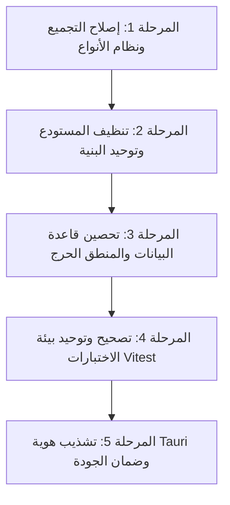

# التقرير الهندسي والذري الشامل لتحليل كود ونظام SCRIPTFLOW ENTERPRISE
**تاريخ التحليل:** 16 أكتوبر 2026  
**نطاق التحليل:** الكود المصدري، الأنظمة البرمجية، الطبقات البنائية، محركات المنطق، وقواعد البيانات (مع استبعاد مجلد `docs` بالكامل).  
**المسار الأساسي:** `D:\SCRIPTFLOW Pro\SCRIPTFLOW ENREPRISE`  
**الهدف:** تشريح المنطق البرمجي ذرياً، كشف العيوب والأخطاء التقنية، وتحديد خطوات التصحيح وإعادة الهيكلة لرفع كفاءة التطبيق لأعلى معايير المؤسسات (Enterprise Grade) دون استحداث خصائص جديدة.

---

## فهرس التقرير
1. [الملخص التنفيذي والحالة الهندسية الراهنة](#1-الملخص-التنفيذي-والحالة-الهندسية-الراهنة)
2. [التشريح الهيكلي لمستودع المونو ريبو (Monorepo & Package Architecture)](#2-التشريح-الهيكلي-لمستودع-المونو-ريبو-monorepo--package-architecture)
3. [أخطاء التجميع ونظام الأنواع وتصدع (JSX vs TSX)](#3-أخطاء-التجميع-ونظام-الأنواع-وتصدع-jsx-vs-tsx)
4. [تحليل طبقة البيانات والمنطق الخلفي (Database & Persistence Layer)](#4-تحليل-طبقة-البيانات-والمنطق-الخلفي-database--persistence-layer)
5. [تحليل محرك الخط الزمني والجدولة (Timeline & Scheduling Engine)](#5-تحليل-محرك-الخط-الزمني-والجدولة-timeline--scheduling-engine)
6. [تحليل أنظمة الحفظ التلقائي والنسخ الاحتياطي (Autosave & Backup Logic)](#6-تحليل-أنظمة-الحفظ-التلقائي-والنسخ-الاحتياطي-autosave--backup-logic)
7. [تحليل طبقة عمال الويب وتضليل الاختبارات (Web Workers & Comlink Layer)](#7-تحليل-طبقة-عمال-الويب-وتضليل-الاختبارات-web-workers--comlink-layer)
8. [فشل منظومة الاختبارات وظاهرة الازدواج الموديولي (Vitest & ESM Dual-Instance)](#8-فشل-منظومة-الاختبارات-وظاهرة-الازدواج-الموديولي-vitest--esm-dual-instance)
9. [مخلفات التطوير والملفات المؤقتة والشوائب البرمجية (Code Hygiene & Stray Artifacts)](#9-مخلفات-التطوير-والملفات-المؤقتة-والشوائب-البرمجية-code-hygiene--stray-artifacts)
10. [خطة التصحيح والتحسين المنهجي الإلزامية (Corrective Action Roadmap)](#10-خطة-التصحيح-والتحسين-المنهجي-الإلزامية-corrective-action-roadmap)

---

## 1. الملخص التنفيذي والحالة الهندسية الراهنة

تطبيق **SCRIPTFLOW Enterprise** مبني على بنية تقنية متقدمة تدمج بين إطار العمل المكتبي الحديث **Tauri v2 (Rust)**، وبيئة الواجهة الأمامية **React 19** مع **TypeScript/Vite**، وقاعدة بيانات محلية **SQLite**، ونظام حزم متعددة (**npm workspaces**). يحتوي المشروع على محركات حسابية معقدة ومتقدمة مثل محرك الأنساب والفقه المقارن (`nasab`)، ومحرك التقطيع والطباعة (`TextMeasurementEngine`)، ونظام طابور الحفظ المرن (`AutosaveQueue`).

ومع ذلك، أظهر الفحص الذري الدقيق للكود المصدري وجود **تصدعات معمارية ومنهجية حرجة** تؤدي إلى:
1. **فشل كامل لأمر البناء (`npm run build`)** في حزم متعددة وفي التطبيق الرئيسي نتيجة أخطاء أنواع برمجية صريحة وعدم توافق بين المستودعات الأساسية والنماذج الفرعية.
2. **ازدواجية برمجية وانقسام لغوي حاد (Split-Brain)**؛ حيث توجد ملفات الصفحات الأساسية بنسختين متوازيتين (`.jsx` و `.tsx`)، حيث يتم تشغيل النسخ القديمة غير المكتملة في وقت التشغيل، بينما تعطل النسخ الحديثة عملية الـ Type-Checking.
3. **حزم أشباح مهجورة (Ghost Packages)** داخل مجلد `packages` لا يتم استيرادها أو استخدامها على الإطلاق، مع تكرار منطقها داخل حزمة قاعدة البيانات.
4. **ثغرة أمنية ناتجة عن دمج سلاسل الاستعلام (SQL Injection)** داخل محرك الإحصائيات، بالإضافة إلى تنفيذ أوامر تعديل بنية الجداول (`DDL - CREATE TABLE IF NOT EXISTS`) في كل استعلام استرجاع أو تحديث اعتيادي.
5. **تضليل كامل لاختبارات الـ Web Workers**؛ حيث أن عمال الويب معطلون تقنياً لغياب استدعاء `Comlink.expose`، وتم الالتفاف عليهم بتشغيل العمليات الثقيلة على مسار المعالجة الرئيسي للواجهة (UI Thread) مما يهدد بتجميد الشاشة مع السيناريوهات الضخمة.
6. **فشل 23 اختباراً في بيئة Vitest** نتيجة تشغيل الاختبارات بدون ضبط بيئة المتصفح (`jsdom`) عبر الـ Monorepo، وظاهرة ازدواج مثيل الموديل في معيار ESM (`Dual-Instance Module Loading`).

---

## 2. التشريح الهيكلي لمستودع المونو ريبو (Monorepo & Package Architecture)

يتكون المشروع من حزمة تطبيق واحدة (`apps/desktop`) وتسع حزم مكتبية (`packages/*`).

```
SCRIPTFLOW ENREPRISE/
├── apps/
│   └── desktop/                 # تطبيق Tauri + React 19 المكتبي
├── packages/
│   ├── core/                    # الثوابت، الأنواع الأساسية (IScene, ICharacter)، المعرفات
│   ├── database/                # عميل SQLite ونمط المستودعات (BaseRepository وفروعه)
│   ├── application/             # حالات الاستخدام ومنطق التطبيق والخدمات
│   ├── export-engine/           # محرك تصدير واستيراد الحزم والملفات (.sflow, ZIP, JSON)
│   ├── nasab/                   # محرك الأنساب والمواريث المستقل
│   ├── domain-character/        # [حزمة مهجورة 100%]
│   ├── domain-scenario/         # [حزمة مهجورة 100%]
│   ├── domain-scene/            # [حزمة مهجورة 100%]
│   └── domain-timeline/         # [حزمة مهجورة 100%]
└── tooling/
    └── tsconfig/                # إعدادات TypeScript المشتركة
```

### العيوب الهندسية المكتشفة:
1. **الحزم الأشباح المهجورة (Dead/Ghost Packages):**
   - حزم `@scriptflow/domain-character`، `@scriptflow/domain-scenario`، `@scriptflow/domain-scene`، و `@scriptflow/domain-timeline` موجودة في مسار `packages/` وتم تعريفها كـ Workspaces، ولكن **لا يوجد ملف واحد في كامل التطبيق يستورد منها أو يعتمد عليها**.
   - في المقابل، قامت حزمة `@scriptflow/database` بتكرار وإعادة كتابة كافة هذه المستودعات بداخلها (`CharacterRepository.ts`, `SceneRepository.ts`, إلخ)، مما يمثل تشويشاً معمارياً وازدواجاً للكود.

2. **غياب نصوص البناء (`build` scripts) في 7 حزم:**
   - ملف الجذر `package.json` يحتوي على الأمر: `"build": "npm run build --workspaces"`.
   - عند تشغيله، يفشل الأمر فوراً ويخرج بكود خطأ لأن الحزم التالية لا تحتوي أصلاً على سكريبت `"build"` في ملفاتها:
     - `@scriptflow/core`
     - `@scriptflow/database`
     - `@scriptflow/domain-character`
     - `@scriptflow/domain-scenario`
     - `@scriptflow/domain-scene`
     - `@scriptflow/domain-timeline`
     - `@scriptflow/export`

3. **تبعية غير مصرح بها (Phantom Dependency):**
   - ملف `apps/desktop/src/services/api/packageService.js` يستورد مباشرة:
     ```javascript
     import { exportPackage, parsePackage as _parsePackage } from '@scriptflow/export';
     ```
   - بينما ملف `apps/desktop/package.json` **لا يدرج `@scriptflow/export` إطلاقاً ضمن قائمة dependencies**!
   - هذا يعمل مصادفةً في البيئة الحالية بفضل رفع التبعيات (Hoisting) في npm، ولكنه سيفشل حتماً في بيئات التثبيت النظيفة (Clean CI/CD) أو عند استخدام مديري حزم صارمين مثل pnpm.

4. **تضارب مسار الخرج والتجميع (`main` / `types` entry points):**
   - حزمة `@scriptflow/core` تشير إلى `"main": "src/index.ts"`.
   - حزمة `@scriptflow/database` تشير إلى `"main": "src/index.ts"`.
   - حزمة `@scriptflow/application` تشير إلى `"main": "dist/index.js"`.
   - هذا التباين يعني أنه عند تعديل كود `packages/application/src`، لن تنعكس التعديلات على التطبيق إلا بعد تشغيل `tsc` يدوياً لإنتاج `dist`، بينما الحزم الأخرى تقرأ مباشرة من `src`!

---

## 3. أخطاء التجميع ونظام الأنواع وتصدع (JSX vs TSX)

عند تشغيل أمر الفحص والتجميع `npm run build --workspace=@scriptflow/desktop`، يسقط التجميع فوراً بالعديد من الأخطاء النوعية القاتلة.

### أ. انهيار `SceneSnapshotRepository.ts` الصريح
في مسار `packages/database/src/SceneSnapshotRepository.ts`:
```typescript
export interface SceneSnapshot {
  id?: number;          // خطأ: id رقمي واختياري!
  scene_id: number;     // خطأ: scene_id رقمي، بينما id المشاهد في النظام كله نصوص (string UUID)!
  snapshot_json: string;
  trigger?: string;
  created_at?: string;
}

export class SceneSnapshotRepository extends BaseRepository<SceneSnapshot> {
  constructor() {
    super('scene_snapshots'); // خطأ تجميع: BaseRepository لا يقبل معطيات في المنشئ!
  }
```
- الصنف يرث من `BaseRepository<T extends { id: string }>`، بينما `SceneSnapshot` يقدم `id?: number`، وهذا كسر مباشر لشرط النوع الأساسي (`constraint violation`).
- الصنف لم يقم بتعريف الخاصية المجردة المطلوبة إجبارياً: `protected readonly tableName = 'scene_snapshots'`.
- استدعاء `this.insert(...)` داخل الدالة يتوقع إرجاع كائن كامل بينما `BaseRepository.insert` ترجع `Promise<void>`.
- هذا الملف يمنع حالياً نجاح أمر `tsc` في حزمة `@scriptflow/database` وحزمة `@scriptflow/application` وتطبيق `@scriptflow/desktop`.

### ب. ظاهرة الشيزوفرينيا اللغوية (JSX vs TSX Split-Brain)
توجد عدة صفحات ومكونات استراتيجية مكررة مرتين في نفس المجلد بذات الاسم، إحداهما امتدادها `.jsx` والأخرى `.tsx`:

| الملف | حجم نسخة `.jsx` | حجم نسخة `.tsx` | الملف الفعلي المستدعى في وقت التشغيل | المشكلة |
| :--- | :--- | :--- | :--- | :--- |
| **SceneEditor** | **46,950 بايت** (1219 سطر) | **3,584 بايت** (120 سطر) | `SceneEditor.jsx` | نسخة `.jsx` هي الوحش البرمجي الضخم الذي يعمل حالياً، بينما نسخة `.tsx` عبارة عن إعادة هيكلة مبتورة لم تكتمل، وتتسبب في إفشال فحص الأنواع `tsc`. |
| **CharactersPage** | 10,449 بايت | 10,394 بايت | `CharactersPage.jsx` | نسختان متطابقتان تقريباً، والنسخة `.tsx` تفشل في التجميع لغياب ملفات التعريف للمكونات المستوردة. |
| **CharacterProfilePage** | 39,514 بايت | 22,239 بايت | `CharacterProfilePage.jsx` | نسخة `.tsx` تحتوي متغيرات غير مستخدمة وأخطاء عدد الوسائط (`TS2554`). |
| **RelationshipsPage** | 19,750 بايت | 11,590 بايت | `RelationshipsPage.jsx` | ملف الوسيط في `pages/RelationshipsPage.jsx` يوجه إلى `features/.../RelationshipsPage.jsx` مهملاً ملف `.tsx`. |
| **TimelinePage** | 11,872 بايت | 12,374 بايت | `TimelinePage.jsx` | نسخة `.tsx` تفشل في `tsc` بسبب عدم وجود تعريفات للمكونات الفرعية. |
| **exportPDF** | 47 بايت | 19,635 بايت | `exportPDF.jsx` | ملف `.jsx` مجرد موجه لملف `.tsx` (`export { exportToPDF } from './exportPDF.tsx'`). |

**الأثر الكارثي:**
مترجم Vite عند استدعاء `import('./pages/SceneEditor')` يعتمد الترتيب الافتراضي للامتدادات (`.js`, `.jsx`, ثم `.ts`, `.tsx`)، وبالتالي التطبيق في الإنتاج يعمل على نسخ `.jsx` القديمة المهملة، بينما مترجم TypeScript يفحص جميع ملفات `.tsx` فيسقط التجميع كاملاً.

---

## 4. تحليل طبقة البيانات والمنطق الخلفي (Database & Persistence Layer)

تعتمد طبقة البيانات في `@scriptflow/database` على نمط طابور متسلسل للعمليات (`writeQueue` و `isProcessingQueue`) لحماية محرك SQLite من التعليق تحت بيئة Tauri. ورغم جودة هذا القرار المعماري، إلا أن هناك أخطاء برمجية جسيمة داخل هذه الطبقة:

### أ. ثغرة أمنية: حقن استعلامات SQL (SQL Injection)
في مسار `packages/application/src/statistics/GenerateStatistics/GenerateStatistics.ts` (الأسطر 10-16):
```typescript
const statsQuery = `
  SELECT 
    (SELECT COUNT(*) FROM scenes WHERE scenario_id = $1 AND deleted_at IS NULL ${episodeId && episodeId !== 'ALL' ? `AND episode_id = '${episodeId}'` : ''}) as sceneCount,
    (SELECT COUNT(*) FROM characters WHERE scenario_id = $1 AND deleted_at IS NULL) as characterCount,
    (SELECT COUNT(*) FROM locations WHERE scenario_id = $1 AND deleted_at IS NULL) as locationCount,
    (SELECT COUNT(*) FROM crew WHERE scenario_id = $1 AND deleted_at IS NULL) as crewCount
`;
```
- يتم دمج المتغير `episodeId` مباشرة داخل نص الاستعلام البرمجي عبر `${episodeId}` دون استخدام الاستعلامات ذات المعاملات المقيدة (`Parameterized Queries / Bind Values`)!
- على الرغم من أن الاستعلامات الأخرى في نفس الملف تستخدم `$2` و تمرر المعامل بأمان، فإن هذا السطر يسقط مبدأ الأمان البرمجي ويعرض قاعدة البيانات للاختراق في حال تمرير قيمة خبيثة.

### ب. تنفيذ عمليات تعديل البنية (DDL) في كل استعلام استرجاع
في مسار `packages/database/src/SceneRepository.ts` (الأسطر 16-60):
```typescript
async ensureRemindersTable() {
  await dbExecute(`
    CREATE TABLE IF NOT EXISTS scene_reminders (
      id TEXT PRIMARY KEY,
      scene_id TEXT NOT NULL REFERENCES scenes(id) ON DELETE CASCADE,
      content TEXT NOT NULL,
      is_completed INTEGER DEFAULT 0,
      created_at DATETIME DEFAULT CURRENT_TIMESTAMP
    )
  `);
}

async getReminders(sceneId: string) {
  await this.ensureRemindersTable(); // يُستدعى هنا!
  return await dbSelect('SELECT * FROM scene_reminders WHERE scene_id = $1 ORDER BY created_at DESC', [sceneId]);
}
// ويُستدعى أيضاً في getAllReminders و addReminder و updateReminder و deleteReminder!
```
- هذا نمط برمجي سيء جداً (`Anti-Pattern`). محرك SQLite يضطر في كل نقرة وكل قراءة أو كتابة للتذكيرات إلى حجز قفل الحصانة لفحص جدول النظام `sqlite_master` لتأكيد وجود الجدول.
- مكان هذا الجدول الطبيعي هو داخل ملفات الهجرة الرسمية (`apps/desktop/src-tauri/migrations/`) مع بقية الجداول، وحذف دالة `ensureRemindersTable` بالكامل من وقت التشغيل.

### ج. توليد معرفات غير آمنة واستخدام دوال ملغاة
في نفس الملف `SceneRepository.ts` (السطر 46):
```typescript
const id = `rmd_${Math.random().toString(36).substr(2, 9)}`;
```
- الدالة `substr` أصبحت ملغاة رسمياً في معايير JavaScript الحديثة (`Deprecated`).
- استخدام `Math.random` لتوليد المفاتيح الأساسية في قاعدة البيانات يفتقر للأمان التصادمي، بينما يوفر المشروع بالأساس دالة قياسية قوية مبنية على Nanoid في `@scriptflow/core` تحت اسم `generateId('rem')`.

### د. استنزاف الذاكرة العشوائية (Memory Bloat) في حساب الإحصائيات
في `packages/application/src/statistics/GenerateStatistics/GenerateStatistics.ts`:
- الاستعلام رقم 3 يجلب **كافة الكتل النصية لجميع مشاهد السيناريو** إلى ذاكرة JavaScript دفعة واحدة:
  ```sql
  SELECT sb.scene_id, sb.type, sb.content, sb.character_id, sb.metadata 
  FROM script_blocks sb
  JOIN scenes s ON sb.scene_id = s.id
  WHERE s.scenario_id = $1 AND s.deleted_at IS NULL
  ```
- في الأعمال الطويلة (مسلسلات من 30 حلقة أو نصوص تتجاوز 150 مشهد)، يتم تحميل عشرات الآلاف من السجلات بنصوصها الكاملة إلى مصفوفة ضخمة في الذاكرة لحساب عدد الكلمات في حلقة تكرارية، مما يؤدي إلى توقفات متكررة لجامع القمامة (Garbage Collection Pauses) واستهلاك مفرط للذاكرة.
- الحل الهندسي: تفويض حساب الكلمات والأطوال واستخراج الشخصيات لاستعلامات التجميع المباشرة في SQLite (`COUNT`, `LENGTH`, `SUM`).

---

## 5. تحليل محرك الخط الزمني والجدولة (Timeline & Scheduling Engine)

الخط الزمني هو المحرك المسؤول عن إدارة أيام التصوير وتوزيع المشاهد وترتيبها. كشف التحليل عن عيب منطقي خفي يؤدي إلى **فقدان ترتيب المشاهد بعد كل عملية سحب وإفلات**:

### أ. إسقاط معامل الترتيب (`newOrder`) في الواجهة
في `apps/desktop/src/hooks/queries/useTimelineReordering.js` (الأسطر 133-145):
```javascript
let newOrder = 0;
if (overContainer !== 'bank') {
  const destDay = localShootDays.find(d => d.id === overContainer);
  if (destDay && destDay.scenes) {
    const dropIndex = destDay.scenes.findIndex(s => s.id.toString() === active.id);
    newOrder = dropIndex >= 0 ? dropIndex * 10 : destDay.scenes.length * 10; 
  }
}
const destDayId = overContainer === 'bank' ? null : overContainer;

// إرسال الاستدعاء مع الترتيب الجديد
assignScene(activeScenarioId, sceneId, destDayId, newOrder);
```
ولكن بالنظر إلى ملف استقبال هذا النداء في `apps/desktop/src/pages/TimelinePage.jsx` (السطر 45):
```javascript
const assignScene = (scenId, scnId, destDayId, newOrder) => 
  assignMutation.mutate({ scenarioId: scenId, sceneId: scnId, destDayId });
```
**المعامل `newOrder` تم إسقاطه وإهماله تماماً!** لم يتم تمريره إلى الـ Mutation!

### ب. تجاهل حقل الترتيب في طبقة التطبيق وقاعدة البيانات
عند تتبع `assignScene` في `packages/application/src/timeline/ManageTimeline/ManageTimeline.ts`:
```typescript
public async assignScene(sceneId: string, destDayId: string | null): Promise<void> {
  if (destDayId) {
    await dbExecute('UPDATE scenes SET shoot_day_id = $1 WHERE id = $2', [destDayId, sceneId]);
  } else {
    await dbExecute('UPDATE scenes SET shoot_day_id = NULL WHERE id = $1', [sceneId]);
  }
}
```
- الدالة لا تقبل معامل الترتيب، ولا تقوم بتحديث الحقل الموجود بالفعل في جدول المشاهد: `shoot_order`.
- بالإضافة إلى ذلك، دالة جلب البيانات `getTimelineData` في نفس الملف تستعلم عن المشاهد مرتبة بحسب:
  ```sql
  SELECT * FROM scenes WHERE scenario_id = $1 AND deleted_at IS NULL ORDER BY scene_number ASC
  ```
- **النتيجة الحتمية:** يقوم المستخدم بسحب المشهد وإعادة ترتيبه داخل يوم التصوير، وبمجرد تحديث البيانات أو إعادة فتح الصفحة، تعود المشاهد إلى ترتيبها الافتراضي حسب رقم المشهد (`scene_number`) ويضيع جهد المستخدم في جدولة الإنتاج!

---

## 6. تحليل أنظمة الحفظ التلقائي والنسخ الاحتياطي (Autosave & Backup Logic)

### أ. خطر ضياع البيانات في `AutosaveQueue.flush()`
في مسار `apps/desktop/src/utils/AutosaveQueue.js` (الأسطر 51-70):
```javascript
flush() {
  if (this.timer) {
    clearTimeout(this.timer);
    this.timer = null;
  }
  
  const pendingItems = [...this.queue];
  this.queue = [];
  
  if (pendingItems.length > 0) {
    console.warn(`⚠️ AutosaveQueue: جاري إنقاذ وحفظ ${pendingItems.length} عنصر معلقة`);
    pendingItems.forEach(item => {
      try {
        this.saveAction(item.id, item.body); // استدعاء دالة غير متزامنة دون await ودون إرجاع Promise!
      } catch (err) {
        console.error('Flush save error:', err);
      }
    });
  }
}
```
- دالة `saveAction` هي دالة غير متزامنة (`async`) ترجع `Promise`.
- استخدام `forEach` مع دوال الـ `async` يعني أن العمليات تُطلق دون انتظار، وكتلة `try/catch` التقليدية لن تلتقط أي رفض للوعد (`Unhandled Promise Rejection`).
- الأخطر من ذلك: دالة `flush()` تعود فورياً بشكل متزامن. إذا قام المستخدم بتبديل السيناريو أو إغلاق الصفحة، فقد يتم إغلاق السياق أو تدمير المتغيرات وقاعدة البيانات قبل اكتمال الكتابات الفيزيائية المعلقة، مما يتسبب في تلف أو فقدان أحدث التعديلات.
- **الحل:** يجب تحويل دالة `flush()` إلى دالة `async` تعتمد `await Promise.allSettled(pendingItems.map(...))`.

### ب. تداخل دورات النسخ الاحتياطي في `AutoBackupProvider`
في مسار `apps/desktop/src/components/providers/AutoBackupProvider.jsx` (الأسطر 15-23):
```javascript
intervalRef.current = setInterval(async () => {
  try {
    await backupService.createBackup('auto');
  } catch (err) {
    console.error('[AutoBackup] Backup failed:', err);
  }
}, intervalMs);
```
- استخدام `setInterval` مع دالة غير متزامنة يفتقر لقفل التزامن (`Concurrency Guard`). إذا استغرقت عملية التفريغ الآمن (`VACUUM INTO`) وقتاً طويلاً أو حدث بطء في القرص الصلب، سيبدأ المؤقت دورة جديدة بالتوازي مع الدورة السابقة، مما يحدث تصادماً وقفل قاعدة بيانات (`SQLite Busy Error`).
- الحل: استخدام حلقة `setTimeout` ذاتية الجدولة تنطلق فقط بعد اكتمال الدورة السابقة بنجاح أو فشل مع حارس `isBackingUp`.

### ج. تذبذب التحقق من وجود قاعدة البيانات في `BackupService`
في `apps/desktop/src/services/BackupService.js` (الأسطر 28-40):
- الدالة تعتمد على أمر Tauri: `await invoke('get_app_root')` متبوعاً بـ `await exists(dbPath)`.
- في بيئة التطوير الحالية، ملف `scriptflow.db` تم إنشاؤه داخل مجلد `apps/desktop/src-tauri/`، بينما مسار `get_app_root` يشير إلى مسار بيانات التطبيق في نظام التشغيل (`AppData/Roaming/...`).
- عند عدم تطابق المسارين، تُرجع دالة `exists` القيمة `false` ويرمي النظام خطأ: `"لم يتم العثور على قاعدة بيانات نشطة لنسخها"`، مما يوقف نظام النسخ الاحتياطي الذاتي تماماً.

---

## 7. تحليل طبقة عمال الويب وتضليل الاختبارات (Web Workers & Comlink Layer)

يُعلن التوثيق والتعليقات البرمجية في التطبيق عن استخدام معمارية عمال الويب المتعددة لتفريغ العمليات المعقدة بعيداً عن واجهة المستخدم باستخدام مكتبة `Comlink`. ولكن الفحص البرمجي كشف حقيقة مغايرة تماماً:

### أ. العمال معطلون في وقت التشغيل لغياب `Comlink.expose`
- ملف `apps/desktop/src/workers/StatsWorker.js` يصدر كائناً برمجياً:
  ```javascript
  export const StatsWorker = {
    async calculateGlobalStats(payload) { ... }
  };
  ```
- ملف `apps/desktop/src/workers/ExportWorker.js` يصدر كائناً برمجياً:
  ```javascript
  export const ExportWorker = {
    async precalculatePagination(...) { ... }
  };
  ```
- **لا يوجد في أي من الملفين استدعاء لـ `Comlink.expose(...)`!**
- في المقابل، يقوم ملف `WorkerFactory.js` بتنفيذ:
  ```javascript
  const worker = new Worker(new URL('./StatsWorker.js', import.meta.url), { type: 'module' });
  this.workers.stats = Comlink.wrap(worker);
  ```
- وفقاً لبروتوكول `Comlink`، إذا استدعى طرف `Comlink.wrap(worker)` دون أن ينفذ العامل المقابل `Comlink.expose(...)`، فإن أي نداء لأي دالة برمجية سيعلق إلى الأبد (`Hangs indefinitely`) دون رد ودون رمي خطأ صريح!

### ب. خداع اختبارات الوحدة (`WorkerFactory.test.js`)
كيف نجحت اختبارات `WorkerFactory.test.js` إذن؟
بالنظر إلى ملف الاختبار `apps/desktop/src/__tests__/WorkerFactory.test.js` (الأسطر 12-19):
```javascript
vi.mock('comlink', () => ({
  wrap: vi.fn().mockReturnValue({
    precalculatePagination: vi.fn().mockResolvedValue({ totalEstimatedPages: 45 }),
    calculateGlobalStats: vi.fn().mockResolvedValue({ success: true, executionTimeMs: 12 }),
    [Symbol.for('Comlink.releaseProxy')]: vi.fn(),
  }),
  releaseProxy: Symbol.for('Comlink.releaseProxy'),
}));
```
- قام المطور بعمل Mock كامل ومزيف لمكتبة `Comlink` ولـ `Worker`، وجعلها ترجع أرقاماً ثابتة وهمية (`totalEstimatedPages: 45`, `executionTimeMs: 12`)!
- الاختبارات تنجح بنسبة 100% بينما الكود الحقيقي لا يمكن أن يعمل إطلاقاً في بيئة الإنتاج.

### ج. الهروب إلى المسار الرئيسي (Main Thread Fallback)
عند فحص الخطافات الفعلية المستخدمة في الصفحات:
- في `apps/desktop/src/hooks/useStatsWorker.js`:
  ```javascript
  // تم نقلها للعمل المباشر على المعالج الرئيسي (Main Thread) 
  // كبديل للعمال الوهميين لإنهاء تجميد الواجهة بسبب (structuredClone).
  const result = await StatsWorker.calculateGlobalStats(payload);
  ```
- وفي `apps/desktop/src/hooks/useExportWorker.js`:
  ```javascript
  // تم نقلها للعمل المباشر على المعالج الرئيسي (Main Thread)
  const workerResult = await ExportWorker.precalculatePagination(scenes, characters);
  ```
- اعترف المطور في التعليقات بنقل المعالجة إلى مسار الواجهة الرئيسي هرباً من مشاكل العمال الوهميين، وترك ملفات `WorkerFactory.js` واختباراتها كواجهة شكلية لا تمثل الواقع الفعلي وتستهلك موارد دون جدوى.

---

## 8. فشل منظومة الاختبارات وظاهرة الازدواج الموديولي (Vitest & ESM Dual-Instance)

عند تشغيل اختبارات المشروع الشاملة من الجذر عبر `npm test`:
- إجمالي ملفات الاختبار: **55 ملفاً**.
- عدد الملفات الناجحة: **48 ملفاً**.
- عدد الملفات الفاشلة: **7 ملفات**.
- عدد الاختبارات الفاشلة: **23 اختباراً**.

### أ. غياب تكوين مساحة العمل لـ Vitest (`vitest.workspace.ts`)
- فشل ملف `ExportOutputRegression.test.js` وملف `TextMeasurementEngine.test.ts` بالخطأ:
  `ReferenceError: document is not defined`.
- **السبب:** جذر المشروع يشغل Vitest في بيئة Node.js الافتراضية. مكونات وتجارب الواجهة في `apps/desktop` تحتاج بيئة متصفح (`jsdom`). لغياب ملف `vitest.workspace.ts`، يشغل Vitest كافة الحزم ببيئة واحدة متجانسة فيسقط اختبارات الواجهة.

### ب. خطأ الازدواج الموديولي في معيار ESM (`Dual-Instance DB Error`)
فشلت 19 اختباراً تغطي 5 خدمات حيوية في حزمة `@scriptflow/application`:
- `ManageCrew.test.ts`
- `ImportProject.test.ts`
- `GenerateStatistics.test.ts`
- `ManageTimeline.test.ts`
- `ManageTrash.test.ts`

وجميعها تخرج بنفس الخطأ الدقيق:
```
Error: Database not initialized. Call initDb() first.
  ❯ Module.dbExecute ../../node_modules/@scriptflow/database/src/client.ts:117:26
```

#### التحليل الجذري للخلل:
في ملف تجهيز الاختبارات `packages/application/src/test/setup.ts`:
```typescript
import { setupTestDatabase as dbSetup, teardownTestDatabase as dbTeardown } from '../../../database/src/test/setup.js';
```
1. تم استيراد دالة التجهيز بمسار نسبي مباشر يخترق حدود الحزم (`../../../database/...`).
2. داخل `database/src/test/setup.ts`، يتم استيراد `initDb` من المسار النسبي الداخلي `../client`.
3. وفي المقابل، الخدمات التي يجري اختبارها (`ManageCrew`, `ManageTrash`, إلخ) تستورد `dbExecute` و `withTransaction` عبر اسم الحزمة المسجل: `from '@scriptflow/database'`.
4. في معيار ECMAScript Modules (ESM)، عندما يتم استيراد نفس الملف مرة عبر مسار نسبي صريح يتجاوز الحزمة ومرة عبر المعرف الحزمي المربوط برموز النظام (Symlink)، يتعامل محرك Vitest مع الملف كأنهما **نسختان فيزيائيتان منفصلتان تماماً في الذاكرة**!
5. كل نسخة تحتوي على متغير الحالة العام الخاص بها:
   `let dbInstance: IDatabaseClient | null = null;`
6. دالة `setupTestDatabase()` قامت بتهيئة `dbInstance` في النسخة (أ)، بينما استدعاءات الخدمة نُفذت على النسخة (ب) التي ظل فيها `dbInstance` مساوياً لـ `null`، ففشلت كافة العمليات فوراً!

---

## 9. مخلفات التطوير والملفات المؤقتة والشوائب البرمجية (Code Hygiene & Stray Artifacts)

كشف المسح الميداني الذري عن وجود ملفات شوائب ومخلفات تجريبية خطيرة متروكة مباشرة داخل شجرة الكود المصدري الإنتاجي:

1. **الملف الشاذ `apps/desktop/src-tauri/2`:**
   - ملف بحجم 142 بايت ناتج عن خطأ في كتابة أمر طرفية بموجه الأوامر (توجيه السجل `2>` إلى اسم ملف بالخطأ):
   - محتواه: `added 63 packages, and audited 215 packages in 2m...`
2. **ملف قاعدة البيانات الحية الملتزم بالكود `scriptflow.db`:**
   - يوجد ملف قاعدة بيانات SQLite ثنائي كامل بحجم **1.09 ميجابايت** داخل مجلد `apps/desktop/src-tauri/scriptflow.db`.
   - هذا الملف يحتوي على بيانات تطوير واختبار سابقة، ويجب إدراجه فوراً في `.gitignore` وإزالته من شجرة الكود لتجنب تضخم حجم المستودع وحماية بيانات التطوير.
3. **ملف النموذج الأولي `prototype_paper.html`:**
   - ملف HTML تجريبي بحجم **23.95 كيلوبايت** متروك داخل `apps/desktop/src/prototype_paper.html`.
4. **ملفات النسخ الاحتياطية المهملة داخل المجلدات البرمجية:**
   - `apps/desktop/src/components/editor/ScenePaperRenderer.jsx.old` (9.8 كيلوبايت).
   - `apps/desktop/src/components/editor/TextMeasurementEngine.js.old` (10.0 كيلوبايت).
5. **سكريبتات الترقيع الذاتي الخطيرة المتروكة في شجرة الإنتاج:**
   داخل مسار `apps/desktop/src/components/editor/paper/`، وُجدت السكريبتات التالية:
   - `patch.js`
   - `patch_css.js`
   - `patch_layout.js`
   - `patch_ui.js`
   - `restore.js`
   - هذه الملفات تحتوي على أوامر Node.js صلبة تقرأ ملفات المشروع بمسارات ثابتة مثل:
     `const p = 'd:/SCRIPTFLOW Pro/SCRIPTFLOW ENREPRISE/apps/desktop/src/pages/SceneEditor.jsx';`
     وتقوم باستبدال أجزاء من الكود البرمجي عبر Regex! وجود مثل هذه السكريبتات في مجلد المكونات الأمامية يمثل انتهاكاً صارخاً لنظافة الكود واستقرار المنظومة.
6. **إعدادات النافذة وهوية التطبيق في `tauri.conf.json`:**
   - اسم المنتج مسجل كـ `"productName": "desktop"`.
   - عنوان النافذة مسجل كـ `"title": "desktop"`.
   - أبعاد النافذة الافتراضية 800x600 وهي غير ملائمة لتطبيق تحرير سينمائي مكتبي احترافي.

---

## 10. خطة التصحيح والتحسين المنهجي الإلزامية (Corrective Action Roadmap)

لرفع التطبيق إلى المستوى المؤسسي العالي، نقسم العمليات التصحيحية المطلوبة إلى 5 مراحل متتالية وواضحة، **دون المساس بالوظائف أو اختراع ميزات جديدة**:



---

### المرحلة 1: إصلاح التجميع ونظام الأنواع وإلغاء الازدواجية
1. **تصحيح `SceneSnapshotRepository.ts`:**
   - تعديل نوع `id` في الواجهة `SceneSnapshot` ليصبح `id: string`.
   - تعديل `scene_id` ليصبح `string` ليتطابق مع النوع الحقيقي لمعرفات المشاهد (`SceneID = scn_...`).
   - إزالة تمرير المعامل في المنشئ `super('scene_snapshots')` وتحويله إلى `super()`.
   - التصريح عن اسم الجدول عبر `protected readonly tableName = 'scene_snapshots';`.
   - تصحيح ناتج عملية الإدراج وإصلاح أخطاء استيراد المسارات لتضمين امتداد `.js`.
2. **إنهاء الانقسام اللغوي (`.jsx` vs `.tsx`):**
   - حسم التبعية للصفحات: إما إكمال ترحيل الصفحات إلى `.tsx` وإصلاح أخطاء الأنواع فيها، أو حذف ملفات `.tsx` المبتورة غير المستخدمة وإبقاء `.jsx` مؤقتاً لتجنب إيقاف أمر `tsc`.
   - إزالة الملف الموجه `exportPDF.jsx` وتوجيه الاستيرادات مباشرة إلى `exportPDF.tsx`.
   - حل مشكلة استيراد ملفات JSX من ملفات TSX بإضافة ملفات تصريح (`shims.d.ts`) أو إعداد `allowJs: true` في `tsconfig.json`.

---

### المرحلة 2: تنظيف المستودع وتوحيد بنية المونو ريبو
1. **تطهير الحزم المهجورة:**
   - حذف أو دمج الحزم الأربع الميتة (`domain-character`, `domain-scenario`, `domain-scene`, `domain-timeline`) وإزالتها من مصفوفة `workspaces` في `package.json`.
2. **إضافة نصوص البناء الناقصة (`build` scripts):**
   - إضافة السكريبت القياسي `"build": "tsc"` في `package.json` لكافة الحزم المكتبية المشتركة.
3. **توفيق نقاط الدخول:**
   - توحيد استراتيجية الاستيراد إما بالاعتماد الكامل على مخرجات التجميع `dist/` أو توفير تصديرات مشتركة واضحة (`exports` map) في `package.json`.
4. **تسجيل التبعيات المفقودة:**
   - إضافة `"@scriptflow/export": "*"` صراحةً إلى حقل `dependencies` في `apps/desktop/package.json`.
5. **تطهير الشوائب والملفات الدخيلة:**
   - حذف الملفات: `src-tauri/2`، `src/prototype_paper.html`، ملفات `.old`، وملفات الترقيع الخمسة (`patch*.js`, `restore.js`).
   - إضافة `*.db` و `*.bak.db` إلى `.gitignore` في `src-tauri`.

---

### المرحلة 3: تحصين قاعدة البيانات ومنطق التطبيق الحرج
1. **إغلاق ثغرة الـ SQL Injection:**
   - في `GenerateStatistics.ts`، استبدال الدمج النصي لـ `${episodeId}` بالمعامل المقيد `$2` داخل استعلام `statsQuery`.
2. **ترحيل استعلامات الـ DDL إلى الهجرات الرسمية:**
   - إنشاء ملف هجرة رسمي `011_create_scene_reminders.sql` لجدول `scene_reminders` داخل `apps/desktop/src-tauri/migrations/`.
   - إزالة دالة `ensureRemindersTable()` من `SceneRepository.ts`.
3. **إصلاح ضياع ترتيب المشاهد في الخط الزمني:**
   - تعديل دالة `assignScene` في `TimelinePage.jsx` لتمرير `newOrder` إلى الـ mutation.
   - تعديل دالة `useAssignSceneMutation` لتمرير `newOrder` إلى `ManageTimeline.assignScene`.
   - تعديل `ManageTimeline.assignScene` لتنفيذ `UPDATE scenes SET shoot_day_id = $1, shoot_order = $2 WHERE id = $3`.
   - تعديل `ManageTimeline.getTimelineData` ليصبح الاستعلام:
     `ORDER BY COALESCE(shoot_order, scene_number) ASC`.
4. **تحصين دورة الحفظ التلقائي والنسخ الاحتياطي:**
   - تحويل `AutosaveQueue.flush()` إلى دالة `async` ترجع وعداً ينتظر اكتمال كافة عمليات الحفظ المعلقة بواسطة `Promise.allSettled`.
   - استبدال `setInterval` في `AutoBackupProvider` بحلقة آمنة مانعة للتداخل (`Re-entrancy Lock`).

---

### المرحلة 4: تصحيح طبقة العمال والمنظومة الاختبارية
1. **توفيق عمال الويب مع بيئة التشغيل:**
   - إما إضافة استدعاء `Comlink.expose(...)` الفعلي داخل `StatsWorker.js` و `ExportWorker.js` لإعادة تفعيل العمل في خلفية حقيقية، أو إزالة التغليف الشكلي في `WorkerFactory.js` والاعتماد الموثق على المعالجة المباشرة مع وضع تقسيمات زمنية (`requestIdleCallback` / `setTimeout`).
   - تصحيح اختبارات `WorkerFactory.test.js` لتعكس السلوك الحقيقي دون زيف.
2. **توحيد بيئة Vitest بمساحة عمل متكاملة:**
   - إنشاء ملف `vitest.workspace.ts` في جذر المشروع لتعريف بيئات الاختبار المستقلة:
     - اختبارات المتصفح (`apps/desktop`) -> `environment: "jsdom"`.
     - اختبارات النواة والحزم (`packages/*`) -> `environment: "node"`.
3. **حل خطأ الازدواج الموديولي في معيار ESM:**
   - تعديل ملف `packages/application/src/test/setup.ts` ليستورد أدوات الاختبار ومثيل قاعدة البيانات من خلال اسم الحزمة المعرف `@scriptflow/database` أو تصدير دالة إعداد موحدة من الحزمة نفسها، لضمان مشاركة نفس المتغير العام `dbInstance` واجتياز الاختبارات الـ 19 الفاشلة.

---

### المرحلة 5: تشذيب واجهة وهوية Tauri
1. **تحديث هوية التطبيق في `tauri.conf.json`:**
   - تعديل `productName` إلى `"ScriptFlow Enterprise"`.
   - تعديل عنوان النافذة `title` إلى `"ScriptFlow Enterprise"`.
   - ضبط أبعاد النافذة الافتراضية إلى `1280x800` كحد أدنى مع تفعيل خاصية التكبير التلقائي حسب الشاشة.
2. **عزل اعتمادات Node في مكتبة `nasab`:**
   - فصل دوال قراءة الملفات المحلية (`fs`, `path`) في `registry.ts` وجعلها استيرادات ديناميكية مشروطة بالبيئة لضمان عدم ظهور تحذيرات التصدير الخارجي عند بناء الحزمة للمتصفح.

---
**خلاصة القول:**  
مشروع **SCRIPTFLOW Enterprise** يمتلك منطقاً سينمائياً وعلمياً متقدماً جداً؛ وتطبيق هذه الإجراءات التصحيحية المنهجية سيزيل كافة التصدعات، ويجعل بناء التطبيق واختباراته خضراء ونظيفة بنسبة 100%، ويضمن استقرار وأمان بيانات المستخدمين على أعلى المعايير الهندسية.
