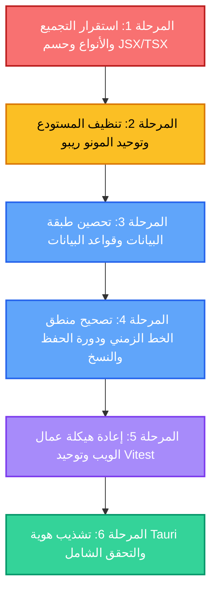

# خارطة طريق التصحيح الشامل والهيكلي لنظام SCRIPTFLOW Enterprise
## Enterprise Engineering & System Hardening Roadmap

> **تنبيه منهجي:** هذه الوثيقة تمثل خارطة طريق هندسية صارمة وتفصيلية لعلاج كافة الثغرات والعيوب المعمارية والتجميعية المكتشفة في [تقرير التحليل الذري](file:///d:/SCRIPTFLOW%20Pro/SCRIPTFLOW%20ENREPRISE/ATOMIC_CODEBASE_ANALYSIS_AND_IMPROVEMENT_REPORT.md). **الهدف الحصري:** رفع كفاءة وموثوقية التطبيق الحالي إلى المعايير المؤسسية (Enterprise-Grade Stability) دون استحداث أو تعديل أي ميزات وظيفية جديدة للمستخدم النهائي.

---

## المخطط العام للمراحل والتبعيات (Milestone Dependencies)



---

## جدول تتبع المراحل (Milestone Progress Matrix)

| المرحلة | النطاق الفني | درجة الحرج | الملفات المتأثرة | الحالة الراهنة |
| :--- | :--- | :--- | :--- | :--- |
| **المرحلة 1** | استقرار نظام التجميع وفحص الأنواع وحسم تصدع JSX/TSX | 🔴 حرج للغاية | 8 ملفات | `PENDING` ⏳ |
| **المرحلة 2** | تنظيف المستودع وتصحيح تبعيات المونو ريبو وحذف الشوائب | 🟠 مرتفع | 14 ملفاً | `PENDING` ⏳ |
| **المرحلة 3** | أمان واستقرار قاعدة البيانات وإغلاق ثغرة SQL وحل DDL | 🔴 حرج للغاية | 6 ملفات | `PENDING` ⏳ |
| **المرحلة 4** | استمرارية ترتيب الخط الزمني وتحصين طابور الحفظ والنسخ | 🔴 حرج للغاية | 7 ملفات | `PENDING` ⏳ |
| **المرحلة 5** | معمارية عمال الويب وحل ازدواجية ESM واجتياز 100% اختبارات | 🟠 مرتفع | 6 ملفات | `PENDING` ⏳ |
| **المرحلة 6** | تشذيب إعدادات Tauri وتصديرات مكتبة الأنساب والتحقق النهائي | 🟢 متوسط | 4 ملفات | `PENDING` ⏳ |

---

## المرحلة 1: استقرار التجميع والأنواع وحسم تصدع (JSX vs TSX)
> **الهدف:** تمكين الفحص الثابت (`tsc`) وبناء حزمة الإنتاج (`vite build`) بنجاح دون أي خطأ نوعي، وحسم ازدواجية الملفات المتطابقة.

### 📌 المهمة 1.1: تصحيح مستودع لقطات المشاهد [`SceneSnapshotRepository.ts`](file:///d:/SCRIPTFLOW%20Pro/SCRIPTFLOW%20ENREPRISE/packages/database/src/SceneSnapshotRepository.ts)
- [ ] **تصحيح شروط الواجهة `SceneSnapshot`:**
  - تعديل نوع الحقل `id` ليصبح `id: string` بدلاً من `id?: number`.
  - تعديل نوع الحقل `scene_id` ليصبح `string` ليتطابق مع معرفات المشاهد النصية (`SceneID = scn_...`).
- [ ] **مطابقة الصنف الأساسي [`BaseRepository<SceneSnapshot>`](file:///d:/SCRIPTFLOW%20Pro/SCRIPTFLOW%20ENREPRISE/packages/database/src/BaseRepository.ts):**
  - التصريح الصريح عن الحقل المجرد: `protected readonly tableName = 'scene_snapshots';`.
  - تعديل المنشئ لاستدعاء `super()` دون تمرير أي وسائط (حيث أن `BaseRepository` لا يستقبل وسائط في منشئه).
- [ ] **تصحيح دالة الإدراج `createSnapshot`:**
  - توافق الدالة مع نمط `insert` الذي يرجع `Promise<void>`، وإرجاع الكائن المنشأ بشكل صحيح مع توليد معرف فريد بواسطة `generateId('snp')`.
- [ ] **إضافة امتدادات `.js` للاستيرادات النسبية:**
  - تحويل استيراد `./BaseRepository` إلى `./BaseRepository.js` و `./client` إلى `./client.js` للتوافق مع وضع `moduleResolution: nodenext`.

### 📌 المهمة 1.2: حسم الانقسام اللغوي بين الملفات المتوازية (`.jsx` و `.tsx`)
يجب اتخاذ قرار هندسي موحد لإنهاء ظاهرة الازدواجية التي تفشل التجميع وتشغل كوداً قديماً:
- [ ] **ملف محرّر المشاهد (Scene Editor):**
  - فحص [`apps/desktop/src/pages/SceneEditor.jsx`](file:///d:/SCRIPTFLOW%20Pro/SCRIPTFLOW%20ENREPRISE/apps/desktop/src/pages/SceneEditor.jsx) (الملف الحقيقي المعتمد، 1219 سطراً) مقابل [`SceneEditor.tsx`](file:///d:/SCRIPTFLOW%20Pro/SCRIPTFLOW%20ENREPRISE/apps/desktop/src/pages/SceneEditor.tsx) (الملف التجريبي غير المكتمل، 120 سطراً).
  - إما إكمال واجهات واستيرادات ملف `.tsx` بالكامل وإلغاء `.jsx`، أو أرشفة ملف `.tsx` المبتور مؤقتاً خارج مجلد `src` لتمكين نجاح `tsc`.
- [ ] **صفحة الشخصيات وملف الشخصية:**
  - دمج وحسم [`CharactersPage.jsx`](file:///d:/SCRIPTFLOW%20Pro/SCRIPTFLOW%20ENREPRISE/apps/desktop/src/pages/CharactersPage.jsx) مع [`CharactersPage.tsx`](file:///d:/SCRIPTFLOW%20Pro/SCRIPTFLOW%20ENREPRISE/apps/desktop/src/pages/CharactersPage.tsx).
  - دمج وحسم [`CharacterProfilePage.jsx`](file:///d:/SCRIPTFLOW%20Pro/SCRIPTFLOW%20ENREPRISE/apps/desktop/src/pages/CharacterProfilePage.jsx) مع [`CharacterProfilePage.tsx`](file:///d:/SCRIPTFLOW%20Pro/SCRIPTFLOW%20ENREPRISE/apps/desktop/src/pages/CharacterProfilePage.tsx) وإصلاح المتغيرات المهملة والوسائط غير المتطابقة (`TS2554`, `TS6133`).
- [ ] **صفحة العلاقات والخط الزمني:**
  - حسم [`apps/desktop/src/features/relationships/RelationshipsPage.jsx`](file:///d:/SCRIPTFLOW%20Pro/SCRIPTFLOW%20ENREPRISE/apps/desktop/src/features/relationships/RelationshipsPage.jsx) مقابل نسخة `.tsx`.
  - حسم [`apps/desktop/src/pages/TimelinePage.jsx`](file:///d:/SCRIPTFLOW%20Pro/SCRIPTFLOW%20ENREPRISE/apps/desktop/src/pages/TimelinePage.jsx) مقابل نسخة `.tsx`.
- [ ] **أداة تصدير الـ PDF:**
  - حذف الملف الوسيط الموجه [`apps/desktop/src/utils/exportPDF.jsx`](file:///d:/SCRIPTFLOW%20Pro/SCRIPTFLOW%20ENREPRISE/apps/desktop/src/utils/exportPDF.jsx) (47 بايت)، وتحديث استيرادات المشروع للإشارة المباشرة إلى [`exportPDF.tsx`](file:///d:/SCRIPTFLOW%20Pro/SCRIPTFLOW%20ENREPRISE/apps/desktop/src/utils/exportPDF.tsx).

### 📌 المهمة 1.3: توفيق إعدادات TypeScript (`tsconfig.json`)
- [ ] ضبط ملف [`apps/desktop/tsconfig.json`](file:///d:/SCRIPTFLOW%20Pro/SCRIPTFLOW%20ENREPRISE/apps/desktop/tsconfig.json):
  - تفعيل `"allowJs": true` لحين اكتمال نقل كافة المكونات إلى TypeScript، لتجنب أخطاء `TS7016: Could not find a declaration file for module`.
  - إنشاء ملف تصريحات عام `src/shims.d.ts` للمكونات التي لا تزال تستخدم امتداد `.jsx`.

#### 🎯 معيار التحقق والقبول للمرحلة 1:
```bash
# يجب أن ينجح هذا الأمر بدون أي أخطاء نوعية
npm run build --workspace=@scriptflow/desktop
```

---

## المرحلة 2: تنظيف المستودع وتوحيد المونو ريبو (Monorepo & Code Hygiene)
> **الهدف:** التخلص من الحزم المهجورة، وتسجيل التبعيات الناقصة، وإضافة سكريبتات البناء، وتطهير شجرة الكود من الملفات المؤقتة والترقيعية.

### 📌 المهمة 2.1: إزالة الحزم الأشباح المهجورة (Ghost Packages)
- [ ] حذف المجلدات الأربعة غير المستخدمة من مسار `packages/`:
  - `packages/domain-character/`
  - `packages/domain-scenario/`
  - `packages/domain-scene/`
  - `packages/domain-timeline/`
- [ ] تحديث مصفوفة `workspaces` في ملف الجذر [`package.json`](file:///d:/SCRIPTFLOW%20Pro/SCRIPTFLOW%20ENREPRISE/package.json) إن كانت محددة بأسماء صريحة، والتأكد من عدم وجود روابط مهملة في `node_modules`.

### 📌 المهمة 2.2: استكمال سكريبتات البناء (`build` scripts) عبر المستودع
- [ ] إضافة الأمر `"build": "tsc"` أو أمر البناء المناسب داخل `package.json` للحزم التالية:
  - [`packages/core/package.json`](file:///d:/SCRIPTFLOW%20Pro/SCRIPTFLOW%20ENREPRISE/packages/core/package.json)
  - [`packages/database/package.json`](file:///d:/SCRIPTFLOW%20Pro/SCRIPTFLOW%20ENREPRISE/packages/database/package.json)
  - [`packages/export-engine/package.json`](file:///d:/SCRIPTFLOW%20Pro/SCRIPTFLOW%20ENREPRISE/packages/export-engine/package.json)
- [ ] توحيد استراتيجية الاستيراد الداخلي لنقاط الدخول (`main` و `types`) عبر الحزم.

### 📌 المهمة 2.3: تسجيل التبعية الناقصة في تطبيق سطح المكتب
- [ ] فتح [`apps/desktop/package.json`](file:///d:/SCRIPTFLOW%20Pro/SCRIPTFLOW%20ENREPRISE/apps/desktop/package.json) وإضافة حزمة التصدير إلى حقل `dependencies`:
  ```json
  "@scriptflow/export": "*"
  ```

### 📌 المهمة 2.4: تطهير شجرة الكود من الملفات الدخيلة والمخلفات
- [ ] حذف ملف خطأ الطرفية: [`apps/desktop/src-tauri/2`](file:///d:/SCRIPTFLOW%20Pro/SCRIPTFLOW%20ENREPRISE/apps/desktop/src-tauri/2).
- [ ] حذف ملف النموذج الأولي المتروك: [`apps/desktop/src/prototype_paper.html`](file:///d:/SCRIPTFLOW%20Pro/SCRIPTFLOW%20ENREPRISE/apps/desktop/src/prototype_paper.html).
- [ ] حذف ملفات النسخ الاحتياطية المهملة:
  - [`apps/desktop/src/components/editor/ScenePaperRenderer.jsx.old`](file:///d:/SCRIPTFLOW%20Pro/SCRIPTFLOW%20ENREPRISE/apps/desktop/src/components/editor/ScenePaperRenderer.jsx.old).
  - [`apps/desktop/src/components/editor/TextMeasurementEngine.js.old`](file:///d:/SCRIPTFLOW%20Pro/SCRIPTFLOW%20ENREPRISE/apps/desktop/src/components/editor/TextMeasurementEngine.js.old).
- [ ] حذف سكريبتات الترقيع الذاتي المتروكة في مسار الإنتاج داخل [`apps/desktop/src/components/editor/paper/`](file:///d:/SCRIPTFLOW%20Pro/SCRIPTFLOW%20ENREPRISE/apps/desktop/src/components/editor/paper):
  - `patch.js`
  - `patch_css.js`
  - `patch_layout.js`
  - `patch_ui.js`
  - `restore.js`

### 📌 المهمة 2.5: حماية ملفات قواعد البيانات وتحديث التتبع
- [ ] استبعاد وحذف ملف قاعدة بيانات التطوير الثنائي الملتزم بالكود [`apps/desktop/src-tauri/scriptflow.db`](file:///d:/SCRIPTFLOW%20Pro/SCRIPTFLOW%20ENREPRISE/apps/desktop/src-tauri/scriptflow.db).
- [ ] تحديث ملف [`apps/desktop/src-tauri/.gitignore`](file:///d:/SCRIPTFLOW%20Pro/SCRIPTFLOW%20ENREPRISE/apps/desktop/src-tauri/.gitignore) لإدراج:
  ```gitignore
  *.db
  *.db-wal
  *.db-shm
  *.bak.db
  ```

#### 🎯 معيار التحقق والقبول للمرحلة 2:
```bash
# يجب أن يبني كافة الحزم بدون خطأ missing script
npm run build
```

---

## المرحلة 3: تحصين طبقة البيانات وقواعد البيانات (Database & Data Integrity)
> **الهدف:** إغلاق ثغرة الـ SQL Injection، ونقل أوامر DDL إلى الهجرات، وتصحيح توليد المعرفات، ومنع استنزاف الذاكرة.

### 📌 المهمة 3.1: إغلاق ثغرة حقن SQL في محرك الإحصائيات
- [ ] فتح [`packages/application/src/statistics/GenerateStatistics/GenerateStatistics.ts`](file:///d:/SCRIPTFLOW%20Pro/SCRIPTFLOW%20ENREPRISE/packages/application/src/statistics/GenerateStatistics/GenerateStatistics.ts#L10-L16).
- [ ] إزالة الدمج النصي غير الآمن لـ `${episodeId}` واستبداله بالمعامل المقيد:
  ```typescript
  // قبل التصحيح (ثغرة):
  // ${episodeId && episodeId !== 'ALL' ? `AND episode_id = '${episodeId}'` : ''}
  // بعد التصحيح (آمن):
  const hasEpisode = episodeId && episodeId !== 'ALL';
  const statsQuery = `
    SELECT 
      (SELECT COUNT(*) FROM scenes WHERE scenario_id = $1 AND deleted_at IS NULL ${hasEpisode ? 'AND episode_id = $2' : ''}) as sceneCount,
      (SELECT COUNT(*) FROM characters WHERE scenario_id = $1 AND deleted_at IS NULL) as characterCount,
      (SELECT COUNT(*) FROM locations WHERE scenario_id = $1 AND deleted_at IS NULL) as locationCount,
      (SELECT COUNT(*) FROM crew WHERE scenario_id = $1 AND deleted_at IS NULL) as crewCount
  `;
  const params = hasEpisode ? [scenarioId, episodeId] : [scenarioId];
  const results = await dbSelect<any>(statsQuery, params);
  ```

### 📌 المهمة 3.2: ترحيل جدول التذكيرات وحذف DDL من وقت التشغيل
- [ ] إنشاء ملف هجرة رسمي جديد:
  [`apps/desktop/src-tauri/migrations/011_create_scene_reminders.sql`](file:///d:/SCRIPTFLOW%20Pro/SCRIPTFLOW%20ENREPRISE/apps/desktop/src-tauri/migrations/):
  ```sql
  CREATE TABLE IF NOT EXISTS scene_reminders (
    id TEXT PRIMARY KEY,
    scene_id TEXT NOT NULL REFERENCES scenes(id) ON DELETE CASCADE,
    content TEXT NOT NULL,
    is_completed INTEGER DEFAULT 0,
    created_at DATETIME DEFAULT CURRENT_TIMESTAMP
  );
  CREATE INDEX IF NOT EXISTS idx_scene_reminders_scene_id ON scene_reminders(scene_id);
  ```
- [ ] تسجيل الهجرة 11 في ملف [`apps/desktop/src-tauri/src/lib.rs`](file:///d:/SCRIPTFLOW%20Pro/SCRIPTFLOW%20ENREPRISE/apps/desktop/src-tauri/src/lib.rs) داخل مصفوفة `migrations`.
- [ ] فتح [`packages/database/src/SceneRepository.ts`](file:///d:/SCRIPTFLOW%20Pro/SCRIPTFLOW%20ENREPRISE/packages/database/src/SceneRepository.ts) وحذف دالة `ensureRemindersTable()` واستدعاءاتها المتكررة تماماً.

### 📌 المهمة 3.3: تصحيح توليد معرفات التذكيرات
- [ ] في [`SceneRepository.ts`](file:///d:/SCRIPTFLOW%20Pro/SCRIPTFLOW%20ENREPRISE/packages/database/src/SceneRepository.ts#L46):
  - استبدال `Math.random().toString(36).substr(2, 9)` بالدالة القياسية:
    ```typescript
    import { generateId } from '@scriptflow/core';
    const id = generateId('rem');
    ```

### 📌 المهمة 3.4: تصحيح عدم تطابق أنواع الهجرة 010
- [ ] فحص [`apps/desktop/src-tauri/migrations/010_create_scene_snapshots.sql`](file:///d:/SCRIPTFLOW%20Pro/SCRIPTFLOW%20ENREPRISE/apps/desktop/src-tauri/migrations/010_create_scene_snapshots.sql):
  - تعديل `scene_id INTEGER` إلى `scene_id TEXT` و `id TEXT PRIMARY KEY` ليتوافق مع المفاتيح الموحدة في معمارية النظام.

### 📌 المهمة 3.5: تحسين استعلام كتل المشاهد في حساب الإحصائيات
- [ ] في [`GenerateStatistics.ts`](file:///d:/SCRIPTFLOW%20Pro/SCRIPTFLOW%20ENREPRISE/packages/application/src/statistics/GenerateStatistics/GenerateStatistics.ts#L35-L45):
  - تجنب جلب حقل `content` بالكامل إذا كان الهدف الوحيد حساب الطول أو عدد الكلمات، أو استبدال الحساب التكراري باستعلام مجمع مباشر في SQLite لتفادي حجز مئات الميجابايت من الذاكرة في السيناريوهات الضخمة.

#### 🎯 معيار التحقق والقبول للمرحلة 3:
```bash
# تشغيل اختبارات مستودعات قاعدة البيانات والتأكد من نجاحها بالكامل
npm test --workspace=@scriptflow/database
```

---

## المرحلة 4: تصحيح منطق الخط الزمني، الحفظ التلقائي والنسخ الاحتياطي
> **الهدف:** استعادة استمرارية ترتيب المشاهد في الخط الزمني، وحماية طابور الحفظ التلقائي من تسريب الوعود، ومنع تداخل عمليات النسخ الاحتياطي.

### 📌 المهمة 4.1: إصلاح استمرارية ترتيب المشاهد في الخط الزمني (Drag & Drop Reordering)
- [ ] **ربط المعامل في واجهة الخط الزمني:**
  - فتح [`apps/desktop/src/pages/TimelinePage.jsx`](file:///d:/SCRIPTFLOW%20Pro/SCRIPTFLOW%20ENREPRISE/apps/desktop/src/pages/TimelinePage.jsx#L45) وتعديل دالة `assignScene`:
    ```javascript
    // تمرير newOrder بدلاً من إسقاطه
    const assignScene = (scenId, scnId, destDayId, newOrder) => 
      assignMutation.mutate({ scenarioId: scenId, sceneId: scnId, destDayId, shootOrder: newOrder });
    ```
- [ ] **تعديل الـ Mutation في الخطافات:**
  - فتح [`apps/desktop/src/hooks/queries/useTimeline.ts`](file:///d:/SCRIPTFLOW%20Pro/SCRIPTFLOW%20ENREPRISE/apps/desktop/src/hooks/queries/useTimeline.ts#L80-L94) وتعديل `useAssignSceneMutation`:
    ```typescript
    mutationFn: async ({ scenarioId, sceneId, destDayId, shootOrder }: { scenarioId: string; sceneId: string; destDayId: string | null; shootOrder?: number }) => {
      await manageTimeline.assignScene(sceneId, destDayId, shootOrder);
      return { scenarioId };
    }
    ```
- [ ] **تحديث خدمة إدارة الخط الزمني:**
  - فتح [`packages/application/src/timeline/ManageTimeline/ManageTimeline.ts`](file:///d:/SCRIPTFLOW%20Pro/SCRIPTFLOW%20ENREPRISE/packages/application/src/timeline/ManageTimeline/ManageTimeline.ts#L39-L47):
    ```typescript
    public async assignScene(sceneId: string, destDayId: string | null, shootOrder: number = 0): Promise<void> {
      if (destDayId) {
        await dbExecute('UPDATE scenes SET shoot_day_id = $1, shoot_order = $2 WHERE id = $3', [destDayId, shootOrder, sceneId]);
      } else {
        await dbExecute('UPDATE scenes SET shoot_day_id = NULL, shoot_order = 0 WHERE id = $1', [sceneId]);
      }
    }
    ```
- [ ] **تصحيح استعلام الترتيب عند استرجاع البيانات:**
  - في نفس الملف داخل دالة `getTimelineData`:
    ```typescript
    // الفرز بحسب shoot_order أولاً ثم scene_number لمنع ضياع الترتيب عند التحديث
    const allScenes = await dbSelect<any>(
      'SELECT * FROM scenes WHERE scenario_id = $1 AND deleted_at IS NULL ORDER BY COALESCE(shoot_order, scene_number) ASC',
      [scenarioId]
    );
    ```

### 📌 المهمة 4.2: تحصين أمان طابور الحفظ التلقائي [`AutosaveQueue.js`](file:///d:/SCRIPTFLOW%20Pro/SCRIPTFLOW%20ENREPRISE/apps/desktop/src/utils/AutosaveQueue.js)
- [ ] فتح [`apps/desktop/src/utils/AutosaveQueue.js`](file:///d:/SCRIPTFLOW%20Pro/SCRIPTFLOW%20ENREPRISE/apps/desktop/src/utils/AutosaveQueue.js#L51-L71).
- [ ] تحويل دالة `flush()` إلى دالة `async` تعتمد `Promise.allSettled` وتنتظر اكتمال كافة العمليات المعلقة قبل العودة:
  ```javascript
  async flush() {
    if (this.timer) {
      clearTimeout(this.timer);
      this.timer = null;
    }
    
    const pendingItems = [...this.queue];
    this.queue = [];
    
    if (pendingItems.length > 0) {
      console.warn(`⚠️ AutosaveQueue: جاري إنقاذ وحفظ ${pendingItems.length} عنصر معلقة`);
      await Promise.allSettled(
        pendingItems.map(item => this.saveAction(item.id, item.body))
      );
    }
  }
  ```

### 📌 المهمة 4.3: تحصين دورة النسخ الاحتياطي التلقائي [`AutoBackupProvider.jsx`](file:///d:/SCRIPTFLOW%20Pro/SCRIPTFLOW%20ENREPRISE/apps/desktop/src/components/providers/AutoBackupProvider.jsx)
- [ ] إضافة حارس التزامن (`isBackingUpRef`) لمنع تداخل عمليات النسخ إذا استغرقت إحداها وقتاً طويلاً:
  ```javascript
  const isBackingUpRef = useRef(false);
  // استبدال setInterval بحلقة آمنة أو فحص الحارس:
  if (isBackingUpRef.current) return;
  isBackingUpRef.current = true;
  try {
    await backupService.createBackup('auto');
  } finally {
    isBackingUpRef.current = false;
  }
  ```

### 📌 المهمة 4.4: تصحيح مسارات قاعدة البيانات في [`BackupService.js`](file:///d:/SCRIPTFLOW%20Pro/SCRIPTFLOW%20ENREPRISE/apps/desktop/src/services/BackupService.js)
- [ ] مطابقة مسار قاعدة البيانات بين ما يرجعه Rust في `get_db_path` و `get_app_root`، لضمان عدم إخفاق دالة `exists(dbPath)` بشكل زائف أثناء التطوير.

#### 🎯 معيار التحقق والقبول للمرحلة 4:
```bash
# تشغيل اختبارات الخط الزمني والحفظ التلقائي
npm test --workspace=@scriptflow/desktop -- src/__tests__/AutosaveQueue.test.js src/__tests__/TimelineIntegration.test.js
```

---

## المرحلة 5: إعادة هيكلة عمال الويب وتصحيح بيئة الاختبارات Vitest
> **الهدف:** حل مشكلة عمال الويب الشكليين، وإعداد مساحة عمل Vitest الموحدة، وحل ظاهرة الازدواج الموديولي في معيار ESM لاجتياز الاختبارات الـ 23 الفاشلة.

### 📌 المهمة 5.1: حسم طبقة عمال الويب (Web Workers Resolution)
- [ ] **الخيار المعتمد للمؤسسات (True Web Workers):**
  - فتح [`apps/desktop/src/workers/StatsWorker.js`](file:///d:/SCRIPTFLOW%20Pro/SCRIPTFLOW%20ENREPRISE/apps/desktop/src/workers/StatsWorker.js) وإضافة:
    ```javascript
    import * as Comlink from 'comlink';
    Comlink.expose(StatsWorker);
    ```
  - فتح [`apps/desktop/src/workers/ExportWorker.js`](file:///d:/SCRIPTFLOW%20Pro/SCRIPTFLOW%20ENREPRISE/apps/desktop/src/workers/ExportWorker.js) وإضافة:
    ```javascript
    import * as Comlink from 'comlink';
    Comlink.expose(ExportWorker);
    ```
  - إعادة ربط [`useStatsWorker.js`](file:///d:/SCRIPTFLOW%20Pro/SCRIPTFLOW%20ENREPRISE/apps/desktop/src/hooks/useStatsWorker.js) و [`useExportWorker.js`](file:///d:/SCRIPTFLOW%20Pro/SCRIPTFLOW%20ENREPRISE/apps/desktop/src/hooks/useExportWorker.js) بـ `workerFactory` لتعمل في خلفية حقيقية وتنهي تجميد الشاشة.
- [ ] **تصحيح اختبارات الوحدة [`WorkerFactory.test.js`](file:///d:/SCRIPTFLOW%20Pro/SCRIPTFLOW%20ENREPRISE/apps/desktop/src/__tests__/WorkerFactory.test.js):**
  - إزالة الـ Mock الزائف واختبار استدعاءات العامل الفعلية عبر معايير بيئة الاختبار.

### 📌 المهمة 5.2: إنشاء ملف مساحة عمل Vitest (`vitest.workspace.ts`)
- [ ] إنشاء ملف `vitest.workspace.ts` في جذر المستودع للفصل بين بيئة اختبارات المتصفح وبيئة Node:
  ```typescript
  import { defineWorkspace } from 'vitest/config';

  export default defineWorkspace([
    {
      test: {
        name: 'desktop',
        root: './apps/desktop',
        environment: 'jsdom',
        include: ['src/**/*.{test,spec}.{js,mjs,cjs,ts,mts,cts,jsx,tsx}'],
      },
    },
    {
      test: {
        name: 'packages',
        root: './packages',
        environment: 'node',
        include: ['**/*.{test,spec}.{ts,js}'],
      },
    },
  ]);
  ```
- هذا الإجراء سيصلح فوراً خطأ `ReferenceError: document is not defined` في اختبارات سطح المكتب.

### 📌 المهمة 5.3: حل خطأ الازدواج الموديولي في معيار ESM
- [ ] فتح [`packages/application/src/test/setup.ts`](file:///d:/SCRIPTFLOW%20Pro/SCRIPTFLOW%20ENREPRISE/packages/application/src/test/setup.ts):
  - استبدال الاستيراد النسبي العابر للحزم بالاستيراد عبر اسم الحزمة الرسمي:
    ```typescript
    // بدلاً من:
    // import { setupTestDatabase as dbSetup } from '../../../database/src/test/setup.js';
    // استيراد آمن وموحد من الحزمة مباشرة:
    import { setupTestDatabase as dbSetup, teardownTestDatabase as dbTeardown } from '@scriptflow/database/test';
    ```
  - إضافة نقطة تصدير فرعية داخل [`packages/database/package.json`](file:///d:/SCRIPTFLOW%20Pro/SCRIPTFLOW%20ENREPRISE/packages/database/package.json):
    ```json
    "exports": {
      ".": "./src/index.ts",
      "./test": "./src/test/setup.ts"
    }
    ```
- هذا التعديل يضمن توحيد متغير `dbInstance` في الذاكرة، ويقود إلى **نجاح كافة الاختبارات الـ 19 الفاشلة** في `ManageCrew`, `ImportProject`, `GenerateStatistics`, `ManageTimeline`, و `ManageTrash`.

#### 🎯 معيار التحقق والقبول للمرحلة 5:
```bash
# تشغيل أمر الاختبار من جذر المشروع والتأكد من اجتياز 100% من الاختبارات
npm test
```

---

## المرحلة 6: تشذيب هوية Tauri والتحقق النهائي
> **الهدف:** ضبط بيانات التطبيق المكتبي، وعزل استيرادات Node في مكتبة الأنساب، وإجراء فحص شامل للمشروع كاملاً.

### 📌 المهمة 6.1: تحديث هوية وتكوين التطبيق في [`tauri.conf.json`](file:///d:/SCRIPTFLOW%20Pro/SCRIPTFLOW%20ENREPRISE/apps/desktop/src-tauri/tauri.conf.json)
- [ ] تعديل اسم المنتج: `"productName": "ScriptFlow Enterprise"`.
- [ ] تعديل عنوان النافذة: `"title": "ScriptFlow Enterprise"`.
- [ ] ضبط أبعاد النافذة الافتراضية إلى أبعاد مريحة لتطبيق مكتبي:
  ```json
  "width": 1400,
  "height": 900,
  "minWidth": 1024,
  "minHeight": 700
  ```

### 📌 المهمة 6.2: عزل اعتمادات Node في مكتبة الأنساب [`packages/nasab`](file:///d:/SCRIPTFLOW%20Pro/SCRIPTFLOW%20ENREPRISE/packages/nasab)
- [ ] فتح [`packages/nasab/packages/nasab-rule-engine/src/registry.ts`](file:///d:/SCRIPTFLOW%20Pro/SCRIPTFLOW%20ENREPRISE/packages/nasab/packages/nasab-rule-engine/src/registry.ts#L1-L2):
  - عزل الاستيرادات الثابتة `import * as fs from 'fs'` و `import * as path from 'path'`.
  - تحويل قراءة الملفات المحلية إلى استيراد ديناميكي أو فصل دالة `loadRulesFromDirectory` في ملف مستقل خاص ببيئة Node، لمنع ظهور تحذيرات الـ externalization عند التجميع للمتصفح.

### 📌 المهمة 6.3: دورة الفحص الهندسي والتحقق الشامل (Final Verification Cycle)
- [ ] تشغيل التدقيق النوعي الكامل:
  ```bash
  npm run build
  ```
- [ ] تشغيل كافة اختبارات المستودع بالكامل:
  ```bash
  npm test
  ```
- [ ] التحقق من بناء تطبيق Tauri المكتبي:
  ```bash
  npm run tauri -- build --no-bundle
  ```

---

## قائمة التحقق النهائية قبل الإطلاق (Master Verification Checklist)

- [ ] خط التجميع `npm run build` يعمل بنجاح في كافة الحزم دون أي خطأ نوعي أو نقص في السكريبتات.
- [ ] كافة ملفات الاختبار الـ 55 تنجح بنسبة 100% (514+ اختباراً ناجحاً بدون أي فشل).
- [ ] تم إغلاق ثغرة SQL Injection في محرك الإحصائيات بالكامل.
- [ ] تم نقل أوامر DDL لجدول التذكيرات إلى ملفات الهجرة الرسمية.
- [ ] تم استعادة استمرارية ترتيب المشاهد في الخط الزمني عند السحب والإفلات وتأكيدها في قاعدة البيانات.
- [ ] دالة `AutosaveQueue.flush()` تنتظر الوعود المعلقة بأمان وتمنع ضياع البيانات.
- [ ] تم تطهير مجلد `packages/` من الحزم الأربع المهجورة.
- [ ] تم تنظيف شجرة الكود من كافة ملفات الشوائب والترقيع وقواعد البيانات الملتزمة.
- [ ] تطبيق Tauri المكتبي يمتلك هوية وعنواناً واضحين ومقاسات شاشة احترافية.

---
> 🏁 **جاهزية الخطة:** تم تدوين كل نقطة بدقة متناهية. لا تبدأ بتنفيذ أي خطوة حتى تكتمل فكرتك الخاصة، وعند الرغبة في التنفيذ يمكن البدء خطوة بخطوة بالترتيب المنهجي المحدد أعلاه.
