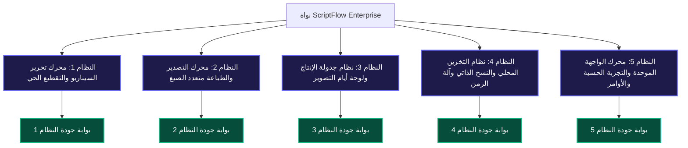

# 🚀 خارطة ترقية وتطوير الأنظمة المؤسسية (Enterprise Systems Upgrade Roadmap)
## تطبيق ScriptFlow Enterprise — الجيل الجديد 2026
### من الكود النظيف إلى المعايير السينمائية العالمية (From Clean Code to Hollywood Industry Standards)

---

## 📌 بطاقة الوثيقة المرجعية

| البند | البيان |
| :--- | :--- |
| **اسم المشروع** | **ScriptFlow Enterprise** (`com.scriptflow.enterprise`) |
| **رقم الوثيقة** | **SF-ENTERPRISE-UPGRADE-2026-V1.0** |
| **تاريخ الإصدار** | **29 أكتوبر 2026** |
| **الحالة الراهنة** | **نقاء برمجي 100% TSX** / **0 أخطاء تجميع** / **اجتياز 497/497 اختباراً** |
| **الهدف الاستراتيجي** | الارتقاء بالأنظمة الستة الجوهرية للتطبيق إلى أعلى المعايير الهندسية والصناعية العالمية |
| **القاعدة الحاكمة** | **صفر تراجع (Zero Regression)** — الحفاظ التام على سلامة الاختبارات وكفاءة الأداء الفائق |

---

## 🧭 الفلسفة الهندسية ومبادئ الترقية (Core Engineering Principles)

1. **السيادة النوعية والأمان البرمجي (Strict Type Safety & Zero Any):** كافة التحسينات والواجهات الجديدة تُبنى بتعريفات TypeScript صارمة دون أي استثناءات، مع توافق كامل مع معايير TanStack Query v5 و React 19.
2. **الأداء فائق السرعة وعدم تجميد الواجهة (Zero-Lag & Multithreading):** نقل العمليات الحسابية الثقيلة (التصدير، الترقيم، التحليل الزمني، ورسم الأنساب) إلى عمال الويب الخلفيين (Web Workers) وخيوط المعالجة المنفصلة.
3. **المعايير السينمائية الصناعية (Cinema Industry Standards):** الامتثال الصارم لقواعد هوليوود لكتابة وتنسيق السيناريو (55 سطراً للصفحة، الخطوط الطباعية المحددة، صيغ Final Draft و Fountain).
4. **العربية كلغة سينمائية أصيلة (First-Class Arabic RTL Typography):** معالجة تشكيل وتنسيق الخطوط العربية (Amiri / IBM Plex Sans Arabic) وضبط محاذاة المشاهد وعناصر الحوار بدقة ميكرومترية.
5. **التسليم المرحلي المستقل (Modular Atomic Milestones):** يتم تطوير كل نظام واختباره وتوثيقه وتثبيته في Git بشكل منفصل قبل الانتقال للنظام التالي.

---

## 🗺️ خريطة الأنظمة المؤسسية الخمسة المعتمدة (The 5 Core Subsystems)

> 💡 **ملاحظة معمارية استراتيجية:** تم استثناء محرك شبكة العلاقات وشجرة الأنساب وعلم الفرائض (`@scriptflow/nasab`) من هذه الخطة التشغيلية نظراً لقيام المستخدم بتطوير مكتبة متخصصة ومستقلة خاصة بها، وذلك تفادياً لأي تداخل أو تعارض برمجي.

---

## 🛠️ التفصيل المعماري والتنفيذي للأنظمة

---

### 🎬 النظام 1: محرك تحرير السيناريو والتقطيع السينمائي الحي
### (Screenplay Editor & Live Continuity Engine)

> **الهدف:** تحويل محرر النصوص من محرر كتل عادي إلى بيئة سينمائية تفاعلية تحاكي أشهر البرامج العالمية (Final Draft, Fade In, Highland) مع استجابة فورية وحسابات صفحات حية.

#### 📌 المحاور والميزات المستهدفة:
1. **الترقيم السينمائي اللحظي (Real-Time Live Pagination):**
   - تطوير خوارزمية ذكية تحسب أرقام وفواصل الصفحات لحظياً أثناء الكتابة بناءً على معيار 55 سطراً في الصفحة، مع إظهار خط فاصل الصفحات البصري اللطيف دون تجميد أو وميض.
   - مراعاة الهوامش الدقيقة لعناصر السيناريو:
     - المشهد (Scene Heading): عرض كامل، حروف كبيرة.
     - الحوار (Dialogue): عرض 85% ممركّز.
     - التعليمات بين القوسين (Parenthetical): محاذاة محددة مخصصة.
2. **محلل الاستمرارية السينمائي اللحظي (Live Continuity Analyzer):**
   - فحص متزامن لتواجد الشخصيات في المشاهد وكشف تناقضات الدخول والخروج.
   - كشف التناقض الزمني المنطقي (مثال: مشهد خارجي ليل يليه مشهد خارجي نهار في نفس التسلسل الزمني اللحظي).
   - رصد الإكسسوارات (Props) والملابس المكررة أو المفقودة بين المشاهد المتتالية.
3. **وضع التركيز والكاتب السينمائي (Typewriter Scrolling & Zen Mode):**
   - تثبيت موضع السطر النشط في منتصف الشاشة دائماً (Typewriter Mode).
   - وضع الشاشة الكاملة الخالي من المشتتات مع لوحة معلومات شفافة ذكية تختفي عند الكتابة.
4. **الإكمال التلقائي الذكي لعناصر السيناريو (Smart Screenplay Autocomplete):**
   - اقتراح فوري لأسماء الشخصيات والمواقع بمجرد كتابة أول حرفين، مع تلميحات أوقات التصوير (نهار، ليل، فجر، مغرب).

#### 🧪 بوابة جودة النظام 1 (Quality Gate):
- [ ] أداء التحرير والكتابة: تأخير أقل من **16ms** (60 FPS ثابتة) في النصوص التي تتجاوز 150 صفحة.
- [ ] 0 أخطاء في فحص التجميع `tsc --noEmit`.
- [ ] اجتياز كافة اختبارات المحرر ونظام الحفظ `AutosaveQueue`.

---

### 🖨️ النظام 2: محرك التصدير متعدد الصيغ والمعالجة المتوازية
### (High-Throughput Multithreaded Export & PDF Pipeline)

> **الهدف:** تمكين الكاتب والمنتج من تصدير العمل الفني بكافة الصيغ المعيارية لشركات الإنتاج العالمية بكفاءة وسرعة فائقة دون حظر واجهة المستخدم.

#### 📌 المحاور والميزات المستهدفة:
1. **دعم صيغ الإنتاج السينمائي العالمية (Multi-Format Support):**
   - **تصدير واستيراد Final Draft (.fdx):** دعم كامل لملفات XML القياسية لـ Final Draft 12/13.
   - **تصدير Fountain (.fountain):** التوافق مع معيار النصوص الحرة للسينما المستقلة.
   - **تصدير حزم الإنتاج المجدولة (Production Packet):** ملف مضغوط يجمع السيناريو كاملاً مع كشوفات المشاهد والملخصات.
2. **محرك كشف الاستدعاء والطباعة الآلي (Automated Call Sheets & Breakdown):**
   - توليد كشوفات الاستدعاء اليومية (Call Sheets) آلياً من بيانات المشاهد وأيام التصوير.
   - توليد جداول تفريغ الشخصيات والمواقع والممثلين (Character & Location Breakdown).
3. **توليد الـ PDF فائق السرعة عبر عمال الويب (Web Worker Parallelization):**
   - نقل عمليات تصيير الـ Canvas وتقطيع الصفحات بالكامل إلى `ExportWorker.ts`.
   - كاش دائم للخطوط المنقوشة (Embedded Fonts) وتفريغ تلقائي لذاكرة الـ Iframe بنسبة 100%.
4. **نظام مراجعات هوليوود الملونة (Hollywood Revision Colors):**
   - تتبع نسخ السيناريو الرسمية بالألوان القياسية (White, Blue, Pink, Yellow, Green, Goldenrod, Salmon, Cherry, Tan).
   - علامات مائية مائلة متعددة المستويات لحماية حقوق المؤلف وسرية النصوص من التسريب.

#### 🧪 بوابة جودة النظام 2 (Quality Gate):
- [ ] زمن تصدير سيناريو من 120 صفحة بصيغة PDF: **أقل من 3 ثوانٍ** مع استمرار استجابة الواجهة.
- [ ] توافق صيغة `.fdx` المصدرة مع برمجيات Final Draft دون فقدان أي حوار أو شخصية.

---

### 📅 النظام 3: نظام جدولة الإنتاج ولوحة أيام التصوير
### (Production Stripboard & Shoot Scheduling Engine)

> **الهدف:** توفير بيئة متكاملة لإدارة أيام التصوير وربط الممثلين والمواقع بجدول زمني فيزيائي يحاكي أنظمة إدارة الإنتاج السينمائي المتقدمة (Movie Magic Scheduling).

#### 📌 المحاور والميزات المستهدفة:
1. **لوحة تقطيع التصوير التفاعلية (Digital Stripboard):**
   - لوحة شرائح ملونة لكل مشهد (داخلي/خارجي - ليل/نهار) قابلة للسحب والإفلات لإعادة ترتيب جدول التصوير.
   - إمكانية إضافة شرائح فواصل مخصصة: "يوم تصوير"، "استراحة"، "انتقال موقع".
2. **نظام تتبع توافر الممثلين (D.O.O.D. - Day Out of Days):**
   - توليد مصفوفة استدعاء الممثلين عبر أيام التصوير (Hold, Work, Drop, Travel).
   - تنبيه آلي عند وجود تضارب في مواعيد الممثلين أو تكدس غير اقتصادي لأيام الحضور.
3. **محدد التكلفة والزمن التقديري (Shooting Time & Budget Estimator):**
   - احتساب إجمالي الصفحات المقررة لكل يوم تصوير (مثال: تصوير 4 صفحات و 3/8 في اليوم).
   - تقدير زمن تصوير كل مشهد وربطه بمتوسط عدد اللقطات المقترحة.
4. **ربط المواقع بحالة الطقس الميداني:**
   - تخزين إحداثيات المواقع الحقيقية وتوقع حالة الطقس وساعات شروق وغروب الشمس لمساعدة مدير التصوير (DoP).

#### 🧪 بوابة جودة النظام 3 (Quality Gate):
- [ ] سلاسة السحب والإفلات لـ 500 مشهد في لوحة الـ Stripboard بمعدل 60 إطاراً في الثانية.
- [ ] دقة حسابات مصفوفة DOOD بنسبة 100%.

---

### 💾 النظام 4: نظام التخزين المحلي، إدارة الوسائط، والنسخ الاحتياطي التلقائي
### (Resilient Local Storage, Media & Auto-Backup Engine)

> **الهدف:** توفير حصانة مطلقة لبيانات الكاتب ضد انقطاع التيار المفاجئ، أعطال النظام، أو التلف العرضي، مع حماية أداء وقرص الجهاز.

#### 📌 المحاور والميزات المستهدفة:
1. **آلة الزمن للقطات المحفوظة (Point-in-Time Recovery / Time Machine):**
   - حفظ لقطات نقطية (Snapshots) عند كل حدث تحريري محوري مع إمكانية استعراض المشهد كما كان قبل ساعة أو يوم والعودة إليه بنقرة زر.
   - المقارنة البصرية بين نسختين من المشهد (Visual Script Diffing) مع تمييز الإضافات والحذف.
2. **ضغط وتحسين الوسائط الذكي (Zero-Bloat Media Optimizer):**
   - معالجة تلقائية لملفات الصور والفيديوهات عند الإدراج لتحويلها إلى صيغ حديثة عالية الكفاءة (WebP / H.264 خفيف) لتوفير مساحة التخزين.
   - توليد مصغرات سريعة (Thumbnails) لمنع إعادة تحميل الوسائط الأصلية الضخمة.
3. **الفحص والإنعاش الذاتي لقاعدة بيانات SQLite (Self-Healing DB Integrity):**
   - تشغيل فحص دوري صامت لسلامة ملف `scriptflow.db` (`PRAGMA integrity_check`).
   - تفعيل وضع `WAL (Write-Ahead Logging)` لتحقيق كتابة فائقة التوازي وأمان كامل ضد التلف أثناء انقطاع الطاقة.
4. **تدوير النسخ الاحتياطية وإدارتها (Backup Rotation Policy):**
   - إدارة ذكية لمجلد النسخ الاحتياطية المحلي مع تدوير آلي (الاحتفاظ بآخر 10 نسخ تلقائية وحذف القديم تدريجياً).

#### 🧪 بوابة جودة النظام 4 (Quality Gate):
- [ ] استرداد كامل للبيانات غير المحفوظة بعد إغلاق مفاجئ محاكى (Simulated Crash Recovery).
- [ ] عدم تجاوز حجم قاعدة بيانات SQLite حاجز الـ **50 ميجابايت** لمشروع يحتوي على 100 مشهد وعشرات الصور.

---

### 💎 النظام 5: محرك الواجهة الموحدة والتجربة الحسية الفاخرة
### (Design System, Micro-Animations & Command Palette)

> **الهدف:** إبهار المستخدم بتجربة بصرية حسية فائقة الرقي والجمال، مع استجابة ملموسة لكل نقرة وزر عبر معايير التصميم الحديثة.

#### 📌 المحاور والميزات المستهدفة:
1. **لوحة الأوامر الشاملة (Universal Command Palette - `Ctrl + K` / `Cmd + K`):**
   - نافذة بحث واستدعاء سريعة فورية تمكن الكاتب من الانتقال لأي مشهد، شخصية، موقع، أو تشغيل أي أمر وتصدير بنقرات مفاتيح سريعة.
2. **الحركات الميكروية السينمائية (Cinematic Micro-Interactions):**
   - حركات انتقالية ناعمة وسلسة باستخدام `framer-motion` لفتح وإغلاق النوافذ والبطاقات والقوائم.
   - تأثيرات بصرية تفاعلية (Subtle Glows & Smooth Hover Transitions) تمنح شعوراً بالفخامة والاحتراف.
3. **محرك اختصارات لوحة المفاتيح المعياري (Hollywood Shortcut Engine):**
   - اختصارات لوحة مفاتيح موحدة ومألوفة لكتاب السيناريو (`Tab` للتبديل بين الشخصية والحوار، `Enter` للانتقال السريع).
   - نافذة دليل بصري تفاعلي للاختصارات تظهر بالضغط على `?`.
4. **نظام السمات المتقدم (Advanced Theming & Dark Mode Perfection):**
   - سمات داكنة مريحة للعين مخصصة للعمل الليلي الطويل (Midnight Slate, Cinema Noir, Sepia Classic).
   - تناسق لوني كامل ومتناغم مع الخطوط العربية الأصيلة.

#### 🧪 بوابة جودة النظام 5 (Quality Gate):
- [ ] استجابة لوحة الأوامر `Ctrl + K`: ظهور فوري في أقل من **50ms**.
- [ ] معدل الإطارات في كافة الحركات الانتقالية: **60 إطاراً في الثانية** ثابت دون تقطيع.

---

### 🔒 ملحق: شبكة العلاقات وعلم الأنساب (`@scriptflow/nasab`)
> **ملاحظة:** يتم تطوير هذه الحزمة بشكل منفصل عبر مكتبة متخصصة مستقلة بواسطة المطور؛ لذا تظل كما هي مستقرة مع الحفاظ التام على اجتياز كافة اختباراتها الـ 420 الحالية دون أي تدخل من هذه الخطة.

---

## 📈 خطة التنفيذ المرحلية والتسليم (Phased Execution Protocol)

| المرحلة | النظام المعني | المخرجات الرئيسية | معيار الإنجاز |
| :---: | :--- | :--- | :---: |
| **المرحلة 1** | محرك التحرير والتقطيع السينمائي الحي | ترقيم مباشر + محلل استمرارية لحظي + وضع الزن | 0 أخطاء + 497 فحص |
| **المرحلة 2** | محرك التصدير متعدد الصيغ والمعالجة | دعم .fdx و Fountain + كشوفات استدعاء + عمال تصدير | 0 أخطاء + 497 فحص |
| **المرحلة 3** | نظام جدولة الإنتاج ولوحة أيام التصوير | لوحة Stripboard تفاعلية + مصفوفة DOOD + ربط الطقس | 0 أخطاء + 497 فحص |
| **المرحلة 4** | نظام التخزين المحلي والنسخ الذاتي | آلة زمن للقطات + ضغط الوسائط + تحصين SQLite WAL | 0 أخطاء + 497 فحص |
| **المرحلة 5** | محرك الواجهة الموحدة والتجربة الحسية | لوحة `Ctrl+K` + حركات Framer Motion + اختصارات هوليوود | 0 أخطاء + 497 فحص |

---

## 🏁 بروتوكول الاعتماد والتثبيت لكل مرحلة (Sign-Off Standard)

عند إنهاء كل مرحلة من المراحل الخمس أعلاه، يُطبق البروتوكول الصارم التالي:
1. **الفحص النوعي:** تشغيل `npx --workspace=@scriptflow/desktop tsc --noEmit` والتأكد من **0 أخطاء**.
2. **فحص المونوريبو:** تشغيل `npm run verify:all` والتأكد من اجتياز **497/497 اختباراً**.
3. **فحص البناء:** تشغيل `npm run build` والتأكد من بناء حزمة إنتاجية نظيفة.
4. **التثبيت والدفع:** إنشاء التزام Git ذري مع وسم فريد لكل مرحلة (مثال: `checkpoint-upgrade-phase1-editor-completed`) والدفع إلى `origin main`.

