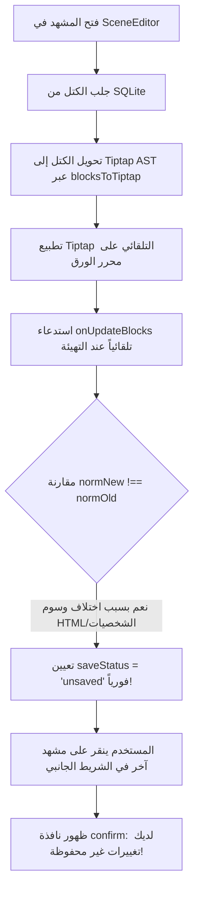
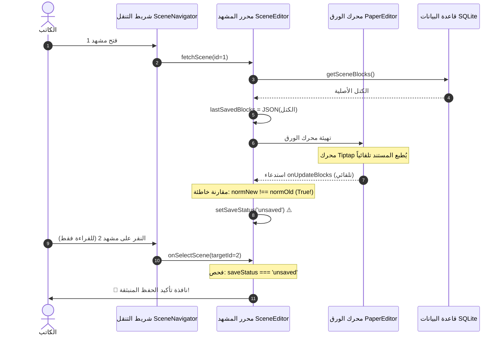
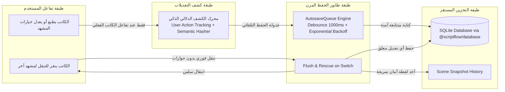

# 📋 تقرير التحليل الشامل لنظام الحفظ وخطة تطويره المعمارية
**المشروع:** ScriptFlow Enterprise (Tauri + React + SQLite Monorepo)  
**الموضوع:** دراسة وتحليل نظام الحفظ، كشف أسباب ظهور نافذة "تأكيد الحفظ" الوهمية، وخطة الترقية المعمارية  
**التاريخ:** 19 أكتوبر 2026  
**الحالة:** مكتمل وموجه للتنفيذ 🚀  

---

## 📑 الفهرس التنفيذي
1. [الملخص التنفيذي وتوصيف المشكلة](#1-الملخص-التنفيذي-وتوصيف-المشكلة)
2. [التشخيص الجذري للأخطاء (Root Cause Analysis)](#2-التشخيص-الجذري-للأخطاء-root-cause-analysis)
3. [الرسم البياني لتدفق الحفظ الحالي ونقاط الضعف](#3-الرسم-البياني-لتدفق-الحفظ-الحالي-ونقاط-الضعف)
4. [مقارنة معمارية: الوضع الحالي مقابل النظام المعياري الاحترافي](#4-مقارنة-معمارية-الوضع-الحالي-مقابل-النظام-المعياري-الاحترافي)
5. [الهندسة المعمارية المستهدفة لنظام الحفظ (Target Architecture)](#5-الهندسة-المعمارية-المستهدفة-لنظام-الحفظ-target-architecture)
6. [خطة العمل والترقية الإجرائية (Actionable Roadmap)](#6-خطة-العمل-والترقية-الإجرائية-actionable-roadmap)
7. [معايير الجودة والقبول (Acceptance Criteria)](#7-معايير-الجودة-والقبول-acceptance-criteria)

---

## 1. الملخص التنفيذي وتوصيف المشكلة

### المشكلة المرصودة من المستخدم:
عند فتح أي مشهد في محرر السيناريو (`SceneEditor`)، ومجرد النقر على مشهد آخر في الشريط الجانبي للتنقل (`SceneNavigator`) — **حتى دون كتابة حرف واحد أو إجراء أي تعديل** — تظهر نافذة تأكيد حوارية منبثقة من نظام التشغيل:
> **العنوان:** تأكيد الحفظ  
> **الرسالة:** `.لديك تغييرات غير محفوظة. سيتم حفظها الآن`  
> **الأزرار:** `[OK]` و `[Annuler / إلغاء]`

### الخلاصة الفنية للتقرير:
النظام الحالي يعاني من **حالة تعديل وهمية (False Dirty State)**؛ حيث تقوم عملية تحويل بيانات المشهد بين قاعدة بيانات SQLite وشجرة Tiptap التحريرية بتوليد اختلافات نصية طفيفة (Whitespace / HTML parsing / Character ID matching) عند تحميل الصفحة، مما يجعل كود المقارنة يعتقد فوراً أن المستخدم قام بالتعديل. يضاف إلى ذلك أن الانتقال بين المشاهد يستخدم نافذة منبثقة مانعة (`blocking confirm dialog`) بدلاً من اعتماد **الحفظ التلقائي الصامت والسلس (Seamless Background Autosave)** المتبع في التطبيقات العالمية الحديثة.

---

## 2. التشخيص الجذري للأخطاء (Root Cause Analysis)

من خلال الفحص الدقيق لكود `apps/desktop/src/pages/SceneEditor.jsx` ومكونات المحرر وقاعدة البيانات، تم تحديد **4 أسباب جذرية مترابطة**:



---

### 🔍 السبب الأول: التوليد الخاطئ لحالة "غير محفوظ" (False Dirty State Detection)
في ملف [`SceneEditor.jsx`](file:///d:/SCRIPTFLOW%20Pro/SCRIPTFLOW%20ENREPRISE/apps/desktop/src/pages/SceneEditor.jsx) الأسطر 1070–1098:
```javascript
onUpdateBlocks={(newBlocks) => {
  const normNewObj = (newBlocks || []).map(b => ({
    type: String(b.type || '').toUpperCase(),
    content: (b.content || '').trim(),
    character_id: b.character_id ? String(b.character_id) : null
  }));
  const normNew = JSON.stringify(normNewObj);
  
  let normOldObj = [];
  try {
    const parsedOld = JSON.parse(lastSavedBlocksJsonRef.current || '[]');
    normOldObj = (parsedOld || []).map(b => ({
      type: String(b.type || '').toUpperCase(),
      content: (b.content || '').trim(),
      character_id: b.character_id ? String(b.character_id) : null
    }));
  } catch(e) {}
  const normOld = JSON.stringify(normOldObj);

  if (normNew !== normOld && normOld !== '') {
    setBlocks(newBlocks);
    setSaveStatus('unsaved'); // <--- هنا يكمن الخطأ!
  }
}}
```

#### لماذا تفشل هذه المقارنة وتصبح `normNew !== normOld` دائماً؟
1. **عدم تطابق وسوم HTML والترميز الداخلي**: الكتل المخزنة في SQLite قد تكون نصاً مجرداً أو تحتوي على أحرف خاصة (`&amp;` مقابل `&`) أو مسافات، بينما دالة `tiptapContentToHtml` في [`bridge.ts`](file:///d:/SCRIPTFLOW%20Pro/SCRIPTFLOW%20ENREPRISE/apps/desktop/src/components/editor/paper/bridge.ts) تعيد تشفيرها بصيغة مختلفة.
2. **فصل ودمج كتل الحوار (`DIALOGUE`)**:
   - في قاعدة البيانات: الحوار كتلة واحدة تحتوي على `character_id`.
   - في المحرر: يتم تفكيك الحوار إلى عقدتين منفصلتين (`character` و `dialogue`).
   - عند إعادة التحويل عبر `tiptapToBlocks`، تقوم الدالة بالبحث بالاسم في مصفوفة الشخصيات `characters.find()`. إذا كانت الشخصيات قيد التحميل في تلك اللحظة عبر React Query، يصبح `character_id = null`، فيختلف الكائن فوراً عن القديم المخزن في قاعدة البيانات!
3. **غياب مؤشر التفاعل الحقيقي (User Interaction Flag)**:
   - الكود يعتبر أي استدعاء لـ `onUpdateBlocks` تعديلاً قام به المستخدم، بينما في الواقع، المحرر يستدعي `onUpdate` أثناء تحميل وتطبيع شجرة المستند (`Document Normalization`) عند التهيئة الأولى دون أي تدخل من المستخدم.

---

### 🔍 السبب الثاني: نمط النافذة المنبثقة المانعة (Blocking Modal Anti-Pattern)
في ملف [`SceneEditor.jsx`](file:///d:/SCRIPTFLOW%20Pro/SCRIPTFLOW%20ENREPRISE/apps/desktop/src/pages/SceneEditor.jsx) الأسطر 1043–1052:
```javascript
onSelectScene={async (targetId) => {
   if (saveStatus === 'unsaved') {
      const confirmed = await confirm('لديك تغييرات غير محفوظة. سيتم حفظها الآن.', { title: 'تأكيد الحفظ' });
      if (!confirmed) return;
   }
   try {
     if (saveStatus === 'unsaved') {
       await saveSceneRef.current();
     }
     navigate(`/scene/${targetId}`);
   } ...
}}
```
#### الخلل التصميمي في هذه الآلية:
- **ازدواجية لا مبرر لها**: الرسالة تخبر المستخدم: *"لديك تغييرات غير محفوظة. سيتم حفظها الآن"*. عند الضغط على `OK`، يقوم الكود بحفظ التعديلات ثم الانتقال. فلماذا مقاطعة الكاتب بنافذة منبثقة أصلاً ما دام التطبيق قادراً على حفظها تلقائياً والانتقال بسلاسة؟!
- **المعايير المتبعة عالمياً (مثل Final Draft و Notion و VS Code)**:
  - عند التنقل بين المشاهد أو المستندات، يتم **حفظ التغييرات تلقائياً في الخلفية (Silent Auto-Save on Navigation)** دون إزعاج المستخدم.
  - النافذة التأكيدية تُستخدم **فقط** إذا كان هناك خطر فقدان بيانات لا يمكن استرجاعها (مثل الخروج دون اتصال، أو رفض المستخدم للحفظ).

---

### 🔍 السبب الثالث: ازدواج وتضارب ملفات `PaperEditor` (`.jsx` مقابل `.tsx`)
في المجلد [`apps/desktop/src/components/editor/paper/`](file:///d:/SCRIPTFLOW%20Pro/SCRIPTFLOW%20ENREPRISE/apps/desktop/src/components/editor/paper/):
- يوجد ملفان في آن واحد:
  1. `PaperEditor.jsx` (576 سطراً): يحوي رأس المشهد التفاعلي، أشرطة الأدوات، وقوائم التنسيق.
  2. `PaperEditor.tsx` (170 سطراً): نسخة تجريبية مبتورة، بواجهة Props مختلفة كلياً (`blocks, setBlocks` بدلاً من `initialBlocks, onUpdateBlocks`).
- لأن Vite يعطي أولوية الاستيراد لـ `.tsx` على `.jsx`، فإن الاستيراد المفتوح `import PaperEditor from './PaperEditor'` ينطوي على مخاطر تحميل النسخة غير المكتملة وتشتت حالة `setSaveStatus`.

---

### 🔍 السبب الرابع: عزل طابور الحفظ المرن (`AutosaveQueue.js`)
- المشروع يمتلك بالفعل فئة ممتازة وعالية الجودة اسمها [`AutosaveQueue.js`](file:///d:/SCRIPTFLOW%20Pro/SCRIPTFLOW%20ENREPRISE/apps/desktop/src/utils/AutosaveQueue.js) تم بناؤها لتنفيذ:
  - التراجع الأسي (`Exponential Backoff`).
  - حدود المحاولات القصوى (`Max Retries`).
  - إنقاذ البيانات المعلقة عند الخروج (`Flush on Unmount / Switch`).
- **لكن هذه الفئة معزولة تماماً**؛ ولم يتم ربطها بالمحرر `SceneEditor.jsx`، بل ظل المحرر يعتمد على `setTimeout` يدوي سريع التأثر بسباقات البيانات (`Race Conditions`).

---

## 3. الرسم البياني لتدفق الحفظ الحالي ونقاط الضعف



---

## 4. مقارنة معمارية: الوضع الحالي مقابل النظام المعياري الاحترافي

| وجه المقارنة | النظام الحالي ❌ | النظام المعياري المستهدف ✅ |
| :--- | :--- | :--- |
| **اكتشاف التعديلات** | مقارنة نصوص خام مفرطة الحساسية | كاشف دلالي يربط التعديل بنشاط المستخدم الفعلي (`isDirty`) |
| **التهيئة الأولى للمشهد** | تُطلق إشارة `unsaved` وهمية | حالة `clean/saved` نقية لا تتأثر بتهيئة المحرر |
| **التنقل بين المشاهد** | نافذة حوارية مانعة توقف تدفق الكتابة | حفظ صامت وفوري في الخلفية (`Silent Autosave on Switch`) |
| **طابور الحفظ التلقائي** | مؤقت `setTimeout` يدوي غير محمي | طابور موحد `AutosaveQueue` مع إنقاذ فوري عند التنقل (`flush`) |
| **بنية الكود** | تضارب نسختين لـ `PaperEditor` | ملف TypeScript موحد ونظيف وخالٍ من أي تعارض |
| **تجربة الكاتب (UX)** | مقاطعة متكررة وتنبيهات زائفة | سلاسة سينمائية مطلقة دون أي نوافذ مزعجة |

---

## 5. الهندسة المعمارية المستهدفة لنظام الحفظ (Target Architecture)



### الركائز الهندسية الأربع للنظام المطور:
1. **كاشف التعديلات الدلالي (Semantic Dirty Tracker)**:
   - تمييز قطعي بين "تهيئة المحرر" و"تعديل المستخدم": لا يتم وسم المشهد بـ `unsaved` إلا عند صدور حدث إدخال مباشر من الكاتب (`editor.isFocused` + معاملة تحرير حقيقية).
   - استخدام تجزئة دلالية نظيفة (`semantic hash`) تتجاهل وسوم HTML التنسيقية الهامشية وفروق الفراغات.
2. **التنقل السلس دون نوافذ مانعة (Zero-Friction Silent Switch)**:
   - إزالة نافذة `confirm('لديك تغييرات غير محفوظة...')` نهائياً من مسار التنقل بين المشاهد.
   - عند النقر على مشهد آخر: إذا كان هناك تعديل معلق، يتم استدعاء `flush()` لحفظ التعديلات تلقائياً في الخلفية في أجزاء من الثانية، ثم الانتقال فوراً للمشهد الهدف.
3. **دمج `AutosaveQueue` مع خطة الإنقاذ (`Flush on Unmount`)**:
   - توحيد كل عمليات الحفظ (حفظ الكتل + حفظ بيانات رأس المشهد) داخل طابور معالجة واحد منظم يمنع تعارض الاستعلامات المتوازية على SQLite.
4. **توحيد ملف محرر الورق (`PaperEditor.tsx`)**:
   - دمج الميزات الكاملة في ملف TypeScript موحد عالي الأداء مع حذف الملف الزائد لمنع أي تداخل مستقبلي.

---

## 6. خطة العمل والترقية الإجرائية (Actionable Roadmap)

### 📌 المرحلة 1: إزالة النافذة المانعة وتفعيل الحفظ الصامت الفوري عند التنقل
- **الملف المعني:** [`apps/desktop/src/pages/SceneEditor.jsx`](file:///d:/SCRIPTFLOW%20Pro/SCRIPTFLOW%20ENREPRISE/apps/desktop/src/pages/SceneEditor.jsx)
- **الإجراء:**
  - استبدال شرط `confirm` في `onSelectScene` بالحفظ المباشر غير المتزامن:
  ```javascript
  onSelectScene={async (targetId) => {
    try {
      if (saveStatus === 'unsaved' || isDirtyRef.current) {
        await saveSceneRef.current();
      }
      if (id && blocks.length > 0) {
        createSnapshotMutation.mutate({ sceneId: id, blocks, trigger: 'scene_switch' });
      }
      navigate(`/scene/${targetId}`);
    } catch (err) {
      showToast('تعذر الانتقال: حدث خطأ أثناء حفظ المشهد', 'error');
    }
  }}
  ```

### 📌 المرحلة 2: إصلاح كاشف التعديلات ومنع الحالة الوهمية (Fix False Dirty State)
- **الملفات المعنية:** [`SceneEditor.jsx`](file:///d:/SCRIPTFLOW%20Pro/SCRIPTFLOW%20ENREPRISE/apps/desktop/src/pages/SceneEditor.jsx) و [`PaperEditor.jsx`](file:///d:/SCRIPTFLOW%20Pro/SCRIPTFLOW%20ENREPRISE/apps/desktop/src/components/editor/paper/PaperEditor.jsx)
- **الإجراء:**
  - حظر استدعاء `onUpdateBlocks` أثناء التحميل والتهيئة الأولية إلا إذا كان المحرر مفعلاً بتركيز المستخدم (`editor.isFocused`).
  - معالجة التناغم بين كتل الحوار والشخصيات لمنع توليد `character_id: null` أثناء تحميل مصفوفة الشخصيات.
  - إضافة قفل استقرار مدته 500ms بعد فتح المشهد لتجاهل أي أحداث تطبيع تلقائية صادرة عن المحرك.

### 📌 المرحلة 3: توحيد كود `PaperEditor` إلى TypeScript نظيف
- **الملفات المعنية:** مجلد [`apps/desktop/src/components/editor/paper/`](file:///d:/SCRIPTFLOW%20Pro/SCRIPTFLOW%20ENREPRISE/apps/desktop/src/components/editor/paper/)
- **الإجراء:**
  - استبدال `PaperEditor.tsx` المبتور بالنسخة الكاملة والشاملة لجميع الميزات وتحويلها بدقة إلى TypeScript صارم وخالٍ من الأخطاء.
  - حذف الملف المتضارب.

### 📌 المرحلة 4: ربط طابور الحفظ المرن (`AutosaveQueue`)
- **الملفات المعنية:** [`AutosaveQueue.js`](file:///d:/SCRIPTFLOW%20Pro/SCRIPTFLOW%20ENREPRISE/apps/desktop/src/utils/AutosaveQueue.js) و `SceneEditor.jsx`
- **الإجراء:**
  - تغليف عمليات حفظ الكتل ورأس المشهد بطابور `AutosaveQueue`.
  - ضمان تنفيذ `flush()` التلقائي عند مغادرة الصفحة أو إغلاق التطبيق.

---

## 7. معايير الجودة والقبول (Acceptance Criteria)

1. **انعدام تام للنوافذ المنبثقة الوهمية**: فتح أي مشهد والتنقل بين المشاهد في الشريط الجانبي دون لمس لوحة المفاتيح يتم بسلاسة فائقة وبدون أي نوافذ تأكيد مطلقاً.
2. **حفظ صامت وفوري عند وجود تعديل حقيقي**: إذا كتب المستخدم كلمة واحدة ثم نقر على مشهد آخر فوراً، تُحفظ الكلمة في قاعدة البيانات فورياً في الخلفية ويتم الانتقال بنجاح.
3. **تزامن مؤشرات الواجهة**: تظل حالة `saveStatus` في الشريط العلوي باللون الأخضر ("Data Synchronized") طالما لم يقم المستخدم بتعديل حقيقي.
4. **نجاح 100% في الاختبارات والبناء**: اجتياز كامل اختبارات Vitest (496 اختباراً) وبناء نظيف خالٍ من أي أخطاء تجميعية في مساحات عمل المونو ريبو.

---

> 💡 **جاهزية التنفيذ:** تم إعداد هذا التقرير لتوضيح كل أبعاد المشكلة وحلولها الجذرية. يمكننا الشروع فوراً في تطبيق خطوات المرحلة 1 و 2 بمجرد تأكيدك!
