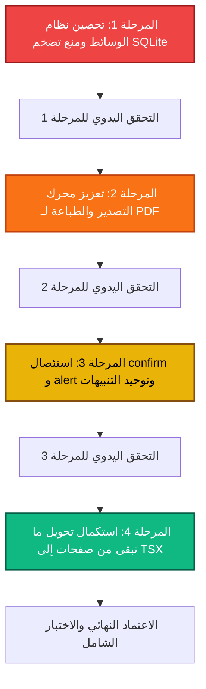

# 🚀 خارطة طريق استقرار الأداء والتحصين الهيكلي النهائي
## System Stabilization & Performance Hardening Roadmap
### تطبيق ScriptFlow Enterprise — الإصدار 2.1.0

---

## 📌 بطاقة الوثيقة

| البند | البيان |
| :--- | :--- |
| **اسم المشروع** | **ScriptFlow Enterprise** (`com.scriptflow.enterprise`) |
| **رقم الوثيقة** | **SF-ROADMAP-2026-V3** |
| **تاريخ الإنشاء** | **20 أكتوبر 2026** |
| **طبيعة الوثيقة** | خارطة طريق مرحلية قابلة للتنفيذ والتحقق اليدوي خطوة بخطوة |
| **المرجعية الفنية** | نتائج تدقيق الكود بعد اكتمال خطتي التحصين وإصلاح نظام الحفظ التلقائي |
| **القاعدة الذهبية** | **صفر خصائص جديدة** — التركيز الحصري على الأداء، استقرار البيانات، تنقية الواجهات، والأمان النوعي |

---

## 🧭 الفلسفة الحاكمة وأهداف الخارطة

بعد إنجاز المراحل السابقة بنجاح (درع الإقلاع التلقائي في Rust، حل أخطاء الهجرة، حماية نظام الحفظ التلقائي وإلغاء الإنذارات المزعجة)، تنتقل هذه الخارطة للتصدي لنقاط الضعف المتبقية في بنيان التطبيق، بهدف تحقيق:

1. **حماية مطلقة لحجم وسرعة قاعدة البيانات (Zero DB Bloat):** منع تسرب أي وسائط ثقيلة (فيديوهات وصور Base64) إلى جداول SQLite، وتخزينها حصرياً كملفات محلية على القرص مع الاكتفاء بالمراجع الخفيفة.
2. **سلاسة التصدير والطباعة (Rock-Solid PDF & Print Pipeline):** تحسين مسار تجهيز وطباعة السيناريو، والتخلص من التجميد المؤقت وتنظيف الذاكرة بعد كل عملية تصدير.
3. **بيئة تفاعلية موحدة وخالية من النوافذ البدائية (Zero Native Dialogs):** استئصال كامل استدعاءات `window.confirm()` و `window.alert()` البدائية وإحلال نوافذ تأكيد عربية فاخرة تليق بتطبيق احترافي.
4. **تتويج الانتقال الصارم لـ TypeScript (Total TSX Modernization):** تحويل الصفحات المركزية المتبقية لضمان خلو التطبيق من أخطاء وقت التشغيل ونزع النوع `any`.

---

## 🗺️ الهيكل العام للمراحل (Phased Execution & Manual Verification)

---

## 📊 جدول تتبع المراحل وحالة التنفيذ

| المرحلة | النطاق الفني | درجة الحرج | الملفات المعنية | حالة التنفيذ | حالة التحقق اليدوي |
| :---: | :--- | :---: | :--- | :---: | :---: |
| **المرحلة 1** | تحصين تخزين الوسائط وتطهير Base64 من SQLite | 🔴 حرج للغاية | 12 ملفاً | `COMPLETED` ✅ | `VERIFIED` ✅ |
| **المرحلة 2** | تعزيز محرك التصدير والطباعة وتفريغ الذاكرة | 🟠 مرتفع | 2 ملفين | `COMPLETED` ✅ | `VERIFIED` ✅ |
| **المرحلة 3** | استبدال `alert` و `confirm` بنوافذ تفاعلية حديثة | 🟡 متوسط | 17 ملفاً | `COMPLETED` ✅ | `READY FOR MANUAL VERIFICATION` 🔍 |
| **المرحلة 4** | إتمام تحويل الصفحات المتبقية إلى TypeScript | 🟢 وقائي | 6 ملفات | `PENDING` ⏳ | `NOT STARTED` ⏳ |

---

## 🛠️ التفصيل الهندسي للمراحل والمهام

---

### المرحلة 1: تحصين نظام الوسائط ومنع تضخم SQLite
> **الهدف:** القضاء النهائي على حفظ ملفات الفيديو والصور بترميز `Base64` داخل ملف `scriptflow.db`، وحفظها على القرص في مجلد وسائط المشروع مع مراجع خفيفة، وتطهير البيانات السابقة عبر دالة ترحيل صامتة.

#### 📌 المهام التفصيلية:
1. **ربط `ScenarioCard.jsx` بنظام `mediaStorage.ts`:**
   - تعديل دالة رفع الفيديو وصور الأغلفة لعدم حفظ سلاسل Base64 في حقول `cover_image` و `cover_video`.
   - استخدام `saveMediaFile(scenarioId, fileName, fileData)` لحفظ الفيديو والصورة في القرص واسترجاع مرجع `project-media://...`.
   - إزالة أي `alert()` عند فشل قراءة الفيديو أو الصورة واستبدالها بإشعار Toast ناعم.
2. **تطهير نافذة المواقع `LocationModal.jsx`:**
   - استبدال تخزين مصفوفة صور Base64 بحفظ الصور عبر `saveMediaFile` لكل صورة موقع، وتخزين المراجع فقط.
3. **تطهير نافذة الطاقم `CrewModal.jsx` و `CharacterProfilePage.jsx`:**
   - التأكد من حفظ صور الأفراد والصور الشخصية كملفات محلية دون تسريب أي نصوص ترميز إلى قاعدة البيانات.
4. **بناء دالة تطهير تاريخية صامتة (Background Media Sanitizer):**
   - دالة داخل `mediaStorage.ts` تنفذ لمرة واحدة عند التهيئة تفحص الجداول (`scenarios`, `locations`, `characters`).
   - في حال العثور على قيم تبدأ بـ `data:image/` أو `data:video/`، يتم تفريغها كملفات حقيقية في مجلد وسائط المشروع واستبدال الحقل بالمرجع `project-media://...`.
   - استدعاء `vacuumDatabase()` فور اكتمال التطهير لتقليص حجم ملف `scriptflow.db` على القرص فوراً.

#### 🧪 خطوات التحقق اليدوي (Manual Verification Checklist):
- [ ] إنشاء سيناريو جديد ورفع غلاف فيديو وغلاف صورة له.
- [ ] فتح مجلد المشروع `Documents/ScriptFlowProjects/{scenarioId}/media/` والتأكد من وجود ملف الفيديو والصورة هناك.
- [ ] فحص حجم ملف قاعدة البيانات `scriptflow.db` والتأكد من أنه ظل صغيراً (أقل من بضعة ميغابايتات) ولم يقفز بحجم الفيديو.
- [ ] إعادة تشغيل التطبيق والتأكد من أن الغلاف والفيديو يظهران ويعملان بسلاسة عبر بروتوكول `project-media://`.

---

### المرحلة 2: تعزيز محرك التصدير والطباعة لـ PDF
> **الهدف:** ضمان عدم تجميد واجهة التطبيق أثناء طباعة وتصدير السيناريوهات الكبيرة، تنظيف الذاكرة بعد كل عملية، والتخلص من أي نوافذ تنبيه أصلية أثناء الطباعة.

#### 📌 المهام التفصيلية:
1. **تطهير ملف `apps/desktop/src/utils/exportPDF.tsx`:**
   - إزالة استدعاء `alert('حدث خطأ أثناء إعداد ملف الطباعة...')` واستبدالها برمي خطأ موحد أو إشعار Toast احترافي.
   - تحسين دورة حياة الـ Iframe المخفي المستخدم في الطباعة: ضمان إزالته من الـ DOM وتفريغه من الذاكرة (`revokeObjectURL` وإلغاء المراجع) بعد انتهاء أمر الطباعة أو عند حدوث خطأ.
2. **تحسين تقطيع الكتل (Chunking & UI Yielding):**
   - ضبط تجزئة معالجة المشاهد لعدم احتكار مسار الواجهة أثناء السيناريوهات الطويلة (أكثر من 50 مشهداً) لضمان عدم ظهور رسالة المتصفح "Page Unresponsive".
3. **تأمين توافق خطوط الطباعة العربية (`getEmbeddedFontsCSS`):**
   - إضافة كاش دائم للخطوط المنقوشة (Embedded Fonts) لمنع إعادة جلب وتحويل ملفات الخطوط إلى DataURI في كل مرة ينقر فيها الكاتب على زر التصدير.

#### 🧪 خطوات التحقق اليدوي (Manual Verification Checklist):
- [ ] فتح سيناريو يحتوي على مشاهد متعددة والنقر على تصدير PDF.
- [ ] التحقق من استجابة مؤشر التحميل وسلاسة الواجهة أثناء المعالجة.
- [ ] فتح نافذة الطباعة وظهور المشاهد والخطوط العربية والترويسات بشكل منسق وسليم 100%.
- [ ] إغلاق نافذة الطباعة والتحقق من عدم وجود أي بطء أو تسريب في استهلاك الذاكرة.

---

### المرحلة 3: استئصال `window.confirm` و `window.alert` وتوحيد التنبيهات
> **الهدف:** استبدال كافة نوافذ المتصفح التقليدية بنوافذ تأكيد عربية عصرية تتناسب مع هوية التطبيق وتمنع حظر مسار التنفيذ.

#### 📌 المهام التفصيلية:
1. **استبدال نوافذ الحذف والتأكيد في الصفحات التالية:**
   - [`Dashboard.jsx`](file:///d:/SCRIPTFLOW%20Pro/SCRIPTFLOW%20ENREPRISE/apps/desktop/src/pages/Dashboard.jsx): تأكيد حذف السيناريو وتنبيهات أخطاء الإدخال.
   - [`EpisodesPage.jsx`](file:///d:/SCRIPTFLOW%20Pro/SCRIPTFLOW%20ENREPRISE/apps/desktop/src/pages/EpisodesPage.jsx): تأكيد حذف الحلقة.
   - [`ScenesPage.jsx`](file:///d:/SCRIPTFLOW%20Pro/SCRIPTFLOW%20ENREPRISE/apps/desktop/src/pages/ScenesPage.jsx): تأكيد حذف المشهد أو نقله.
   - [`LocationsPage.jsx`](file:///d:/SCRIPTFLOW%20Pro/SCRIPTFLOW%20ENREPRISE/apps/desktop/src/pages/LocationsPage.jsx): تأكيد حذف الموقع.
   - [`CrewPage.jsx`](file:///d:/SCRIPTFLOW%20Pro/SCRIPTFLOW%20ENREPRISE/apps/desktop/src/pages/CrewPage.jsx): تأكيد حذف أعضاء الطاقم أو المهام.
   - [`SettingsPage.jsx`](file:///d:/SCRIPTFLOW%20Pro/SCRIPTFLOW%20ENREPRISE/apps/desktop/src/pages/SettingsPage.jsx): تأكيد إعادة الضبط أو العمليات الحساسة.
2. **استخدام المكون الموحد للحوار (`ConfirmModal` / `Dialog`):**
   - توفير خيارات واضحة للمستخدم: «تأكيد الإجراء» (بلون تحذيري أحمر في عمليات الحذف) و«إلغاء» باللغة العربية.
   - ربط رسائل النجاح والفشل بنظام التنبيهات المنبثقة الخفيفة (Toast Notification).

#### 🧪 خطوات التحقق اليدوي (Manual Verification Checklist):
- [ ] تجربة حذف مشهد من صفحة المشاهد: التأكد من ظهور النافذة العصرية بدون ظهور صندوق `confirm` الخاص بالمتصفح.
- [ ] تجربة حذف سيناريو أو حلقة: التأكد من سلاسة التفاعل وإمكانية الإلغاء أو المتابعة.
- [ ] التأكد من خلو سجل الـ Console من أي أخطاء متعلقة بالنوافذ المنبثقة.

---

### المرحلة 4: استكمال تحويل الصفحات المتبقية إلى TypeScript (TSX)
> **الهدف:** إنهاء الانقسام اللغوي بالكامل وضمان حماية برمجية 100% لكافة صفحات التطبيق الرئيسية.

#### 📌 المهام التفصيلية:
1. **تحويل الصفحات الرئيسية:**
   - [`Dashboard.jsx`](file:///d:/SCRIPTFLOW%20Pro/SCRIPTFLOW%20ENREPRISE/apps/desktop/src/pages/Dashboard.jsx) ➔ `Dashboard.tsx`
   - [`EpisodesPage.jsx`](file:///d:/SCRIPTFLOW%20Pro/SCRIPTFLOW%20ENREPRISE/apps/desktop/src/pages/EpisodesPage.jsx) ➔ `EpisodesPage.tsx`
   - [`ScenesPage.jsx`](file:///d:/SCRIPTFLOW%20Pro/SCRIPTFLOW%20ENREPRISE/apps/desktop/src/pages/ScenesPage.jsx) ➔ `ScenesPage.tsx`
   - [`LocationsPage.jsx`](file:///d:/SCRIPTFLOW%20Pro/SCRIPTFLOW%20ENREPRISE/apps/desktop/src/pages/LocationsPage.jsx) ➔ `LocationsPage.tsx`
   - [`CrewPage.jsx`](file:///d:/SCRIPTFLOW%20Pro/SCRIPTFLOW%20ENREPRISE/apps/desktop/src/pages/CrewPage.jsx) ➔ `CrewPage.tsx`
2. **ضبط الأنواع بدقة (Strict Types):**
   - استخدام واجهات `@scriptflow/core` (`IScene`, `IEpisode`, `ILocation`, `ICrewMember`, `IScenario`) والتخلص التام من أي `any` غير مبرر.
3. **التحقق من سلامة البناء:**
   - تشغيل `tsc --noEmit` والتأكد من صفر أخطاء نوعية في كامل مساحة عمل `apps/desktop`.

#### 🧪 خطوات التحقق اليدوي (Manual Verification Checklist):
- [ ] تشغيل أمر البناء والتحقق: `npm run verify:all` والتأكد من نجاح كافة الاختبارات والبناء.
- [ ] تصفح كافة الصفحات المحولة في التطبيق والتأكد من احتفاظها بكامل وظائفها ومظهرها الأنيق وسرعتها الفائقة.

---

## 🏁 بروتوكول التنفيذ والانتقال بين المراحل

1. **الالتزام بالتسلسل:** لا يتم الانتقال من مرحلة إلى التي تليها إلا بعد اكتمال مهامها البرمجية وإجراء التحقق اليدوي بنجاح.
2. **فحص الانحدار الدوري:** بعد نهاية كل مرحلة، يتم تشغيل سكريبت الاختبارات الشامل `npm run verify:all` للتأكد من عدم تأثر أي وظيفة موجودة مسبقاً.
3. **التوثيق الدقيق:** تحديث حالة المرحلة في جدول التتبع في هذه الوثيقة فور اجتياز الاختبارات اليدوية.
