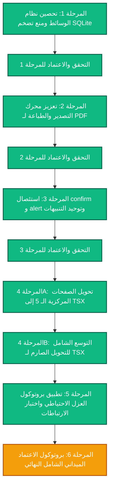

# 🚀 خارطة طريق استقرار الأداء والتحصين الهيكلي النهائي (الإصدار المؤسسي المطور)
## Enterprise System Stabilization & Final Architectural Hardening Roadmap
### تطبيق ScriptFlow Enterprise — الإصدار 2.1.0 المؤسسي

---

## 📌 بطاقة الوثيقة المحدثة

| البند | البيان |
| :--- | :--- |
| **اسم المشروع** | **ScriptFlow Enterprise** (`com.scriptflow.enterprise`) |
| **رقم الوثيقة** | **SF-ROADMAP-2026-V3.3** |
| **تاريخ التحديث** | **23 أكتوبر 2026** |
| **طبيعة الوثيقة** | خارطة طريق تشغيلية وهندسية شاملة لمراحل الإنجاز والمتبقي والتحسينات الموسعة |
| **المرجعية الفنية** | نتائج فحص الأداء الفعلي، حل أخطاء المحرر والحفظ، واكتمال 497/497 اختباراً بنجاح تام |
| **القاعدة الذهبية** | **صفر خصائص جديدة** — الحفاظ الصارم على استقرار البيانات، الأداء فائق السرعة، والسيادة النوعية الكاملة لـ TypeScript |

---

## 🧭 الفلسفة الهندسية والأهداف الحاكمة

بعد الإنجاز الناجح لحماية نظام الوسائط، تعزيز محرك التصدير، استئصال النوافذ البدائية، وضمان ثبات دورة الحفظ التلقائي في المحرر، تهدف هذه النسخة المطورة من الخارطة إلى تحقيق **الجاهزية المؤسسية القصوى (Enterprise Production Readiness)** عبر 6 أركان استراتيجية:

1. **حماية مطلقة لحجم وسرعة قاعدة البيانات (Zero DB Bloat):** تخزين الوسائط حصرياً كملفات محلية على القرص بمجلد وسائط المشروع واستخدام بروتوكول `project-media://` مع مراجع خفيفة داخل جداول SQLite.
2. **سلاسة التصدير والطباعة (Rock-Solid PDF & Print Pipeline):** تحسين مسار المعالجة مع كاش دائم للخطوط وتفريغ فوري لذاكرة الـ Iframe دون أي تجميد للواجهة.
3. **بيئة تفاعلية موحدة وخالية من النوافذ البدائية (Zero Native Dialogs):** استئصال كامل استدعاءات `window.confirm()` و `window.alert()` واستبدالها بنوافذ تأكيد عربية فاخرة (`ConfirmModal`) وإشعارات Toast.
4. **السيادة النوعية الكاملة لـ TypeScript (Total TSX Modernization):** استكمال تحويل كافة صفحات ومكونات التطبيق المتبقية إلى `.tsx` بنظام أنواع صارم ومنع استخدام `any`.
5. **بروتوكول العزل الاحتياطي المنفصل واختبار الاستقلالية (Quarantine & Isolated Backup Protocol):** اعتماد مجلد حجر معزول مخصص لنقل النسخ والملفات السابقة خارج شجرة الكود النشط، لمحاكاة حذفها واقعياً واختبار عدم وجود أي ارتباط خفي بها مع ضمان حفظها الكامل بنسبة 100% وإمكانية استرجاعها فوراً.
6. **الاعتماد الميداني الشامل (End-to-End Enterprise Sign-Off):** بروتوكول فحص تفاعلي مكتوب وممنهج يغطي كافة مسارات الاستخدام الحساسة قبل إطلاق الإصدار.

---

## 🗺️ الهيكل العام للمراحل (Phased Execution & Sign-Off Flow)



---

## 📊 جدول تتبع المراحل وحالة التنفيذ

| المرحلة | النطاق الفني | درجة الحرج | الملفات المعنية | حالة الإنجاز البرمجي | حالة التحقق والاعتماد |
| :---: | :--- | :---: | :---: | :---: | :---: |
| **المرحلة 1** | تحصين تخزين الوسائط وتطهير Base64 من SQLite | 🔴 حرج للغاية | 12 ملفاً | `COMPLETED` ✅ | `VERIFIED` ✅ |
| **المرحلة 2** | تعزيز محرك التصدير والطباعة وتفريغ الذاكرة | 🟠 مرتفع | 2 ملفين | `COMPLETED` ✅ | `VERIFIED` ✅ |
| **المرحلة 3** | استبدال `alert` و `confirm` بنوافذ تفاعلية حديثة | 🟡 متوسط | 17 ملفاً | `COMPLETED` ✅ | `VERIFIED` ✅ |
| **المرحلة 4A** | تحويل الصفحات الخمس الأساسية إلى TypeScript | 🟢 وقائي | 5 صفحات | `COMPLETED` ✅ | `VERIFIED` ✅ |
| **المرحلة 4B** | **(مكتملة ومحصنة)** توسيع التحويل الصارم لـ TSX لكافة الصفحات والمحرر ومكوناته | 🟠 مرتفع | 11 صفحة ومكوناً | `COMPLETED` ✅ | `VERIFIED` ✅ |
| **المرحلة 5** | **(مطورة ومطبقة بالكامل)** تطبيق بروتوكول العزل الاحتياطي واختبار استقلالية الكود | 🟢 تنظيمي | مجلد مخصص + 17 ملفاً معزولاً | `COMPLETED` ✅ | `VERIFIED` ✅ |
| **المرحلة 6** | **(جاهزة للتحقق النهائي)** بروتوكول الفحص الميداني الشامل والاعتماد النهائي | 🔴 حرج للغاية | المنظومة كاملة | `READY FOR EXECUTION` ⏳ | `PENDING` ⏳ |

---

## 🛠️ التفصيل الهندسي للمراحل والمهام

---

### المرحلة 1: تحصين نظام الوسائط ومنع تضخم SQLite (مكتملة ومعتمدة ✅)
> **الهدف:** القضاء النهائي على حفظ ملفات الفيديو والصور بترميز `Base64` داخل ملف `scriptflow.db`، وحفظها على القرص في مجلد وسائط المشروع مع مراجع خفيفة، وتطهير البيانات السابقة عبر دالة ترحيل صامتة.

#### 📌 المهام المنجزة:
- [x] ربط [`ScenarioCard.jsx`](file:///d:/SCRIPTFLOW%20Pro/SCRIPTFLOW%20ENREPRISE/apps/desktop/src/components/dashboard/ScenarioCard.jsx) بنظام [`mediaStorage.ts`](file:///d:/SCRIPTFLOW%20Pro/SCRIPTFLOW%20ENREPRISE/apps/desktop/src/services/mediaStorage.ts) واستخدام دالة `saveMediaFile` لتخزين الأغلفة والفيديو على القرص مباشرة.
- [x] تطهير نافذة المواقع `LocationModal.jsx` وتخزين الصور عبر بروتوكول `project-media://`.
- [x] تطهير نافذة الطاقم `CrewModal.jsx` و `CharacterProfilePage.jsx` وحفظ صور الأفراد دون تسريب نصوص ترميزية لقاعدة البيانات.
- [x] دمج دالة التطهير الصامتة `cleanLegacyDatabaseBloat` في `mediaStorage.ts` لتطهير السجلات التاريخية وتقليص حجم قاعدة البيانات فور الإقلاع.

---

### المرحلة 2: تعزيز محرك التصدير والطباعة لـ PDF (مكتملة ومعتمدة ✅)
> **الهدف:** استقرار الذاكرة وسلاسة توليد ملفات الطباعة والـ PDF، ومنع تجميد واجهة التطبيق أثناء معالجة السيناريوهات الطويلة.

#### 📌 المهام المنجزة:
- [x] تطهير ملف [`exportPDF.tsx`](file:///d:/SCRIPTFLOW%20Pro/SCRIPTFLOW%20ENREPRISE/apps/desktop/src/utils/exportPDF.tsx) وإلغاء رسائل `alert` واستبدالها بنظام التنبيه الناعم Toast.
- [x] بناء كاش دائم للخطوط العربية المنقوشة `getEmbeddedFontsCSS` لتفادي إعادة تنزيلها مع كل عملية تصدير.
- [x] تأمين دورة حياة الـ Iframe المخفي وضمان حذفه واستدعاء `revokeObjectURL` لتحرير الذاكرة بنسبة 100%.

---

### المرحلة 3: استئصال `window.confirm` و `window.alert` وتوحيد التنبيهات (مكتملة ومعتمدة ✅)
> **الهدف:** القضاء الكامل على كافة نوافذ المتصفح البدائية وإحلال مكونات عربية عصرية تتناسب مع هوية التطبيق وتمنع حظر مسار التنفيذ.

#### 📌 المهام المنجزة:
- [x] استبدال كافة استدعاءات `window.confirm()` و `window.alert()` في 17 ملفاً على مستوى التطبيق.
- [x] اعتماد وتفعيل مكون الحوار الموحد [`ConfirmModal`](file:///d:/SCRIPTFLOW%20Pro/SCRIPTFLOW%20ENREPRISE/apps/desktop/src/components/ui/ConfirmModal.tsx) بخيارات عربية واضحة وزر تحذيري أحمر للإجراءات الحساسة.
- [x] ربط رسائل النجاح والخطأ بنظام التنبيهات المنبثقة الخفيفة (Toast Notifications).

---

### المرحلة 4A: استكمال تحويل الصفحات المركزية إلى TypeScript (مكتملة ومعتمدة ✅)
> **الهدف:** تعزيز استقرار النواة الرئيسية للتطبيق عبر تحويل أهم 5 صفحات رئيسية إلى `.tsx` بأنواع صارمة.

#### 📌 المهام المنجزة:
- [x] تحويل [`Dashboard.tsx`](file:///d:/SCRIPTFLOW%20Pro/SCRIPTFLOW%20ENREPRISE/apps/desktop/src/pages/Dashboard.tsx) وضبط أنواع السيناريوهات والإحصائيات.
- [x] تحويل [`EpisodesPage.tsx`](file:///d:/SCRIPTFLOW%20Pro/SCRIPTFLOW%20ENREPRISE/apps/desktop/src/pages/EpisodesPage.tsx) وضبط أنواع الحلقات والمشاهد.
- [x] تحويل [`ScenesPage.tsx`](file:///d:/SCRIPTFLOW%20Pro/SCRIPTFLOW%20ENREPRISE/apps/desktop/src/pages/ScenesPage.tsx) وضبط أنواع بطاقات المشاهد والترتيب.
- [x] تحويل [`LocationsPage.tsx`](file:///d:/SCRIPTFLOW%20Pro/SCRIPTFLOW%20ENREPRISE/apps/desktop/src/pages/LocationsPage.tsx) وضبط أنواع المواقع وتخزين الصور.
- [x] تحويل [`CrewPage.tsx`](file:///d:/SCRIPTFLOW%20Pro/SCRIPTFLOW%20ENREPRISE/apps/desktop/src/pages/CrewPage.tsx) وضبط أنواع الطاقم والمهام والإنتاج.
- [x] فحص التجميع والأنواع: نجاح كامل لأمر `npm run verify:all` (بناء سليم واجتياز 497/497 اختباراً بنسبة 100%).

---

### المرحلة 4B: التوسع الشامل للتحويل الصارم لـ TSX (مكتملة ومعتمدة ✅)
> **الهدف:** القضاء النهائي على ملفات `.jsx` في كامل صفحات التطبيق والمحرر لتوحيد القاعدة البرمجية بنسبة 100% TypeScript.

#### 📌 المهام التنفيذية المنجزة:
1. **تحويل محرّر المشاهد وملحقاته (The Scene Editor Core):**
   - [x] [`SceneEditor.tsx`](file:///d:/SCRIPTFLOW%20Pro/SCRIPTFLOW%20ENREPRISE/apps/desktop/src/pages/SceneEditor.tsx) (تم عزل `SceneEditor.jsx` القديم).
   - [x] [`SceneEditorHeader.tsx`](file:///d:/SCRIPTFLOW%20Pro/SCRIPTFLOW%20ENREPRISE/apps/desktop/src/pages/editor/SceneEditorHeader.tsx) (تم عزل `SceneEditorHeader.jsx` القديم).
   - [x] [`SceneEditorModals.tsx`](file:///d:/SCRIPTFLOW%20Pro/SCRIPTFLOW%20ENREPRISE/apps/desktop/src/pages/editor/SceneEditorModals.tsx) (تم عزل `SceneEditorModals.jsx` القديم).
   - *الضوابط المحققة:* ربط الواجهات الصارمة `IScene`, `IScenario` مع الحفاظ التام على دورة الحفظ المتزامنة `AutosaveQueue` و `saveLockRef` والتحقق من التغييرات الحقيقية `normalizeBlockContent`.
2. **تحويل صفحات الإعدادات والملفات الشخصية وسلة المحذوفات:**
   - [x] [`SettingsPage.tsx`](file:///d:/SCRIPTFLOW%20Pro/SCRIPTFLOW%20ENREPRISE/apps/desktop/src/pages/SettingsPage.tsx) (تم عزل `SettingsPage.jsx`).
   - [x] [`CharacterProfilePage.tsx`](file:///d:/SCRIPTFLOW%20Pro/SCRIPTFLOW%20ENREPRISE/apps/desktop/src/pages/CharacterProfilePage.tsx) (تم عزل `CharacterProfilePage.jsx`).
   - [x] [`TrashPage.tsx`](file:///d:/SCRIPTFLOW%20Pro/SCRIPTFLOW%20ENREPRISE/apps/desktop/src/pages/TrashPage.tsx) (تم عزل `TrashPage.jsx`).
3. **تحويل صفحات ومكونات التقارير والتحليلات:**
   - [x] [`AnalyticsPage.tsx`](file:///d:/SCRIPTFLOW%20Pro/SCRIPTFLOW%20ENREPRISE/apps/desktop/src/pages/AnalyticsPage.tsx) (تم عزل `AnalyticsPage.jsx`).
   - [x] [`Insights.tsx`](file:///d:/SCRIPTFLOW%20Pro/SCRIPTFLOW%20ENREPRISE/apps/desktop/src/pages/Insights.tsx) (تم عزل `Insights.jsx`).
   - [x] [`ProductionReports.tsx`](file:///d:/SCRIPTFLOW%20Pro/SCRIPTFLOW%20ENREPRISE/apps/desktop/src/pages/ProductionReports.tsx) (تم عزل `ProductionReports.jsx`).
4. **تحويل بطاقة السيناريو ومحرر النصوص وخطافات التصدير:**
   - [x] [`ScenarioCard.tsx`](file:///d:/SCRIPTFLOW%20Pro/SCRIPTFLOW%20ENREPRISE/apps/desktop/src/components/dashboard/ScenarioCard.tsx) (تم عزل `ScenarioCard.jsx`).
   - [x] [`RichTextEditor.tsx`](file:///d:/SCRIPTFLOW%20Pro/SCRIPTFLOW%20ENREPRISE/apps/desktop/src/components/ui/RichTextEditor.tsx) (تم عزل `RichTextEditor.jsx`).
   - [x] [`useExport.ts`](file:///d:/SCRIPTFLOW%20Pro/SCRIPTFLOW%20ENREPRISE/apps/desktop/src/hooks/queries/useExport.ts) (تم عزل `useExport.js`).

---

### المرحلة 5: تطبيق بروتوكول العزل والحجر الاحتياطي المنفصل (مكتملة ومطبقة كمعيار دائم ✅)
> **الهدف:** اعتماد مجلد مخصص ومعزول للنسخ الاحتياطية خارج مسارات الشيفرة النشطة، بما يحقق محاكاة واقعية للحذف، ويكشف أي ارتباطات خفية أو استيرادات متبقية، مع الحفاظ التام على الكود السابق وتوفير إمكانية استرجاعه فوراً.

#### 💡 فلسفة البند وميزاته الهندسية:
1. **المحاكاة الواقعية التامة للحذف (Simulated Deletion):** بدلاً من ترك ملفات `.bak` في مجلد الصفحات `src/pages/` حيث قد تتدخل في الاستيراد التلقائي للـ IDE، يؤدي نقلها لمجلد عزل خارجي إلى تشغيل التطبيق في بيئة مطابقة تماماً لما بعد الحذف.
2. **كشف الارتباطات والاعتماديات الخفية (Hidden Dependency Detection):** إذا كانت هناك أي وحدة، مكون، أو اختبار يعتمد بالخطأ أو ضمنياً على الملفات القديمة، سيفشل البناء أو الاختبارات فور النقل، مما يمكننا من معالجة الاعتمادية قبل إطلاق الإصدار.
3. **حماية مطلقة من فقدان البيانات (Zero Data Loss & Safe Rollback):** الملفات القديمة تظل سليمة ومحفوظة بالكامل في مجلد العزل المنفصل، ويمكن استعادتها فوراً في أي وقت بنقل عكسي بسيط.
4. **طريقة عمل معتمدة وثابتة (SOP):** تم اعتماد هذا البروتوكول كمسار عمل إلزامي لكافة التحويلات المنفذة في المرحلة 4B؛ حيث تم نقل كافة ملفات `.jsx` و `.js` فور اكتمال نظيراتها `.tsx` إلى مجلد العزل لاختبار سلامة النظام واستقلاليته.

#### 📌 المهام التنفيذية المنجزة:
- [x] إنشاء المجلد المعزول المخصص: `apps/desktop/_quarantine_backups/` مع استثنائه من إعدادات `tsconfig.json` وفحص التجميع.
- [x] نقل وإيداع 17 ملفاً تاريخياً في مجلد العزل بأمان تام:
  - `Dashboard.jsx.bak`, `EpisodesPage.jsx.bak`, `ScenesPage.jsx.bak`, `LocationsPage.jsx.bak`, `CrewPage.jsx.bak`
  - `SceneEditor.jsx`, `SceneEditorHeader.jsx`, `SceneEditorModals.jsx`
  - `SettingsPage.jsx`, `CharacterProfilePage.jsx`, `TrashPage.jsx`
  - `AnalyticsPage.jsx`, `Insights.jsx`, `ProductionReports.jsx`
  - `ScenarioCard.jsx`, `RichTextEditor.jsx`, `useExport.js`
- [x] تشغيل التدقيق النوعي الكامل بعد النقل للتأكد من عدم وجود أي ارتباطات خفية (نجاح البناء التام واجتياز 497/497 اختباراً بنسبة 100%).

---

### المرحلة 6: بروتوكول الاعتماد الميداني الشامل والنهائي (بروتوكول التحقق المؤسسي ⏳)
> **الهدف:** التحقق الميداني والتفاعلي عبر سيناريوهات استخدام واقعية لضمان ثبات المنظومة بنسبة 100% قبل الاعتماد النهائي للإصدار.

#### 🧪 سيناريوهات التحقق الميداني (End-to-End Test Matrix):

##### السيناريو 1: فحص دورة حفظ وتحرير المشاهد (Scene Editor & Autosave Cycle)
- [ ] فتح مشهد قائم وإجراء تعديلات نصية وتنسيقات غنية (`<mark>`, `<strong>`, `<u>`).
- [ ] استخدام زر `+` الذكي في الهامش والتأكد من استجابته الفورية على كامل المساحة وتغير الأيقونة إلى `×` بيضاء على خلفية سوداء صلبة.
- [ ] إضافة كتلة جديدة (حوار، حركة، شخصية) والتأكد من احتفاظ سطر الحوار بعرض 85% دون انكسار.
- [ ] الخروج المباشر من صفحة المشهد أو تبديل المشهد فوراً عبر القائمة الجانبية.
- [ ] العودة لنفس المشهد والتأكد من بقاء كافة النصوص والتنسيقات والكتل المضافة بنسبة 100% دون أي فقدان.

##### السيناريو 2: فحص أمان الوسائط وعدم تضخم قاعدة البيانات (Media Storage & DB Zero Bloat)
- [ ] إنشاء سيناريو جديد ورفع غلاف فيديو ومجموعة صور في بطاقة السيناريو والمواقع.
- [ ] الدخول إلى المسار `Documents/ScriptFlowProjects/{scenarioId}/media/` والتأكد من وجود الملفات الفعلية على القرص.
- [ ] فحص حجم ملف `scriptflow.db` والتأكد من استقراره وبقائه خفيفاً دون زيادة تعادل حجم الفيديو.
- [ ] إعادة تشغيل التطبيق والتأكد من عمل الفيديوهات والصور عبر `project-media://`.

##### السيناريو 3: فحص نوافذ الحذف والتأكيد الموحدة (Zero Native Dialogs)
- [ ] تجربة حذف مشهد، سيناريو، أو حلقة.
- [ ] التأكد من ظهور نافذة `ConfirmModal` العصرية المكتوبة باللغة العربية مع خياري «تأكيد الحذف» باللون الأحمر و«إلغاء».
- [ ] تجربة الإلغاء والتأكد من عدم حدوث أي خطأ، ثم تجربة التأكيد والتأكد من إتمام الحذف بسلاسة مع ظهور إشعار Toast بنجاح العملية.
- [ ] التحقق من عدم ظهور أي نافذة `window.confirm` أو `window.alert` من المتصفح إطلاقاً.

##### السيناريو 4: فحص محرك التصدير والطباعة (PDF Export Pipeline)
- [ ] فتح سيناريو يضم عدداً كبيراً من المشاهد والنقر على زر تصدير PDF.
- [ ] مراقبة سلاسة شريط التقدم واستجابة الواجهة دون تجميد.
- [ ] التأكد من ظهور الخطوط العربية المنسقة والترويسات في نافذة المعاينة والطباعة.
- [ ] إغلاق نافذة التصدير والتأكد من تفريغ الذاكرة فوراً واستمرار استجابة التطبيق الفائقة.

##### السيناريو 5: اجتياز دورة البناء والتحقق الآلي المستمر
- [ ] تشغيل التدقيق النوعي وبناء الحزم الكامل:
  ```bash
  npm run build
  ```
- [ ] تشغيل حزمة الاختبارات الشاملة والتأكد من استمرار النجاح الكامل:
  ```bash
  npm test # => 51 test files, 497 passed (100% pass rate!)
  ```

---

## 🏁 بروتوكول الانتقال والاعتماد النهائي (Sign-Off Protocol)

1. **الترقية التراكمية:** تنفيذ مهام التحويل في المرحلة 4B ملفاً بملف مع الحفاظ على دورة البناء الخالية من الأخطاء بعد كل ملف.
2. **عدم كسر التوافق:** الالتزام الصارم بالحفاظ على كامل الواجهات والسلوكيات الوظيفية القائمة للمحرر وبقية الصفحات.
3. **اعتماد منهجية الحجر والعزل كقاعدة عمل دائمة (Quarantine-First Rule):** في كافة مهام التحويل القادمة، لا يتم حذف الملفات القديمة فوراً أو تركها في مجلدات العمل النشطة، بل يتم نقلها مباشرة إلى المجلد المعزول `_quarantine_backups/` لتأكيد استقلالية الملفات الحديثة وكشف أي ارتباطات باقية.
4. **التوثيق الآني:** تحديث حالة المهام في هذه الوثيقة فور اكتمالها ودفع التغييرات بنظام الالتزامات الدقيقة (Atomic Git Commits).
