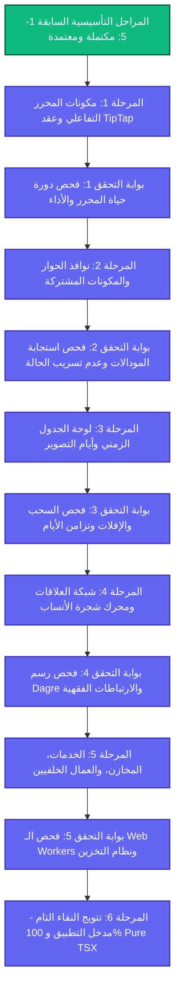

# 🏛️ وثيقة خطة تصفية الديون البرمجية والتحويل الكامل للمنظومة إلى TypeScript 100%
## (Enterprise Technical Debt Elimination & Pure TSX Modernization Roadmap)

> **الإصدار:** 1.0.0 — Enterprise Standard  
> **تاريخ التأسيس:** 2026-10-26  
> **المستهدف الأساسي:** الوصول بتطبيق ScriptFlow Enterprise إلى نقاء برمجي تام 100% TypeScript/TSX مع استئصال كافة ملفات `.jsx` و `.js` المتبقية وتأمين دورات العمل بدون أي انكسارات وظيفية.  
> **المرجع التأسيسي السابق:** [`SYSTEM_STABILIZATION_AND_PERFORMANCE_ROADMAP.md`](file:///d:/SCRIPTFLOW%20Pro/SCRIPTFLOW%20ENREPRISE/SYSTEM_STABILIZATION_AND_PERFORMANCE_ROADMAP.md) (المراحل 1 - 5 مكتملة ومعتمدة بنجاح).

---

## 🧭 الرؤية الهندسية وأهداف الخطة

بعد اكتمال تحويل كافة **الصفحات الأساسية (12 صفحة)** ونواة المحرر الرئيسية ومحرك التصدير وحفظ الوسائط بنجاح تام، يركز هذا المخطط على **تصفية الديون البرمجية التراكمية (Technical Debts)** المتبقية في:
1. مكونات المحرر التفاعلية وعقد الكتابة السينمائية (TipTap Paper Nodes).
2. نوافذ الحوار والتشغيل المشتركة (Shared Modals & Dialogs).
3. لوحة الجداول الزمنية وإدارة أيام التصوير (Timeline & Call Sheets).
4. شبكة العلاقات الأسرية ومحرك المواريث والرسوم البيانية (Pedigree & Relationship Feature).
5. مخازن الحالة، الخدمات، عمال المعالجة الخلفية، ونقاط الدخول الرئيسية للمنظومة (`App.tsx` & `main.tsx`).

---

## 🛡️ المبادئ الصارمة للتحويل (Architectural Tenets)

> [!IMPORTANT]
> **بروتوكول العزل المسبق الإلزامي (Quarantine-First Protocol):**
> لا يُحذف أي ملف `.jsx` أو `.js` مباشرة؛ بل يُنقل فور اكتمال نظيره `.tsx` إلى مجلد العزل المنفصل [`apps/desktop/_quarantine_backups/`](file:///d:/SCRIPTFLOW%20Pro/SCRIPTFLOW%20ENREPRISE/apps/desktop/_quarantine_backups/). هذا يضمن:
> 1. صفر فقدان للبيانات والشيفرات مع إمكانية التراجع الفوري (Safe Rollback).
> 2. كشف أي ارتباطات ضمنية قديمة فوراً عند تشغيل التدقيق.
> 3. تشغيل التطبيق في بيئة واقعية ومطابقة تماماً لما بعد الحذف.

> [!TIP]
> **بوابة التحقق النوعي الآلي (Zero-Regression Quality Gate):**
> لا تُعتمد أي مرحلة حتى يجتاز الكود:
> * فحص الأنواع الصارم: `npx --workspace=@scriptflow/desktop tsc --noEmit` بـ 0 أخطاء.
> * فحص حزمة الاختبارات الكاملة: `npm run verify:all` (497/497 اختباراً بنسبة نجاح 100%).
> * بناء حزم الإنتاج: `npm run build` بنجاح كامل وسرعة قياسية.

---

## 🗺️ الهيكل العام ومسار المراحل (Phased Modernization Flow)



---

## 📊 جدول تتبع المراحل وحالة التنفيذ

| المرحلة | النطاق الفني المستهدف | درجة الأهمية | عدد الملفات | حالة البرمجة | حالة الاعتماد |
| :---: | :--- | :---: | :---: | :---: | :---: |
| **المرحلة 1** | مكونات المحرر التفاعلي وعقد الكتابة السينمائية | 🔴 حرج للغاية | 18 ملفاً | `COMPLETED` ✅ | `VERIFIED` ✅ |
| **المرحلة 2** | نوافذ الحوار والمودالات والمكونات المشتركة | 🟠 مرتفع | 17 ملفاً | `PLANNED` ⏳ | `PENDING` ⏳ |
| **المرحلة 3** | نظام الجدول الزمني وإدارة أيام التصوير | 🟠 مرتفع | 9 ملفات | `PLANNED` ⏳ | `PENDING` ⏳ |
| **المرحلة 4** | شبكة العلاقات الأسرية ومحرك شجرة الأنساب | 🟡 متوسط | 14 ملفاً | `PLANNED` ⏳ | `PENDING` ⏳ |
| **المرحلة 5** | الخدمات، المخازن العامة، والعمال الخلفيون (Workers) | 🟢 وقائي | 16 ملفاً | `PLANNED` ⏳ | `PENDING` ⏳ |
| **المرحلة 6** | تتويج النقاء التام: مداخل التطبيق ونقاء الـ Monorepo | 🔴 حرج | ملفين + الإعدادات | `PLANNED` ⏳ | `PENDING` ⏳ |

---

## 🛠️ التفصيل الهندسي والتنفيذي للمراحل

---

### المرحلة 1: مكونات المحرر التفاعلي وعقد الكتابة السينمائية (The Editor Core Cluster) - [مكتملة ومعتمدة ✅]
> **الهدف:** استكمال تحويل المكونات الفرعية التابعة لمحرر المشاهد الورقي والذكي، مع الحفاظ الصارم على قياسات الصفحات والتقطيع ودقة الكتابة التلقائية.

#### 📌 الملفات المستهدفة:
1. **مكونات المحرر الفرعية (`apps/desktop/src/components/editor/`):**
   - [x] [`SmartEditor.jsx`](file:///d:/SCRIPTFLOW%20Pro/SCRIPTFLOW%20ENREPRISE/apps/desktop/src/components/editor/SmartEditor.jsx) ➔ `SmartEditor.tsx` (ضبط أنواع الكتل والاختصارات والتنقل).
   - [x] [`SceneNavigator.jsx`](file:///d:/SCRIPTFLOW%20Pro/SCRIPTFLOW%20ENREPRISE/apps/desktop/src/components/editor/SceneNavigator.jsx) ➔ `SceneNavigator.tsx` (ضبط مصغرات المشاهد ومؤشرات الصفحات المحسوبة).
   - [x] [`SceneMetadataForm.jsx`](file:///d:/SCRIPTFLOW%20Pro/SCRIPTFLOW%20ENREPRISE/apps/desktop/src/components/editor/SceneMetadataForm.jsx) ➔ `SceneMetadataForm.tsx` (ضبط حقول المشهد وتحديد المواقع والشخصيات).
   - [x] [`SceneTasksBoard.jsx`](file:///d:/SCRIPTFLOW%20Pro/SCRIPTFLOW%20ENREPRISE/apps/desktop/src/components/editor/SceneTasksBoard.jsx) ➔ `SceneTasksBoard.tsx` (إدارة مهام الإنتاج الخاصة بالمشهد).
   - [x] [`SceneRemindersModal.jsx`](file:///d:/SCRIPTFLOW%20Pro/SCRIPTFLOW%20ENREPRISE/apps/desktop/src/components/editor/SceneRemindersModal.jsx) ➔ `SceneRemindersModal.tsx`.
   - [x] [`ToneSelector.jsx`](file:///d:/SCRIPTFLOW%20Pro/SCRIPTFLOW%20ENREPRISE/apps/desktop/src/components/editor/ToneSelector.jsx) ➔ `ToneSelector.tsx`.
   - [x] [`WorkspaceCanvas.jsx`](file:///d:/SCRIPTFLOW%20Pro/SCRIPTFLOW%20ENREPRISE/apps/desktop/src/components/editor/WorkspaceCanvas.jsx) ➔ `WorkspaceCanvas.tsx`.
   - [x] [`paper/TabMenu.jsx`](file:///d:/SCRIPTFLOW%20Pro/SCRIPTFLOW%20ENREPRISE/apps/desktop/src/components/editor/paper/TabMenu.jsx) ➔ `TabMenu.tsx`.
   - [x] [`paper/extensions/CharacterNodeView.jsx`](file:///d:/SCRIPTFLOW%20Pro/SCRIPTFLOW%20ENREPRISE/apps/desktop/src/components/editor/paper/extensions/CharacterNodeView.jsx) ➔ `CharacterNodeView.tsx`.
2. **عقد TipTap وملحقات التنسيق (`apps/desktop/src/components/editor/paper/extensions/*.js`):**
   - [x] `ActionNode.js` ➔ `ActionNode.ts`
   - [x] `DialogueNode.js` ➔ `DialogueNode.ts`
   - [x] `CharacterNode.js` ➔ `CharacterNode.ts`
   - [x] `ParentheticalNode.js` ➔ `ParentheticalNode.ts`
   - [x] `TransitionNode.js` ➔ `TransitionNode.ts`
   - [x] `ShotNode.js` ➔ `ShotNode.ts`
   - [x] `DirectorNoteNode.js` ➔ `DirectorNoteNode.ts`
   - [x] `AudioNode.js` ➔ `AudioNode.ts`
   - [x] `TextNode.js` ➔ `TextNode.ts`
   - [x] `PaginationExtension.js` ➔ `PaginationExtension.ts`
   - [x] `TabMenuExtension.js` ➔ `TabMenuExtension.ts`

---

### المرحلة 2: نوافذ الحوار والمكونات المشتركة (Shared Dialogs & UI Modals)
> **الهدف:** توحيد كافة النوافذ المنبثقة المستخدمة في إدارة الشخصيات والمواقع والحلقات والمشاهد، مع إلزامية دعم الأنواع الصارمة لبيانات الإدخال ونظام التحقق.

#### 📌 الملفات المستهدفة:
- [ ] [`CharacterModal.jsx`](file:///d:/SCRIPTFLOW%20Pro/SCRIPTFLOW%20ENREPRISE/apps/desktop/src/components/CharacterModal.jsx) ➔ `CharacterModal.tsx`
- [ ] [`LocationModal.jsx`](file:///d:/SCRIPTFLOW%20Pro/SCRIPTFLOW%20ENREPRISE/apps/desktop/src/components/LocationModal.jsx) ➔ `LocationModal.tsx`
- [ ] [`LocationPreviewModal.jsx`](file:///d:/SCRIPTFLOW%20Pro/SCRIPTFLOW%20ENREPRISE/apps/desktop/src/components/LocationPreviewModal.jsx) ➔ `LocationPreviewModal.tsx`
- [ ] [`CrewModal.jsx`](file:///d:/SCRIPTFLOW%20Pro/SCRIPTFLOW%20ENREPRISE/apps/desktop/src/components/CrewModal.jsx) ➔ `CrewModal.tsx`
- [ ] [`CrewPreviewModal.jsx`](file:///d:/SCRIPTFLOW%20Pro/SCRIPTFLOW%20ENREPRISE/apps/desktop/src/components/CrewPreviewModal.jsx) ➔ `CrewPreviewModal.tsx`
- [ ] [`CrewAssignmentModal.jsx`](file:///d:/SCRIPTFLOW%20Pro/SCRIPTFLOW%20ENREPRISE/apps/desktop/src/components/CrewAssignmentModal.jsx) ➔ `CrewAssignmentModal.tsx`
- [ ] [`AddEpisodeModal.jsx`](file:///d:/SCRIPTFLOW%20Pro/SCRIPTFLOW%20ENREPRISE/apps/desktop/src/components/AddEpisodeModal.jsx) ➔ `AddEpisodeModal.tsx`
- [ ] [`QuickAddSceneModal.jsx`](file:///d:/SCRIPTFLOW%20Pro/SCRIPTFLOW%20ENREPRISE/apps/desktop/src/components/QuickAddSceneModal.jsx) ➔ `QuickAddSceneModal.tsx`
- [ ] [`QuickEditSceneModal.jsx`](file:///d:/SCRIPTFLOW%20Pro/SCRIPTFLOW%20ENREPRISE/apps/desktop/src/components/QuickEditSceneModal.jsx) ➔ `QuickEditSceneModal.tsx`
- [ ] [`CloneSceneModal.jsx`](file:///d:/SCRIPTFLOW%20Pro/SCRIPTFLOW%20ENREPRISE/apps/desktop/src/components/CloneSceneModal.jsx) ➔ `CloneSceneModal.tsx`
- [ ] [`InteractiveMapPicker.jsx`](file:///d:/SCRIPTFLOW%20Pro/SCRIPTFLOW%20ENREPRISE/apps/desktop/src/components/InteractiveMapPicker.jsx) ➔ `InteractiveMapPicker.tsx`
- [ ] [`MapDisplay.jsx`](file:///d:/SCRIPTFLOW%20Pro/SCRIPTFLOW%20ENREPRISE/apps/desktop/src/components/MapDisplay.jsx) ➔ `MapDisplay.tsx`
- [ ] [`WeatherWidget.jsx`](file:///d:/SCRIPTFLOW%20Pro/SCRIPTFLOW%20ENREPRISE/apps/desktop/src/components/WeatherWidget.jsx) ➔ `WeatherWidget.tsx`
- [x] [`SortableItem.jsx`](file:///d:/SCRIPTFLOW%20Pro/SCRIPTFLOW%20ENREPRISE/apps/desktop/src/components/SortableItem.jsx) ➔ `SortableItem.tsx` (تم إنجازه مع المرحلة 1 لضبط كتابة كتل المحرر)
- [ ] [`Toast.jsx`](file:///d:/SCRIPTFLOW%20Pro/SCRIPTFLOW%20ENREPRISE/apps/desktop/src/components/Toast.jsx) ➔ `Toast.tsx`
- [ ] [`FallbackLoader.jsx`](file:///d:/SCRIPTFLOW%20Pro/SCRIPTFLOW%20ENREPRISE/apps/desktop/src/components/FallbackLoader.jsx) ➔ `FallbackLoader.tsx`
- [ ] [`ui/AdvancedFilterBar.jsx`](file:///d:/SCRIPTFLOW%20Pro/SCRIPTFLOW%20ENREPRISE/apps/desktop/src/components/ui/AdvancedFilterBar.jsx) ➔ `AdvancedFilterBar.tsx`
- [ ] [`ui/InlineFieldError.jsx`](file:///d:/SCRIPTFLOW%20Pro/SCRIPTFLOW%20ENREPRISE/apps/desktop/src/components/ui/InlineFieldError.jsx) ➔ `InlineFieldError.tsx`

---

### المرحلة 3: لوحة الجدول الزمني وأيام التصوير (Timeline & Production Board)
> **الهدف:** تعزيز استقرار محرك جدولة الإنتاج وحسابات أوقات المشاهد والسحب والإفلات عبر `@dnd-kit`.

#### 📌 الملفات المستهدفة:
- [ ] [`components/timeline/TimelineBoard.jsx`](file:///d:/SCRIPTFLOW%20Pro/SCRIPTFLOW%20ENREPRISE/apps/desktop/src/components/timeline/TimelineBoard.jsx) ➔ `TimelineBoard.tsx`
- [ ] [`components/timeline/TimelineAgenda.jsx`](file:///d:/SCRIPTFLOW%20Pro/SCRIPTFLOW%20ENREPRISE/apps/desktop/src/components/timeline/TimelineAgenda.jsx) ➔ `TimelineAgenda.tsx`
- [ ] [`components/timeline/TimelineSidebar.jsx`](file:///d:/SCRIPTFLOW%20Pro/SCRIPTFLOW%20ENREPRISE/apps/desktop/src/components/timeline/TimelineSidebar.jsx) ➔ `TimelineSidebar.tsx`
- [ ] [`components/timeline/TimelineStats.jsx`](file:///d:/SCRIPTFLOW%20Pro/SCRIPTFLOW%20ENREPRISE/apps/desktop/src/components/timeline/TimelineStats.jsx) ➔ `TimelineStats.tsx`
- [ ] [`components/timeline/ShootDayModal.jsx`](file:///d:/SCRIPTFLOW%20Pro/SCRIPTFLOW%20ENREPRISE/apps/desktop/src/components/timeline/ShootDayModal.jsx) ➔ `ShootDayModal.tsx`
- [ ] [`components/timeline/ShootDayColumn.jsx`](file:///d:/SCRIPTFLOW%20Pro/SCRIPTFLOW%20ENREPRISE/apps/desktop/src/components/timeline/ShootDayColumn.jsx) ➔ `ShootDayColumn.tsx`
- [ ] [`components/timeline/ScenePreviewModal.jsx`](file:///d:/SCRIPTFLOW%20Pro/SCRIPTFLOW%20ENREPRISE/apps/desktop/src/components/timeline/ScenePreviewModal.jsx) ➔ `ScenePreviewModal.tsx`
- [ ] [`components/timeline/ContinuityPanel.jsx`](file:///d:/SCRIPTFLOW%20Pro/SCRIPTFLOW%20ENREPRISE/apps/desktop/src/components/timeline/ContinuityPanel.jsx) ➔ `ContinuityPanel.tsx`
- [ ] [`hooks/queries/useTimelineReordering.js`](file:///d:/SCRIPTFLOW%20Pro/SCRIPTFLOW%20ENREPRISE/apps/desktop/src/hooks/queries/useTimelineReordering.js) ➔ `useTimelineReordering.ts`

---

### المرحلة 4: شبكة العلاقات ومحرك شجرة الأنساب (Relationships & Pedigree Graph)
> **الهدف:** تأمين واجهة رسم الشبكات التفاعلية ومحاذاة المخططات والتكامل مع حزمة الفقه والمواريث `@scriptflow/nasab`.

#### 📌 الملفات المستهدفة:
1. **الصفحة والمكونات الرئيسية (`features/relationships/`):**
   - [ ] [`RelationshipsPage.jsx`](file:///d:/SCRIPTFLOW%20Pro/SCRIPTFLOW%20ENREPRISE/apps/desktop/src/features/relationships/RelationshipsPage.jsx) ➔ `RelationshipsPage.tsx`
   - [ ] [`components/RelationshipsToolbar.jsx`](file:///d:/SCRIPTFLOW%20Pro/SCRIPTFLOW%20ENREPRISE/apps/desktop/src/features/relationships/components/RelationshipsToolbar.jsx) ➔ `RelationshipsToolbar.tsx`
   - [ ] [`components/CustomRelationshipEdge.jsx`](file:///d:/SCRIPTFLOW%20Pro/SCRIPTFLOW%20ENREPRISE/apps/desktop/src/features/relationships/components/CustomRelationshipEdge.jsx) ➔ `CustomRelationshipEdge.tsx`
   - [ ] [`components/EdgeList.jsx`](file:///d:/SCRIPTFLOW%20Pro/SCRIPTFLOW%20ENREPRISE/apps/desktop/src/features/relationships/components/EdgeList.jsx) ➔ `EdgeList.tsx`
   - [ ] [`components/PartnerSelects.jsx`](file:///d:/SCRIPTFLOW%20Pro/SCRIPTFLOW%20ENREPRISE/apps/desktop/src/features/relationships/components/PartnerSelects.jsx) ➔ `PartnerSelects.tsx`
2. **نوافذ العلاقات والمواريث (`features/relationships/components/modals/`):**
   - [ ] `CharacterRPGPanel.jsx` ➔ `CharacterRPGPanel.tsx`
   - [ ] `CoParentPopup.jsx` ➔ `CoParentPopup.tsx`
   - [ ] `ErrorModal.jsx` ➔ `ErrorModal.tsx`
   - [ ] `InheritanceModal.jsx` ➔ `InheritanceModal.tsx`
   - [ ] `InheritancePanel.jsx` ➔ `InheritancePanel.tsx`
   - [ ] `ManualLinkPopup.jsx` ➔ `ManualLinkPopup.tsx`
3. **الخطافات والمساعدات الحسابية (`features/relationships/hooks/` & `utils/`):**
   - [ ] `useRelationshipActions.js` ➔ `useRelationshipActions.ts`
   - [ ] `useRelationshipGraph.js` ➔ `useRelationshipGraph.ts`
   - [ ] `dagreLayout.js`, `edgeUtils.js`, `gedcomUtils.js`, `graphTransformers.js`, `typeRegistry.js` ➔ تحويلها إلى `.ts`.

---

### المرحلة 5: الخدمات، المخازن العامة، والعمال الخلفيون (Services, Stores & Web Workers)
> **الهدف:** تعزيز استقرار البنية التحتية لمعالجة العمليات الثقيلة (Multithreading Workers) والتخزين والاتصال.

#### 📌 الملفات المستهدفة:
1. **عمال الويب (Web Workers & Factory):**
   - [ ] [`workers/ExportWorker.js`](file:///d:/SCRIPTFLOW%20Pro/SCRIPTFLOW%20ENREPRISE/apps/desktop/src/workers/ExportWorker.js) ➔ `ExportWorker.ts`
   - [ ] [`workers/StatsWorker.js`](file:///d:/SCRIPTFLOW%20Pro/SCRIPTFLOW%20ENREPRISE/apps/desktop/src/workers/StatsWorker.ts)
   - [ ] [`workers/WorkerFactory.js`](file:///d:/SCRIPTFLOW%20Pro/SCRIPTFLOW%20ENREPRISE/apps/desktop/src/workers/WorkerFactory.ts)
   - [ ] [`hooks/useExportWorker.js`](file:///d:/SCRIPTFLOW%20Pro/SCRIPTFLOW%20ENREPRISE/apps/desktop/src/hooks/useExportWorker.ts)
   - [ ] [`hooks/useStatsWorker.js`](file:///d:/SCRIPTFLOW%20Pro/SCRIPTFLOW%20ENREPRISE/apps/desktop/src/hooks/useStatsWorker.ts)
2. **المخازن والخدمات العامة:**
   - [ ] [`store/useUIStore.js`](file:///d:/SCRIPTFLOW%20Pro/SCRIPTFLOW%20ENREPRISE/apps/desktop/src/store/useUIStore.ts)
   - [ ] [`hooks/useKeyboard.js`](file:///d:/SCRIPTFLOW%20Pro/SCRIPTFLOW%20ENREPRISE/apps/desktop/src/hooks/useKeyboard.ts)
   - [ ] [`hooks/useToast.js`](file:///d:/SCRIPTFLOW%20Pro/SCRIPTFLOW%20ENREPRISE/apps/desktop/src/hooks/useToast.ts)
   - [ ] [`hooks/useTheme.js`](file:///d:/SCRIPTFLOW%20Pro/SCRIPTFLOW%20ENREPRISE/apps/desktop/src/hooks/useTheme.ts)
   - [ ] [`services/exportStrategies.js`](file:///d:/SCRIPTFLOW%20Pro/SCRIPTFLOW%20ENREPRISE/apps/desktop/src/services/exportStrategies.ts)
   - [ ] [`services/BackupService.js`](file:///d:/SCRIPTFLOW%20Pro/SCRIPTFLOW%20ENREPRISE/apps/desktop/src/services/BackupService.ts)
   - [ ] [`services/api/packageService.js`](file:///d:/SCRIPTFLOW%20Pro/SCRIPTFLOW%20ENREPRISE/apps/desktop/src/services/api/packageService.ts)
   - [ ] [`lib/queryClient.js`](file:///d:/SCRIPTFLOW%20Pro/SCRIPTFLOW%20ENREPRISE/apps/desktop/src/lib/queryClient.ts)
   - [ ] أدوات `utils/*.js` المتبقية (`AutosaveQueue.js`, `continuityAnalyzer.js`, `dagreLayout.js`, `dateUtils.js`, `htmlUtils.js`, `PromiseQueue.js`, `validation.js`, `sceneConstants.js`).

---

### المرحلة 6: تتويج النقاء التام (App Entry Points & 100% Pure TSX Monorepo)
> **الهدف:** إغلاق آخر ملفات `.jsx` في رأس شجرة المكونات وتفعيل فحص التجميع الصارم الخالي من أي استثناءات.

#### 📌 المهام التنفيذية:
- [ ] [`apps/desktop/src/App.jsx`](file:///d:/SCRIPTFLOW%20Pro/SCRIPTFLOW%20ENREPRISE/apps/desktop/src/App.jsx) ➔ `App.tsx` (تأمين المسارات والمزودات العامة بنقاء تام).
- [ ] [`apps/desktop/src/main.jsx`](file:///d:/SCRIPTFLOW%20Pro/SCRIPTFLOW%20ENREPRISE/apps/desktop/src/main.jsx) ➔ `main.tsx` (تأمين نقطة الإقلاع ومزود React Query و StrictMode).
- [ ] تدقيق نهائي شامل لـ `tsconfig.json` وضمان عدم وجود أي ملف جافاسكريبت نشط في كامل مجلد `src`.
- [ ] تشغيل التدقيق الثلاثي الشامل:
  ```bash
  npx --workspace=@scriptflow/desktop tsc --noEmit # => 0 errors
  npm run verify:all                               # => 497/497 tests passing
  npm run build                                    # => Clean Production Bundle
  ```

---

## 🏁 بروتوكول الإغلاق والاعتماد النهائي (Sign-Off Protocol)

1. **الترقية التراكمية الحذرة:** تنفيذ الملفات حزمة بحزمة مع تشغيل الفحص الآلي بعد كل مجموعة لضمان عدم حدوث أي انكسار أو تراجع.
2. **التطبيق الإلزامي لبروتوكول العزل:** نقل كافة الملفات المحولة فوراً إلى `_quarantine_backups/` للحفاظ على النسخ الاحتياطية وإثبات استقلالية البناء الحديث.
3. **الالتزام الدقيق (Atomic Git Commits):** تثبيت ودفع كل مرحلة مكتملة بشكل مستقل لتوثيق تاريخ التغييرات بدقة وسهولة الرجوع إليها.
