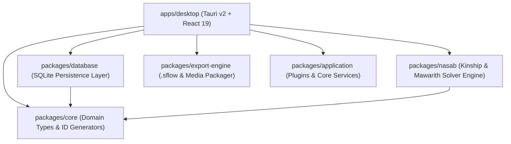

# دليل الجرد الهندسي الشامل والتدفق التشغيلي لأنظمة ScriptFlow Enterprise 📐
*(وثيقة مرجعية فائقة التفصيل للمطورين والمهندسين المعماريين — Developer Reference & Architecture Manual)*

---

## 🏛️ 1. الرؤية الهيكلية للمشروع (Monorepo Architecture Overview)
يعتمد مشروع **ScriptFlow Enterprise** على معمارية **Monorepo** محصنة مقسمة إلى تطبيق سطح مكتب رئيسي (`apps/desktop`) و 9 حزم خدمات داخلية متخصصة (`packages/*`).

---

## 📦 2. الجرد التفصيلي للأنظمة والتوافق والتدفقات البرمجية

---

### 1️⃣ محرك تحرير السيناريو الاحترافي (Screenplay Editor Engine)
* **المسار والأغلفة:** `apps/desktop/src/components/editor/paper/`
* **الملفات الأساسية:**
  - `PaperEditor.tsx`: المكون الرئيسي للمحرر التفاعلي.
  - `PaginationExtension.ts`: إضافة TipTap الخاصة بالترقيم ورسم الفواصل البصرية.
  - `bridge.ts`: محول البيانات الثنائي بين TipTap AST وقاعدة البيانات.
  - `paper-editor.css`: تنسيقات شبكة A4 والخطوط السينمائية.

#### 🔄 تدفق العمل والآلية الهندسية (Execution Flow):
1. **بدء المحرر:** يقرأ `PaperEditor.tsx` كتل المشهد من قاعدة البيانات عبر `bridge.ts` ويحولها إلى شجرة **ProseMirror JSON AST**.
2. **التحرير والتنقل:** عند قيام الكاتب بالضغط على `Enter` أو `Tab`، تقوم إضافات TipTap بتبديل نوع الكتلة تلقائياً (مثلاً: الانتقال من `CHARACTER` إلى `DIALOGUE`).
3. **التغيير والتصنيع:** ينطلق حدث `onUpdate` بداخل المحرر ليقوم `bridge.ts` باستخراج الكتل البرمجية الصافية وتمريرها طازجة إلى طابور الحفظ التلقائي `AutosaveQueue`.
4. **المدخلات والمخرجات:**
   - *المدخلات:* كائن المشهد والكتل النصية `IScriptBlock[]`.
   - *المخرجات:* شجرة عناصر تفاعلية + تحديثات تسلسلية فطنة لقاعدة البيانات.

---

### 2️⃣ محرك حساب القياس والترقيم الموحد (Text Measurement & Pagination Engine)
* **المسار والأغلفة:** `apps/desktop/src/components/editor/TextMeasurementEngine.ts`
* **الملفات الأساسية:**
  - `TextMeasurementEngine.ts`: المحرك الرياضي لحساب أسطر النص والكلمات.
  - `ScenePaperRenderer.tsx`: المكون البصري لرسم صفحات المشهد A4.
  - `paginationCalculator.ts`: المحرك التجميعي لحساب ترقيم المشاهد والمشروع بالكامل.

#### 🔄 تدفق العمل والآلية الهندسية (Execution Flow):
1. **القياس اللحظي:** يقرأ المحرك الكتل البرمجية، ويستخدم سياق Canvas 2D (`HTMLCanvasElement.getContext('2d')`) لقياس العرض الدقيق لكل كلمة بناءً على الخط والنوع (`IBM Plex Sans Arabic`).
2. **التقسيم والأسطر:** يتم حساب الأسطر الصافية وإضافة أسطر الهوامش، مع فحص الحد الأقصى للمشهد بـ `33 سطر` في الصفحة A4 (`794 × 1123px`).
3. **تطبيق قواعد المنع (Orphan Rules):** إذا جاءت كتلة `character` في السطر الأخير من الصفحة متبوعة بـ `dialogue`، يتم سحب الشخصية والحوار تلقائياً للصفحة التالية لمنع كسر الحوار المفرد.
4. **تجميع المشهد والترقيم:** يرجع المحرك المصفوفة `pages: GroupPage[]` مع حساب أرقام الصفحات التراكمية.

---

### 3️⃣ محرك التصدير والطباعة السريع (PDF Print & Iframe Export Engine)
* **المسار والأغلفة:** `apps/desktop/src/utils/exportPDF.tsx`
* **الملفات الأساسية:**
  - `exportPDF.tsx`: المنظم الرئيسي لاستراتيجيات التصدير واستدعاء الطباعة.
  - `SceneCoverPage.tsx`: مكون رسم أغلفة السيناريو والحلقات والمشاهد.
  - `CallSheetPage.tsx`: مكون رسم كشوفات الاستدعاء الإنتاجية.
  - `useExport.js`: خطة استعلام البيانات التجمعية والتصدير.

#### 🔄 تدفق العمل والآلية الهندسية (Execution Flow):
1. **تفريغ البيانات الصارم:** عند ضغط الكاتب على التصدير، يتم استدعاء `AutosaveQueue.flush()` لضمان حفظ كل كلمة من الذاكرة إلى القرص أولاً.
2. **الجلب المجمع (Batch Fetching):** يتم جلب كافة كتل المشاهد في استعلام واحد سريح (`getBlocksForScenes`), وحساب الترقيم الصارم.
3. **التوليد النصي (Server-Side Style DOM Rendering):** يتم استدعاء `renderToString` لتوليد مستند HTML متكامل يحوي تنسيقات الطباعة الصريحة لـ `@media print`.
4. **الطباعة الفورية (Hidden Iframe Engine):** يتم إنشاء إطار `<iframe>` مخفي بداخل بيئة Tauri، وكتابة الـ HTML به ثم استدعاء `iframe.contentWindow.print()` فورياً بفتح نافذة طباعة نظام التشغيل.

---

### 4️⃣ محرك قاعدة البيانات والطوابير التسلسلية (SQLite DB Client & Repositories)
* **المسار والأغلفة:** `packages/database/src/`
* **الملفات الأساسية:**
  - `client.ts`: مشغل الاتصال بـ SQLite وطابور الكتابة الفردية `writeQueue`.
  - `BaseRepository.ts`: الصف الأساسي للعمليات المباشرة (CRUD).
  - `ScriptBlockRepository.ts`: مستودع كتل النصوص ومراقب الفواصل `checkAndRegap`.
  - `TrashRepository.ts`: مستودع المهملات وتنظيف السجلات اليتيمة.

#### 🔄 تدفق العمل والآلية الهندسية (Execution Flow):
1. **الاتصال والتهيئة:** يفتح `client.ts` قاعدة البيانات بصيغة `WAL Mode` مع تفعيل `busy_timeout = 5000` و `synchronous = NORMAL`.
2. **طابور الكتابة المتسلسلة (Write Queue Mutex):** جميع عمليات الإضافة والتعديل تمر عبر `writeQueue` لمنع أخطاء التدافع (`SQLITE_BUSY`).
3. **مراقبة الترتيب (Re-gap Watcher):** ينطلق `checkAndRegap` ليفحص المسافات بين كتل المشهد، وإذا قل الفارق عن `1.0` يعيد توزيع القيم بفواصل ناصعة (`index * 65536`).
4. **الحذف والنظافة المرجعية:** عند الحذف من المهملات، تنفذ المعاملة تنظيفاً شاملاً للسجلات المرتبطة بـ `page_numbering` و `scene_characters`.

---

### 5️⃣ محرك النسب والمواريث الإسلامي (`packages/nasab`)
* **المسار والأغلفة:** `packages/nasab/src/`
* **الملفات الأساسية:**
  - `LineageEngine.ts`: محرك تحليل وتسلسل مشجرة الأنساب.
  - `KunyaEngine.ts`: مولد الكنى العربية الرسمية.
  - `KinshipValidator.ts` & `foster_engine.ts`: مدقق صلة الرحم والمحارم والرضاع.
  - `InheritanceEngine.ts`: حاسب الفرائض والمواريث الشريعة الفقهية.

#### 🔄 تدفق العمل والآلية الهندسية (Execution Flow):
1. **بناء الرسم البياني (Graph Building):** يقرأ محرك النسب عقد الشخصيات وروابطها، ويبني رسمًا بيانيًا متجهاً (Directed Graph) لأولياء الدم والأقارب.
2. **التحقق من العلاقات والكنى:** يفحص المحرك علاقات المحارم والرضاع، ويولد الكنية الرسمية تلقائياً (مثل: أبو الحسين).
3. **حساب المواريث (Fiqh Calculation Engine):** يحدد الفروض المقدرة شرعاً (النصف، الربع، الثمن، الثلثان، الثلث، السدس)، ثم يحسب العصبات، ويجري عمليات الحجب بالنقصان والشخص، ثم يطبق العول أو الرد وفق المذهب المختار.

---

### 6️⃣ محرك الحزم والتجميع (`packages/export-engine`)
* **المسار والأغلفة:** `packages/export-engine/src/sflow/packageManager.js`
* **الملفات الأساسية:**
  - `packageManager.js`: منظم حزم الـ ZIP والتحقق بـ Zod Schema.
  - `mediaProcessor.js`: معالج مسارات وصور الوسائط.

#### 🔄 تدفق العمل والآلية الهندسية (Execution Flow):
1. **التحقق الهيكلي:** يفحص `packageManager` ملف المشروع ويؤكد المطابقة لـ `schemaVersion: 5`.
2. **قراءة الوسائط الثنائية (Binary Streams):** بدلاً من تحويل الصور لـ Base64، يقرأ المحرك الملفات كـ `ArrayBuffer` ثنائي نقي من القرص.
3. **التجميع الموازي (Worker Zip Compression):** يمرر المحرك الملفات للـ Web Worker ليقوم بتجميعها بـ `JSZip` وضغطها بـ `DEFLATE` دون استهلاك ذاكرة الـ Main Thread.

---

### 7️⃣ شبكة العلاقات البصرية المتصلة (React Flow Kinship Visualizer)
* **المسار والأغلفة:** `apps/desktop/src/features/relationships/` & `RelationshipsPage.tsx`
* **الملفات الأساسية:**
  - `RelationshipsPage.tsx`: الصفحة الرئيسية لشبكة العلاقات.
  - `useRelationshipFlow.ts`: خطة إدارة تحويل البيانات لعقد ووصلات.
  - `CharacterNode.tsx`: كارت رسم بطاقة الشخصية داخل الشبكة.

#### 🔄 تدفق العمل والآلية الهندسية (Execution Flow):
1. **تحويل البيانات:** تحويل جداول `characters` و `character_relationships` إلى كائنات `nodes` و `edges`.
2. **الحساب الموقعي التلقائي (Dagre Layout):** استخدام مكتبة `dagre` لرسم المخطط الشجري أوتوماتيكياً وتوزيع المستويات النسبية.
3. **التفاعل والتحديث:** عند سحب عقدة أو تعديل قرابة، يتم حفظ الإحداثيات والعلاقات فورياً في قاعدة البيانات.

---

### 8️⃣ محرك الجدولة والتصميم الإنتاجي بـ 4 عروض (4-View Timeline & Schedule Engine)
* **المسار والأغلفة:** `apps/desktop/src/pages/TimelinePage.tsx` & `components/timeline/`
* **الملفات الأساسية:**
  - `TimelinePage.tsx`: الصفحة الحاوية للعروض الأربعة.
  - `TimelineView.tsx`: عرض الشريط الزمني الأفقي.
  - `KanbanView.tsx`: عرض شرائط تفكيك المشاهد القابلة للسحب والإفلات بـ `@dnd-kit`.
  - `CalendarView.tsx` & `GridView.tsx`: عروض التقويم والشبكة التفصيلية.

#### 🔄 تدفق العمل والآلية الهندسية (Execution Flow):
1. **تجميع بيانات أيام التصوير:** قراءة جداول `shoot_days`, `scenes`, و `production_tasks`.
2. **التفاعل والدفع:** عند سحب بطاقة مشهد وإسقاطها في يوم تصوير جديد بـ Kanban/Stripboard، ينطلق حدث التحديث ليتغير `shoot_day_id` وتتعدل أوقات التصوير تلقائياً في كافة العروض الأربعة بحالة متزامنة.

---

### 9️⃣ نظام طابور الحفظ التلقائي الصارم (Autosave & Retry Queue)
* **المسار والأغلفة:** `apps/desktop/src/utils/AutosaveQueue.js`
* **الملفات الأساسية:**
  - `AutosaveQueue.js`: الصنف الرئيسي لإدارة الطابور والتأخيرات.
  - `useSceneEditorState.ts`: الموفر التفاعلي لطابور الحفظ بمحرر المشهد.

#### 🔄 تدفق العمل والآلية الهندسية (Execution Flow):
1. **الجدولة والتأخير (Debounce):** ينتظر الطابور مودة `1000ms` بعد آخر حركة قلم للكاتب لتجميع التغييرات.
2. **إعادة المحاولة التراكمية (Exponential Backoff):** في حال حدوث انشغال بـ SQLite، يعيد المحاولة بعد `500ms` ثم `1000ms` ثم `2000ms`.
3. **التفريغ الإجباري (Force Flush):** يوفر دالة `flush()` تنفذ كافة المعاملات المعلقة فورياً عند التصدير أو التبديل.

---

### 🔟 خدمة النسخ التلقائي الدورية (AutoBackup Service)
* **المسار والأغلفة:** `apps/desktop/src/providers/AutoBackupProvider.jsx` & `services/BackupService.js`
* **الملفات الأساسية:**
  - `AutoBackupProvider.jsx`: المزود الزمني الدوري بـ React context.
  - `BackupService.js`: خدمة تنفيذ أخذ النسخ على القرص.

#### 🔄 تدفق العمل والآلية الهندسية (Execution Flow):
1. **الموقت الدوري:** يعمل مؤقت كل 30 دقيقة بالخلفية.
2. **النسخ الحذر:** يقرأ مسار `scriptflow.db` الحالي، ويتحقق من صلاحية Tauri FS Scope، ثم ينشئ نسخة مطابقة باسم `scriptflow_backup_YYYYMMDD_HHMMSS.db` بداخل مجلد النسخ الاحتياطية الآمن.

---

### 1️⃣1️⃣ مدير التخزين القرصي المباشر للوسائط (Local Disk Media Storage)
* **المسار والأغلفة:** `apps/desktop/src/services/mediaStorage.ts`
* **الملفات الأساسية:**
  - `mediaStorage.ts`: خدمة التحويل والاستدعاء والمسارات القرصية.

#### 🔄 تدفق العمل والآلية الهندسية (Execution Flow):
1. **حفظ الملفات الصافية:** عند رفع صورة شخصية أو غلاف، يتم كتابة الملف كـ Binary على القرص بمسار `~/Documents/ScriptFlowProjects/media/`.
2. **تحويل البروتوكول:** إرجاع رمز مسار `project-media://scenario_id/file.png`.
3. **الاستدعاء الآمن:** استخدام `convertFileSrc` من Tauri لفك التشفير وإدراج الصورة في الـ DOM بأعلى سرعة وبدون استهلاك ذاكرة Base64.

---

### 1️⃣2️⃣ طبقة المعالجة الموازية الخلفية (Web Workers Layer)
* **المسار والأغلفة:** `apps/desktop/src/workers/ExportWorker.js` & `WorkerFactory.js`
* **الملفات الأساسية:**
  - `ExportWorker.js`: خيط المعالجة المعزول بالخلفية.
  - `WorkerFactory.js`: مصنع ومغلف الاتصال عبر `Comlink`.

#### 🔄 تدفق العمل والآلية الهندسية (Execution Flow):
1. **إنشاء خيط المعالجة:** يتم إنشاء `Worker` مستقل بنطاق منفصل عن واجهة المستخدم.
2. **التواصل المعزول:** يتم نقل البيانات الثقيلة والعمليات الرياضية لحساب أرقام صفحات السيناريو الطويلة عبر `Comlink` إلى خيط المعالجة، ثم استقبال النتائج دون تجميد واجهة الكاتب.

---

### 1️⃣3️⃣ نواة بيئة الرست المحلية (Tauri Rust Core)
* **المسار والأغلفة:** `apps/desktop/src-tauri/src/lib.rs` & `capabilities/`
* **الملفات الأساسية:**
  - `lib.rs`: النواة التجميعية لـ Rust واختبارات سلامة القاعدة.
  - `capabilities/default.json`: ملف تحديد نطاق وصلاحيات النظام.

#### 🔄 تدفق العمل والآلية الهندسية (Execution Flow):
1. **الإقلاع والتحقق:** عند فتح التطبيق، ينطلق Rust لفحص المسارات المحلية واختبار سلامة قاعدة البيانات عبر `check_db_health`.
2. **إدارة الصلاحيات والنوافذ:** يقيد Rust الوصول للقرص بالنطاق المسموح فقط، ويدير عمليات إغلاق وفتح النوافذ والـ Native Dialogs.

---

## 📊 جدول ملخص الأنظمة والملفات ومخطط التدفق (Master Directory & Flow Table)

| النظام / المكون | الملفات الأساسية ذات الصلة | آلية التدفق والعمل (Flow Mechanism) | نوع المدخلات والمخرجات |
| :--- | :--- | :--- | :--- |
| **محرر الورق والسيناريو** | `PaperEditor.tsx`, `PaginationExtension.ts`, `bridge.ts` | تحويل TipTap AST إلى كتل نصية وحفظها بطابور `AutosaveQueue` | **In:** TipTap JSON AST  **Out:** `IScriptBlock[]` |
| **محرك الترقيم والقياس** | `TextMeasurementEngine.ts`, `ScenePaperRenderer.tsx` | قياس الكلمات بـ Canvas 2D وتطبيق قواعد منع كسر الحوار المفرد | **In:** `IScriptBlock[]`  **Out:** `pages: GroupPage[]` |
| **محرك الطباعة والتصدير** | `exportPDF.tsx`, `SceneCoverPage.tsx`, `useExport.js` | التفريغ الصارم، الجلب المجمع، والتوليد عبر `<iframe>` مخفي سريح | **In:** Scenario ID  **Out:** Interactive PDF Print View |
| **مستودعات قاعدة البيانات** | `client.ts`, `ScriptBlockRepository.ts`, `TrashRepository.ts` | تفعيل WAL Mode، الكتابة بطابور موحد `writeQueue`, ومراقب `re-gap` | **In:** SQL Queries  **Out:** SQLite Result Sets |
| **محرك النسب والمواريث** | `LineageEngine.ts`, `InheritanceEngine.ts`, `KunyaEngine.ts` | بناء رسم بياني متجه للمحارم والنسب وحساب الفروض والعصبات شرعاً | **In:** Family Tree Graph  **Out:** Inheritance Shares / Kunya |
| **محرك الحزم `.sflow`** | `packageManager.js`, `mediaProcessor.js` | التحقق من Zod Schema وقراءة الثنائيات كـ ArrayBuffer وضغطها بـ Worker | **In:** Project Data  **Out:** Binary `.sflow` Archive |
| **شبكة العلاقات البصرية** | `RelationshipsPage.tsx`, `useRelationshipFlow.ts` | تحويل العلاقات لعقد ووصلات وتوزيع المكان أوتوماتيكياً بـ `dagre` | **In:** Character Relationships  **Out:** ReactFlow Canvas |
| **محرك الجدولة (4 عروض)** | `TimelinePage.tsx`, `KanbanView.tsx`, `TimelineView.tsx` | السحب والإسقاط بـ `@dnd-kit` وتحديث `shoot_day_id` بالتزامن الحركي | **In:** Scene & Task Drag Event  **Out:** Updated Schedule View |
| **طابور الحفظ التلقائي** | `AutosaveQueue.js`, `useSceneEditorState.ts` | التجميد لـ 1000ms، إعادة المحاولة بـ Exponential Backoff والتفريغ الصارم | **In:** Block Edit Actions  **Out:** Persisted DB Transactions |
| **النسخ التلقائي الدوري** | `AutoBackupProvider.jsx`, `BackupService.js` | مؤقت كل 30 دقيقة يفحص صلاحية Tauri Scope وينشئ لقطة زملية للقواعد | **In:** Timer Signal  **Out:** Timestamped Backup File |
| **المدير القرصي للمديا** | `mediaStorage.ts` | كتابة ثنائية على القرص بـ `media/` وإرجاع مسار `project-media://` الصريح | **In:** Image File / Blob  **Out:** `project-media://` URI |
| **العمالة الخلفية** | `ExportWorker.js`, `WorkerFactory.js` | نقل الحسابات الثقيلة لخيط معالجة معزول عبر بروتوكول `Comlink` | **In:** Worker Payload  **Out:** Async Layout Calculations |
| **نواة بيئة الرست المحلية** | `lib.rs`, `capabilities/default.json` | فحص سلامة القواعد المحلية وإدارة النوافذ والصلاحيات القرصية الأهلية | **In:** Native IPC Invokes  **Out:** Rust System Commands |

---

> [!IMPORTANT]
> تمثل هذه الوثيقة المرجع الهندسي الشامل والتدقيقي لجميع أنظمة ومكونات وتدفقات ScriptFlow Enterprise، وتوفر للمطورين فهماً بنوياً صريحاً لكيفية عمل النظام من مستوى شفرة الـ React والـ Canvas إلى النواة بـ Rust و SQLite.
