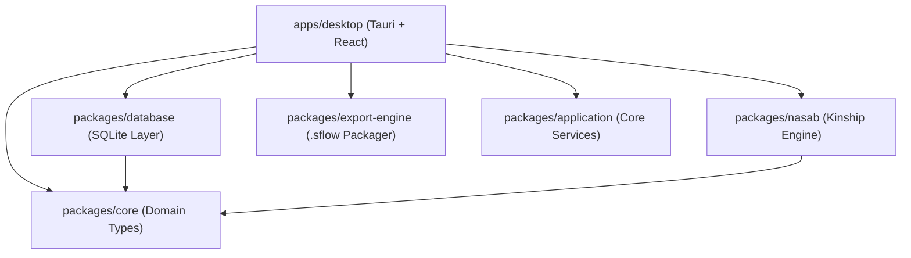

# 🏛️ التوثيق المعماري العام (01: System Architecture)

## 1. النظرة العامة (Overview)
تطبيق **SCRIPTFLOW ENTERPRISE** هو بيئة عمل احترافية (Desktop Application) مصممة لكتّاب السيناريو والمخرجين وفرق الإنتاج. 
تم تصميمه ليعمل بكفاءة فائقة (High Performance) دون الحاجة لاتصال دائم بالإنترنت (Offline-First)، معتمداً على أحدث التقنيات الهجينة.

## 2. التقنيات الأساسية (Core Tech Stack)
- **واجهة المستخدم (Frontend):** React 19 + Vite.
- **تنسيق الواجهة (Styling):** TailwindCSS.
- **محرك النصوص (Rich Text):** TipTap / ProseMirror.
- **نواة سطح المكتب (Backend Core):** Tauri v2 (مكتوب بلغة Rust) لتوفير جسر اتصال سريع وآمن مع نظام التشغيل.
- **قاعدة البيانات (Persistence):** SQLite (عبر `tauri-plugin-sql`) مع تفعيل نمط `WAL` للأداء العالي.

## 3. المعمارية الهيكلية (Monorepo Architecture)
يعتمد المشروع على بنية **Monorepo** مقسمة منطقياً إلى التطبيق الرئيسي (`apps/desktop`) وحزم منفصلة (`packages`) لتنظيم الكود ومنع التداخل.

### 📦 تفصيل الحزم (Packages Directory)
1. **`apps/desktop`**: يحتوي على واجهة المستخدم، مكونات React، صفحات التطبيق، وخدمات Tauri الجسدية (IPC).
2. **`packages/database`**: طبقة التعامل مع SQLite. تعتمد نمط المستودعات (Repository Pattern) لفصل استعلامات SQL عن واجهة المستخدم.
3. **`packages/nasab`**: محرك الأنساب والمواريث الإسلامي. يحتوي على خوارزميات الفقه والصلات.
4. **`packages/export-engine`**: محرك معالجة الملفات وتجميعها في صيغة `.sflow` (باستخدام JSZip).
5. **`packages/core`**: يحتوي على الأنواع (Types/Interfaces) ومولدات المعرفات (ID Generators).
6. **`packages/application`**: طبقة الخدمات العامة والمنطق التجاري (Business Logic) الذي لا يرتبط بالواجهة مباشرة.

## 4. تدفق البيانات العام (General Data Flow)
1. يتفاعل المستخدم مع واجهة **React**.
2. تدير **React Query** حالة البيانات المجلوبة وتقدم ميزة التخزين المؤقت (Caching).
3. عند الكتابة أو التعديل، تُرسل البيانات إلى **AutosaveQueue** (طابور الحفظ).
4. يقوم الطابور باستدعاء الـ **Repositories** الموجودة في `packages/database`.
5. تقوم الـ Repositories بإرسال أوامر SQL عبر **Tauri IPC** إلى نواة **Rust**.
6. تنفذ نواة Rust الأوامر على ملف `scriptflow.db` المخزن محلياً بفضل `tauri-plugin-sql`.
